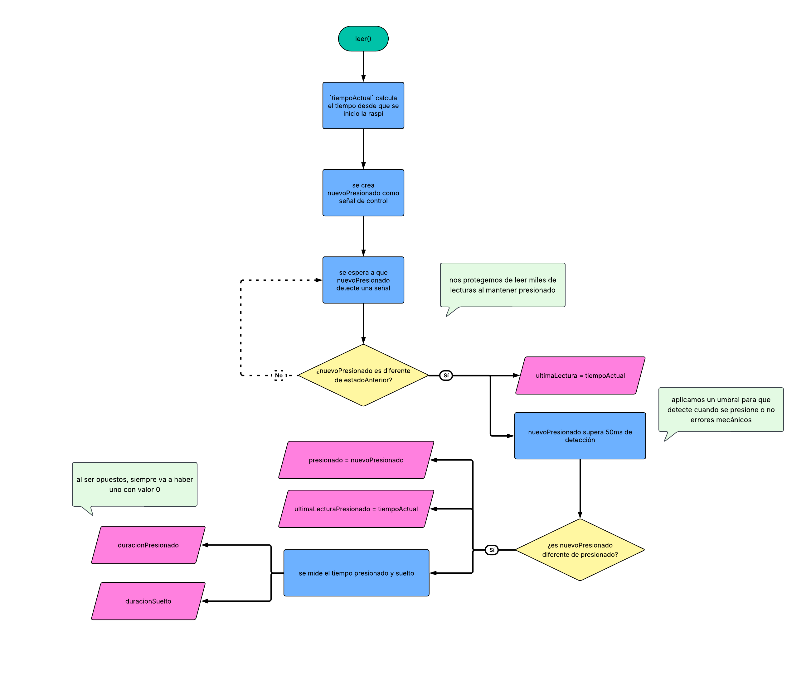

# [placeholder para el nombre ayudaaa]

## concepto

## clases

## concepto

## clases

### integrantes

Bianka Vilchez

Dayana Pañitrur

Camila Ramirez

### Inspiración

Seleccionar un computador personal creado entre 1980 y 2010 y desarrollar un tributo a partir de una de sus características más representativas.

El proyecto consiste en rendir tributo a un computador personal mediante la exploración de sus características sonoras y funcionales. A través de una propuesta interactiva, se busca representar sus funciones y procesos mediante sonidos percusivos, utilizando ritmos, frecuencias y secuencias que permitan identificar sus distintos modos de funcionamiento.

El sonido de un computador está condicionado por la época en la que fue desarrollado, ya que responde a las posibilidades tecnológicas, las necesidades funcionales y el contexto cultural de su tiempo.

Por ejemplo, ¿suena igual un computador de los años 80 que uno de los años 2000? ¿Qué diferencias existen entre sus sonidos y qué nos dicen sobre la evolución de estas máquinas? Se plantea que los sonidos de un computador permiten reconocer aspectos de su época, desde sus limitaciones técnicas hasta las formas en que las personas se relacionaban con la tecnología.

Sharp X68000

El proyecto consiste en un dispositivo sonoro inspirado en las configuraciones y el sistema del computador Sharp X68000. La interacción se realizará mediante dos botones y dos perillas, cada uno con una función específica para seleccionar, reproducir y controlar los sonidos.

### Controles e interacciones

| Control | Acción |
| --- | --- |
| Encoder: giro horario | Avanza al siguiente sonido. |
| Encoder: giro antihorario | Retrocede al sonido anterior. |
| Encoder: pulsación | Reproduce el sonido seleccionado. |
| Potenciómetro | Regula el volumen general en un rango de 0 a 100. |
| Botón Loop: primera pulsación | Activa la repetición continua del sonido. |
| Botón Loop: segunda pulsación | Desactiva la repetición continua del sonido. |
| Cinco lucecitas LED | Indican cuál de los cinco sonidos está seleccionado. |

### Experiencia de uso

1. **Encender el dispositivo:** el sistema se inicia y queda preparado para seleccionar un sonido.
2. **Seleccionar un sonido:** la persona gira el encoder en sentido horario o antihorario para recorrer los cinco sonidos. La lucecita correspondiente indica cuál está seleccionado.
3. **Reproducir el sonido:** la persona presiona el encoder para escuchar el sonido seleccionado.
4. **Regular el volumen:** gira el potenciómetro para ajustar el volumen general del dispositivo, dentro de un rango de 0 a 100.
5. **Activar el loop:** presiona el botón LOOP una vez para que el sonido se repita continuamente.
6. **Desactivar el loop:** presiona nuevamente el botón LOOP para desactivar la repetición.
7. **Cambiar de sonido:** gira el encoder para seleccionar otro sonido y presiónalo para reproducirlo. Si el sonido anterior estaba en loop, el sistema debe gestionar el cambio según la lógica definida para la reproducción.
8. **Explorar los cinco sonidos:** la persona puede recorrer el menú de forma continua. Después del quinto sonido, el encoder vuelve al primero; en sentido contrario, desde el primero pasa al quinto.

### Archivos

main.cpp 

Boton.h + Boton.cpp 

Perilla.h + Perilla.cpp 

Sonido.h + Sonido.cpp 

Lucecita.h + Lucecita.cpp

ampli.h + ampli.cpp

### class Boton

Como grupo nos corresponde realizar la clase Boton, el cuál debe funcionar tanto para lo que hagamos nosotras en nuestro proyecto, como para lo que haga el grupo 07 para el suyo.

Licencia
Este código es obra de Bianka Vilchez, Camila Ramirez y Dayana Pañitrur (2026).
Se distribuye bajo la licencia [Creative Commons Atribución-CompartirIgual 4.0 Internacional](http://creativecommons.org/licenses/by-sa/4.0/).

#### Boton.h

En el archivo .h definimos todo, declaramos todo, prometemos las cosas que hará el botón, el cómo lo hará lo escribiremos en el archivo .cpp

El nombre de nuestra clases es **BotonGrupo1**

Algo importante que debemos integrar en nuestro archivo .h son:

- La biblioteca de la Rapberry Pi Pico para poder programarla
- Biblioteca del GPIO, para integrar la conexión física de los pines de la Raspi

Hacer el código `public` hará que cualquier persona pueda ver, usar o modificar nuestra clase Boton

modoSwitch

| anterior | actual | resultado |
| :------: | :----: | :-------: |
| 0        | 0      |  0        |
| 1        | 0      | 1         |
| 1        | 1      | 0         |
| 0        | 1      | 1         |

XOR

Una u otra, pero no ambos

Cuando el anterior **o** el actual cambien de estado, el `modoSwitch` lo hará

#### Boton.cpp



### class Led

### class Ampli

Se preparó

```cpp

#ifndef AMPLI_H
#define AMPLI_H

#include "hardware/adc.h"

class Ampli {

  public:

  // --atributos--
  // a que pin se conecta el BCLK
  // Bit CLocK  
  int pinReloj;

  // a que pin se conecta LRC
  // debe ir consecutivo a reloj
  int pinLRC = pinReloj + 1 ;

  // a que pin se conecta el DIN
  // Serial Audio Data 
  int pinDatos;
  
  bool sonando = false; 

  int volumen = 50;
  int frecuencia = 11025;

 // variable que enlaza al listado de sonidos que se carguen eventualmente
 // cuenta desde 0
  int sonidoActual = -1;

 // -- constructor --
 Ampli(int pinReloj, int pinDatos);

 // --metodos--
 // realiza el proceso de reproducir audio
 // reproduce sonidoActual
 void reproducir();

 // el audio debe reproducirse de manera ciclica
 //reproduce sonidoActual
 void reproducirLoop();

 // estipula como se regula el volumen
 // utiliza valores de 0 a 100
 void controlVolumen(); 
};

#endif

```

<br>

```cpp

#include "Ampli.h"

//constructor 
Ampli::Ampli(int pinReloj, int pinDatos) {

  pinReloj = nuevoPinReloj;
  pinDatos = nuevoPinDatos;

   // inicia el ampli MAX98357A pero sin reproducir ningún sonido 
   //
}

// Inicia la reproducción de audio
// esta funciona con la variable sonidoActual
// tiene inicio y fin 
void Ampli::reproducir(){
}

// A diferencia de reproducir()
// Inicia el sonido de modo ciclico
// funciona con la variable sonidoActual
void Ampli::reproducirLoop(){ 
}

// Define como se controla el volumen
// se trabaja con valores de 0 a 100
void Ampli::controlVolumen(){

}

```
