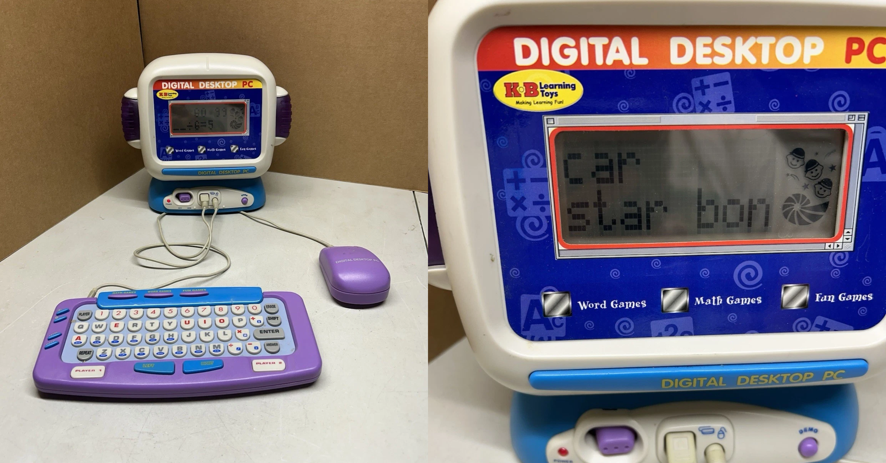
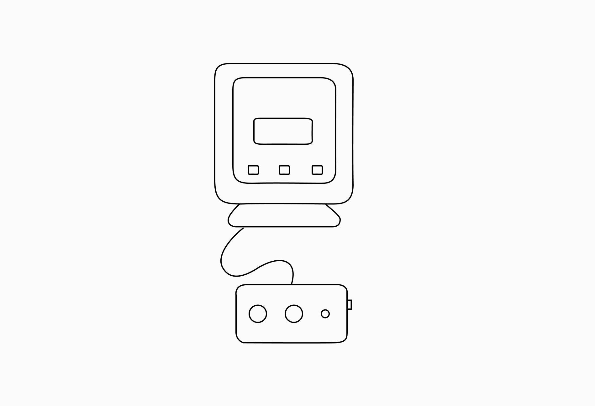
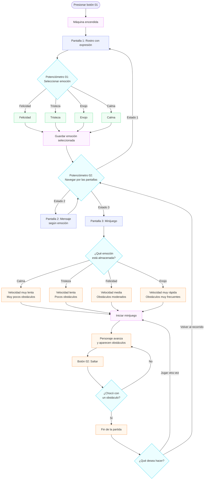

# proyecto-02

## Nombre del proyecto

**Integrantes:** 
- Magdalena Balart [_(magdalenabalart)_](https://github.com/disenoUDP/dis8645-2026-2-procesos-2/tree/main/02-magdalenabalart)
- Catalina Oyanedel [_(catalinaoyanedel-01)_](https://github.com/disenoUDP/dis8645-2026-2-procesos-2/tree/main/17-catalinaoyanedel-01)
- Yaira Ruiz [_(yairaruiz)_](https://github.com/disenoUDP/dis8645-2026-2-procesos-2/tree/main/26-yairaruiz)
- Marcela Zuñiga [_(marcezm)_](https://github.com/disenoUDP/dis8645-2026-2-procesos-2/tree/main/32-marcezm)


## Descripción general
El proyecto consiste en una máquina que tiene como fin ser un acompañamiento emocional, permitiendo explorar distintas formas de interactuar.

La máquina cuenta con tres estados de la pantalla principales:

- Modo 01 – Expresiones: muestra un rostro cuya expresión emocional puede modificarse.
- Modo 02 – Mensajes: presenta un mensaje variable asociado a la emoción seleccionada anteriormente y se pueden explorar más.
- Modo 03 – Minijuego: presenta un juego en el que un personaje debe saltar obstáculos. Su nivel de dificultad cambia dependiendo de la emoción seleccionada.

### Referentes
Nuestra principal inspiración son los computadores de juguete de los años 2000, los cuales imitaban la apariencia de computadores convencionales, pero adaptaban sus funciones a una interacción más simple y accesible. Estos juguetes ofrecían experiencias de aprendizaje y entretenimiento mediante actividades predeterminadas, personajes digitales y juegos sencillos, utilizando pantallas simples y botones para ofrecer estas experiencias.

Elegimos como principal referente un Digital Desktop PC de la marca KB Learning Toys.




### Decisiones
A partir de este referente, destacamos sus características como pantallas LCD, los botones físicos, colores vívidos, el teclado, los gráficos de baja resolución y que cuenta con estos tres modos (word games, math games y fun games). Decidimos mantener la estructura del monitor, ocupar el recurso del teclado para tener nuestros botones y perillas separadas de la pantalla, para proponer una experiencia similar a la de este tipo de computador, y tener 3 modos de "juego", reinterpretándolo con nuestro objetivo.

#### Boceto:



#### Materialidad e interfaz
Planeamos realizar la carcasa en impresión 3d, para mantenernos fiel a las formas y materiales de nuestro referente. La interfaz está en desarrollo.

---

## Funcionamiento del sistema

### Diagramas de flujos

#### Usuario:


### Esquemático


#### BOM: Lista de componentes

| Componente | Pin | Nota |
|------------|-----|------|
| Rasberry Pi Pico 2W |  | |
|  | |  |

## Estructura del código

```
codigo/
├── main.cpp
    └── Boton.h / Boton.cpp
    └── Perilla.h / Perrilla.cpp
    └── Emociones.h / Emociones.cpp
    └── Mensajes.h / Emociones.cpp
    └── Juego.h / Juego.cpp
```

### Clases escritas por nosotras

#### `[NombreClase]`
- **Qué hace:** 
- **Atributos:** 
- **Métodos:** 
- **Se relaciona con:** 

```cpp
class NombreClase {
  private:
    bool encendido;
  public:
    void encender();   // qué hace, en una línea
};
```

#### Prompts usados:
para qué se usó cada uno y qué se hizo con la respuesta.

### Clases de terceros
Hechas por grupo 04

#### `[NombreClase]`
- **Qué hace:** 
- **Atributos:** 
- **Métodos:** 
- **Se relaciona con:** 


# Resultados
fotos, videos

### Aprendizajes
conclusiones, reflexiones del proceso

### Reparto del trabajo
| Integrante | Tareas |
|------------|--------|
| Nombre 1 | Código |
| Nombre 2 | Circuito |
| Nombre 3 | Interfaz |

### Bibliografía:
fuentes consultadas.


