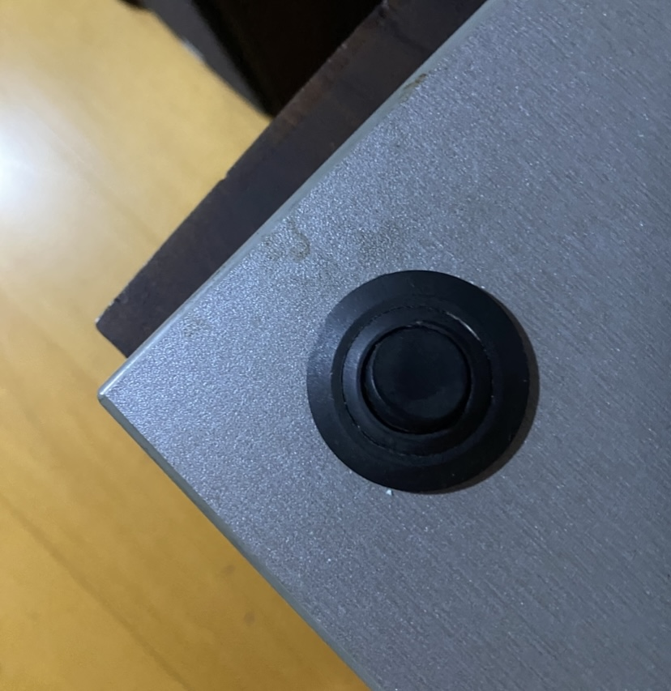
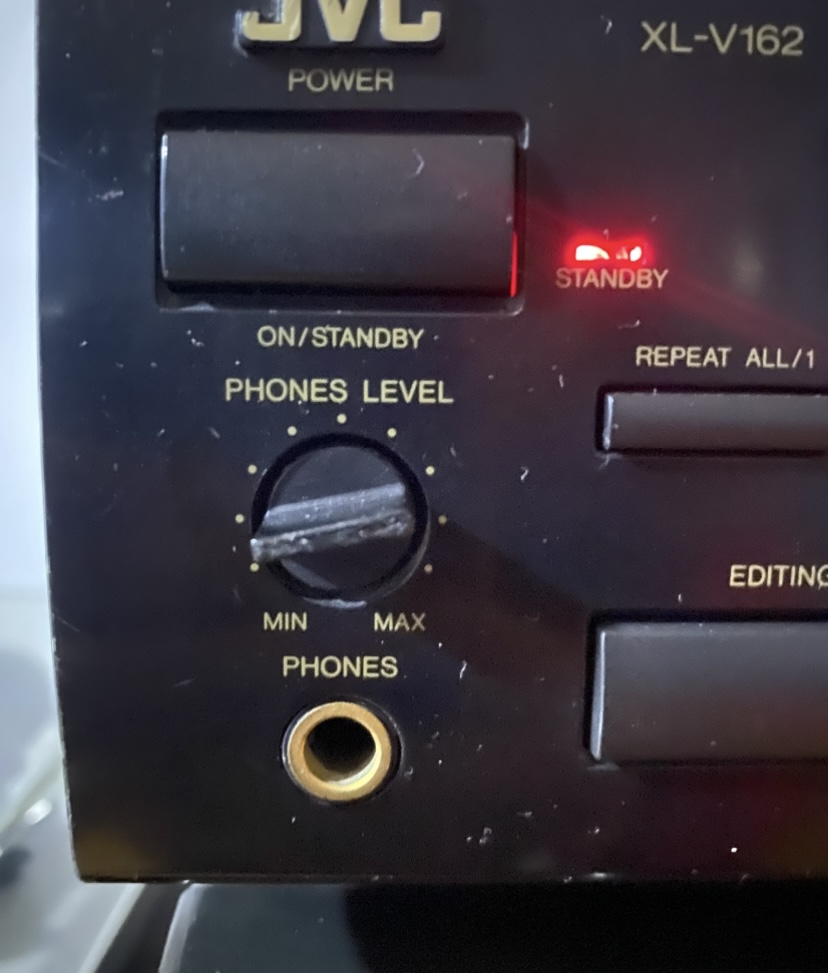
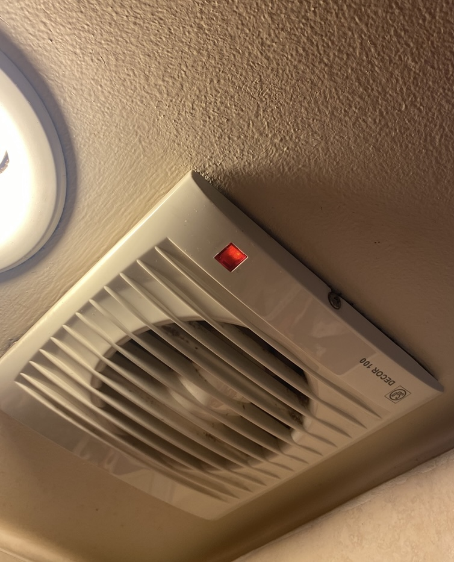
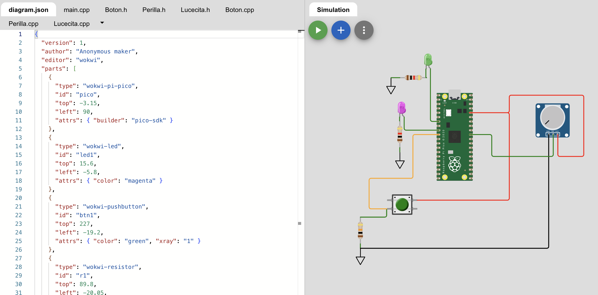

# sesion-08a

## apuntes sesión

# Programación orientada a objetos (POO)

### Clases y objetos

La programación orientada a objetos sirve para ordenar el código y evitar repetir instrucciones. Por ejemplo, si tenemos varios botones que hacen cosas parecidas, podemos crear una clase `Boton` y usarla varias veces. Si necesitamos cambiar algo de su funcionamiento, lo modificamos en la clase y no en cada botón por separado.

- **Clase:** estructura que usamos para crear objetos.
- **Objeto:** elemento que creamos a partir de una clase.
- **Atributos:** características de un objeto, como su estado o posición.
- **Métodos:** acciones que puede realizar, como `encender()` o `apagar()`.
- **Constructor:** se ejecuta al crear un objeto y permite definir sus valores iniciales.
- **Subclase:** clase que hereda características y métodos de otra.

Por ejemplo, podemos crear una clase `Boton` y después tener `boton1` y `boton2`. Los dos comparten la misma estructura, pero pueden estar conectados a pines distintos y realizar acciones diferentes.

### Archivos .h y .cpp

- `.h`: declara los atributos y métodos de una clase, es decir, qué tiene y qué puede hacer.
- `.cpp`: contiene el código que define cómo funcionan esos métodos.

### ADC

El ADC (convertidor analógico a digital) transforma una señal analógica en un valor digital. Por ejemplo, permite leer la posición de un potenciómetro y convertirla en un número.

Con una resolución de 12 bits, los valores van desde 0 hasta 4095.

### Caja negra

Una caja negra es un sistema del que conocemos lo que entra (*input*) y lo que sale (*output*), pero no necesariamente cómo funciona por dentro.

`INPUT → CAJA NEGRA → OUTPUT`

## encargos

encargo-08a:

1. tomar muchas fotos, mínimo 3 por cada uno de los 3 elementos que estudiamos hoy: perillas, botones, y luces. subir las fotos a su README como respuesta a este encargo, y describirlas textualmente, para con esa info complejizar nuestras clases programadas este viernes.

### 1. Botón tipo switch – Tocadiscos
Este botón es de un tocadiscos y sirve para encender o detener el motor que hace girar el vinilo. Es un botón de tipo switch, que funciona como un interruptor, permitiendo abrir o cerrar el paso de corriente eléctrica. A diferencia de un pulsador, que solo se activa mientras lo mantenemos apretado, este botón mantiene su estado hasta que se vuelve a presionar. Tiene dos estados, encendido y apagado (1 y 0), por lo que funciona como una entrada digital.
 
    
### 2. Potenciómetro – Equipo de música
Este potenciómetro está en un equipo de música JVC y se usa para controlar el volumen de los audífonos. Funciona girando una perilla que va cambiando la resistencia eléctrica, lo que permite subir o bajar el volumen. A diferencia de un botón, que tiene dos estados, el potenciómetro permite regular distintos niveles de forma gradual, desde el mínimo hasta el máximo.


### 3. LED – Extractor de aire
Este LED rojo está en un extractor de aire del baño y se usa para indicar cuando está encendido. Es un componente de salida que funciona emitiendo luz cuando pasa corriente eléctrica por él. En este caso, la luz roja permite saber si el extractor está encendido o apagado sin tener que fijarse directamente en el ventilador.


2. partir del ejemplo de hoy, que está subido en codigos/ de hoy, y hacer que las luces parpadeen. para eso, definir parpadeo de forma paramétrica.

https://wokwi.com/projects/477403274082177025

### Paso 01: agregar el método parpadear()

Partí del código de clases, donde ya teníamos `Lucecita.h` y `Lucecita.cpp`, con los métodos `prender()` y `apagar()`.

La idea era agregar un método para que la luz parpadeara, pero que pudiéramos cambiar sus tiempos sin tener que modificar todo el código.

En `Lucecita.h` agregué:

```cpp
void parpadear(int tiempoEncendida, int tiempoApagada);
```
- `int tiempoEncendida`: tiempo que el LED permanece prendido.
- `int tiempoApagada`: tiempo que permanece apagado.

### Paso 02: resolver primer problema: sleep_ms()

Al principio hice el parpadeo usando `sleep_ms()`, para esperar entre prender y apagar la luz, pero apareció un error porque `sleep_ms()` no era reconocido en `Lucecita.cpp`. Para solucionarlo tuve que incluir `pico/stdlib.h`, que ya estábamos usando en `main.cpp`.

Después conseguí que la luz parpadeara, pero apareció otro problema: **al presionar el botón por segunda vez, la luz no se apagaba inmediatamente**.

Esto pasaba porque `sleep_ms()` hace que el programa espere antes de continuar. Durante esa espera no podía leer si el botón estaba siendo presionado.

chatgpt me pasó estos códigos para controlar el tiempo:

- `get_absolute_time()`: obtiene el tiempo actual.
- `to_ms_since_boot()`: permite trabajar con ese tiempo en milisegundos.
- `ultimoCambio`: atributo que guarda cuándo cambió por última vez el estado de la luz.

Así, en vez de detener el programa esperando, el método revisa si ya pasó el tiempo necesario para cambiar la luz de prendida a apagada, o al revés.

### paso 03: hacer que el botón prenda y apague el parpadeo

Después trabajé en `main.cpp` para que el botón funcionara como un interruptor:

- Primera pulsación: comienza el parpadeo.
- Segunda pulsación: se detiene y la luz queda apagada.

Para eso agregué estas variables:

```cpp
bool sistemaPrendido = false;
bool botonEstadoAnterior = false;
```

**¿Por qué necesitaba las dos?**

`sistemaPrendido` guarda si el parpadeo está activado o no.

`botonEstadoAnterior` guarda cómo estaba el botón en la lectura anterior.


### Paso 04: agregar una segunda luz

Después agregué otro LED al circuito, conectado al pin GP5. El primero estaba conectado al GP6, copié la formula anterior del primer led.

Para el segundo LED utilicé la perilla.

Quería que la luz parpadeara a una velocidad fija solamente cuando la perilla estuviera en cierta posición, y que se apagara cuando saliera de ese rango.

```cpp
if (parpadeo.posicion >= 2000 && parpadeo.posicion <= 3000) {
  luzSegunda.parpadear(250, 250);
} else {
  luzSegunda.apagar();
}
```

La perilla entrega valores entre 0 y 4095.

- `>= 2000`: la posición tiene que ser mayor o igual a 2000.
- `<= 3000`: también tiene que ser menor o igual a 3000.
- `&&`: las dos condiciones tienen que cumplirse.

Cuando está entre esos valores, la segunda luz parpadea con 250 ms prendida y 250 ms apagada, lo que equivale a 2 Hz.

Si sale de ese rango, se apaga.

### Resultado final

Terminé con dos luces que funcionan de manera independiente:

- **LED 1 (GP6):** parpadea con tiempos de 500 ms y se prende o apaga usando el botón.
- **LED 2 (GP5):** parpadea con tiempos de 250 ms cuando la perilla está entre 2000 y 3000. Fuera de ese rango se apaga.



## lectura
