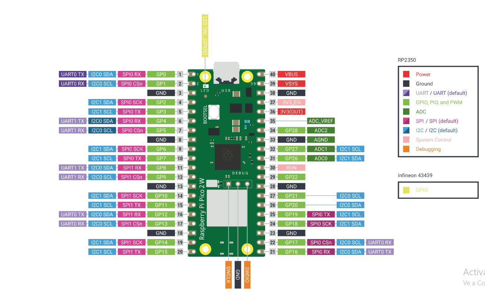

# sesion-08a
Hola Emi, profe Aarón, Misa y Sebas.  

Luego de 2 meses intensos, logré culminar la primera etapa de mi anteproyecto de grado, junto con la compañía y el apoyo del profesor Aarón (en Chile oficial) y Gustavo (en Colombia oficial).
Gracias a ustedes por la flexibilidad y la compresión para con el proyecto. Ahora es momento de ponerme al día con el taller, motivo por el cual extendí mi estadía en el país.

Estuve revisando los repositorios de mis compañerxs junto al calendario del curso para guiarme en que etapa del semestre estamos (comparando temas con fechas), para poder ponerme al día. Y encontré que estamos viendo programación en C++ para chips RP2040. Así que comencemos.

>[!NOTE]
>
>Para poder organizarme, clasifique los temas que se están viendo, en este orden para poder repasarlos y estudiarles:
>
> ## Programación orientada a objetos (POO)
> 1. Estructuras macro para los textos:
>
>`Archivos .h`
>`Archivos .cpp`
>
> 2. Tangibles:
>     
>`Botones`
>`Perillas`
>`Luces` 

# Apuntes sesión

## Programación orientada a objetos (POO)
Es una forma de programar donde, en vez de escribir instrucciones sueltas, creas “cosas” (objetos) que tienen sus propias características y acciones. Sirve para ordenar el código y evitar repetir instrucciones. Es como armar un programa con piezas de Lego.

**Conceptos básicos:**

`Clase (class):` el molde o plano. Define cómo será algo (por ejemplo, “cómo es un auto”).  
`Objeto:` una cosa concreta hecha con ese molde (mi auto rojo).  
`Atributos:` variables dentro de la clase; lo que el objeto tiene (color, velocidad).  
`Métodos:` funciones dentro de la clase; lo que el objeto hace (acelerar, frenar).  
`Constructor:` método con el mismo nombre de la clase; se ejecuta al crear el objeto y le da sus valores iniciales.  
`public / private:` en C++ defines qué partes se pueden usar desde afuera (public) y cuáles quedan protegidas dentro de la clase (private).  
`Herencia:` una clase puede tomar lo de otra y agregarle cosas nuevas (class Camioneta : public auto).  

**En resumen:**
Se hace el molde una sola vez y creas todos los objetos que quieras, sin repetir código.

**Ejemplo:**
Una receta de galletas (la clase) y las galletas que salen (los objetos). Todas siguen la misma receta, pero cada una puede tener distinto sabor.

<br>
<br>
<br>

## Clase vs. objeto
*aquí use un ejemplo de galletas while working con claude para poder entender. Una metáfora*
*también estoy estudiando con este ejemplo creado en clase con el profesor Aarón, periodo: [ejemplo en wokwi](https://wokwi.com/projects/477335809803977729)* 

- **Clase**: el *molde de galletas* (o la receta). Define qué forma tiene y qué puede hacer. Todavía no es una galleta.
- **Objeto**: una *galleta* hecha con ese molde. Cada galleta puede tener su propio sabor.

En el código:

```cpp
Boton pulsador(7);     // un objeto "pulsador" hecho con el molde Boton, conectado al pin 7

Lucecita luz(6);       // un LED en el pin 6
Lucecita luzDos(5);    // otro LED en el pin 5
```

Con **un solo molde** (`Lucecita`) hacemos **dos objetos** (`luz` y `luzDos`).

<br>
<br>
<br>

## ¿Por qué dos archivos por clase (`.h` y `.cpp`)? 
Se puede escribir todo en un solo archivo, pero con muchos componentes se vuelve larguísimo y difícil de ordenar.

La regla es simple: **cada cosa tiene su propio espacio**. Así `main.cpp` queda corto y solo dice **qué hacer**, no **cómo se hace**.

| Archivo | Qué contiene | Analogía |
|---|---|---|
| `.h` (header / encabezado) | **Qué tiene y qué puede hacer** la clase (la lista) | La portada de una receta: nombre e ingredientes |
| `.cpp` | **Cómo se hace** cada acción (el código real) | Los pasos de la receta |
| `main.cpp` | **Usa** las clases | El cliente que pide la comida |

Ejemplo: `Lucecita.h` solo dice "un LED tiene `prender()`, `apagar()` y `parpadear()`". Las instrucciones reales para prenderlo están en `Lucecita.cpp`.

Y `main.cpp` escribe `#include "Lucecita.h"` para decir: "voy a usar LEDs, muéstrame qué pueden hacer".

<br>
<br>
<br>

## Estructura del proyecto

Todos los archivos van en la misma carpeta, sin subcarpetas:

```
proyecto/
├── main.cpp
├── Boton.h
├── Boton.cpp
├── Perilla.h
├── Perilla.cpp
├── Lucecita.h
├── Lucecita.cpp
└── diagram.json
```

`diagram.json` es el archivo que le dice a Wokwi cómo está armado el circuito (Pico, LEDs, botón, perilla y cables). Sin él, el código no tiene nada que controlar.  
`diagram.json` es un archivo solo de Wokwi. Es el “plano del circuito” para el simulador (qué piezas hay y cómo están conectadas). No es parte del código C++.

Si lo corres en una placa real, no necesitas `diagram.json`. En su lugar, armas el circuito físicamente (con protoboard, LEDs, resistencias, botón y potenciómetro).

<br>
<br>
<br>

### Orden para escribir el código

Para cada clase, siempre el mismo orden:

1. Escribir el `.h` primero (decidir qué tiene la clase)
2. Escribir el `.cpp` después (programar cómo funciona)
3. Repetir para cada clase
4. Al final, escribir `main.cpp` (usar todo)

<br>
<br>
<br>


## Esqueleto de un archivo `.h`

Cada `.h` empieza y termina así (se llama *include guard*):

```cpp
#ifndef LUCECITA_H
#define LUCECITA_H

// aquí va la declaración de la clase

#endif
```

Cambia el nombre según el archivo: `BOTON_H` en `Boton.h`, `PERILLA_H` en `Perilla.h`.

## Pinout de raspberry-pi-pico-2-w

[Aquí esta el esquemático en la pagina oficial](https://pip-assets.raspberrypi.com/categories/1088-raspberry-pi-pico-2-w/documents/RP-008305-DS-1-pico-2-w-pinout.pdf)


# encargos

encargo-08a:

1. tomar muchas fotos, mínimo 3 por cada uno de los 3 elementos que estudiamos hoy: perillas, botones, y luces. subir las fotos a su README como respuesta a este encargo, y describirlas textualmente, para con esa info complejizar nuestras clases programadas este viernes.

# 2. partir del ejemplo de hoy, que está subido en codigos/ de hoy, y hacer que las luces parpadeen. para eso, definir parpadeo de forma paramétrica.
Para este apartado estoy desglosando el ejercicio con la ayuda de claude, para poder entender el por qué y como funcionan las cosas.

Partimos creando todos los documentos en wokwi, y partimos escribiendo Lucecita.h y Lucecita.cpp

## La clase `Lucecita`

> Primero se escribe el `.h` (qué tiene y qué hace) y después el `.cpp` (cómo funciona).

<br>
<br>
<br>

## Parte A: `Lucecita.h`

Pregunta clave: **¿qué tiene y qué hace un LED?**

- **Tiene**: un pin donde está conectado y un estado (prendido o apagado).
- **Hace**: prender, apagar y parpadear.

```cpp
#ifndef LUCECITA_H
#define LUCECITA_H

// GPIO = General Purpose Input Output
// (pines que pueden ser entrada o salida de la raspy)
#include "hardware/gpio.h"  //Trae las funciones para controlar pines (gpio_init, gpio_put...).

class Lucecita {
public //Todo lo de abajo se puede usar desde afuera (desde main.cpp).


//atributos

//vamos a escribir los atributos que tiene lucecita,
//las variables dentro de la clase, y lo que el objeto tiene.

  int patita;   //int es por el número entero, patita es el nombre de la variable. 
                //Atributo: el número de pin. Cada LED guardará el suyo.
  bool prendida = false;  //Atributo: true o false. Parte en false (apagada).  
  


//constructor
Lucecita(int nuevaPatita);  //la clase + el nuevo nombre con el cual se podrá
                            //identificar la lucecita. 


//método (Funciones dentro de la clase; lo que el objeto hace)
void prender(); //prenderse
void apagar();  //apagarse
void parpadear(int tiempoPrendido, int tiempoApagado); 

};

#endif
//aquí solo declaramos. No hay ni una instrucción real todavía.
```

### Línea por línea

| Código | Qué significa |
|---|---|
| `#ifndef / #define / #endif` | *Include guard*: evita que el archivo se cargue dos veces y cause errores. |
| `#include "hardware/gpio.h"` | Trae las funciones para controlar pines (`gpio_init`, `gpio_put`...). |
| `class Lucecita {` | Empieza el molde de galletas. |
| `public:` | Todo lo de abajo se puede usar desde afuera (desde `main.cpp`). |
| `int patita;` | Atributo: el número de pin. Cada LED guarda el suyo. |
| `bool prendida = false;` | Atributo: `true` o `false`. Parte en `false` (apagada). |
| `Lucecita(int nuevaPatita);` | **Constructor**: mismo nombre que la clase, sin `void`. |
| `void prender();` | Método: una acción. `void` = no devuelve ningún valor. |
| `void parpadear(int, int);` | Método que recibe dos números: tiempo prendida y tiempo apagada. |

Detalles:

- En el `.h` solo **declaramos**. No hay instrucciones reales todavía.

<br>
<br>
<br>

## parte b `Lucecita.cpp`

```cpp
//Aquí sí escribimos cómo funciona cada cosa.

//primero, importat el archivo .h (header)
#include "Lucecita.h"
#include "pico/stdlib.h"

//constructor 
Lucecita::Lucecita(int nuevaPatita) {

//guardar el valor de nuevaPatita
Lucecita::patita = nuevaPatita;

//inicializar la Patita
gpio_init(Lucecita::patita);

 // la patita es salida
gpio_set_dir(Lucecita::patita, GPIO_OUT);

//comenzar apagada
Lucecita::apagar();
}


//metodos

void Lucecita::prender(){
//hacer true la variable interna
  Lucecita::prendida = true; 
  gpio_put(Lucecita::patita, true);
}

void Lucecita::apagar(){
//hacer false la varaible interna
  Lucecita::prendida = false;
  gpio_put(Lucecita::patita, false);
}

void Lucecita::parpadear(int tiempoPrendido, int tiempoApagado){
  // dar valor de tiempo encendido y apagado
  // tiempoPrendido utiliza el método de Lucecita::prender()
  // tiempoApagado utiliza el método de Lucecita:apagar()
  prender();
  sleep_ms(tiempoPrendido);
  apagar();
  sleep_ms(tiempoApagado);
}
```

### El prefijo `Lucecita::`

Significa **"esta función pertenece a la clase Lucecita"**. Sin él, C++ pensaría que es una función suelta sin relación con el `.h`.

### El constructor

Es la **rutina de preparación** de un objeto. Se ejecuta **automáticamente y una sola vez**, en el momento en que se crea el objeto. No se llama después como los otros métodos.

Cuando en `main.cpp` se escribe:

```cpp
Lucecita luz(6);
```

pasa esto:

1. `nuevaPatita` recibe el valor `6`.
2. `Lucecita::patita = nuevaPatita;` lo guarda dentro del objeto.
3. `gpio_init(...)` le dice a la Pico: "voy a usar este pin".
4. `gpio_set_dir(..., GPIO_OUT)` define el pin como **salida** (manda electricidad, no la lee).
5. `Lucecita::apagar();` hace que el LED parta apagado.

> **Ojo con la diferencia:** crear el objeto es la línea `Lucecita luz(6);` (la galleta). El constructor es la rutina de preparación que se ejecuta durante esa creación.

### Los métodos

| Función | Qué hace |
|---|---|
| `gpio_put(pin, true)` | Manda voltaje al pin: el LED se **prende**. |
| `gpio_put(pin, false)` | Corta el voltaje: el LED se **apaga**. |
| `sleep_ms(500)` | La Pico espera 500 milisegundos sin hacer nada más. |
| `parpadear(...)` | Combina todo: prender, esperar, apagar, esperar. |

`pico/stdlib.h` se importa en el `.cpp` porque ahí vive `sleep_ms`.


## lectura
