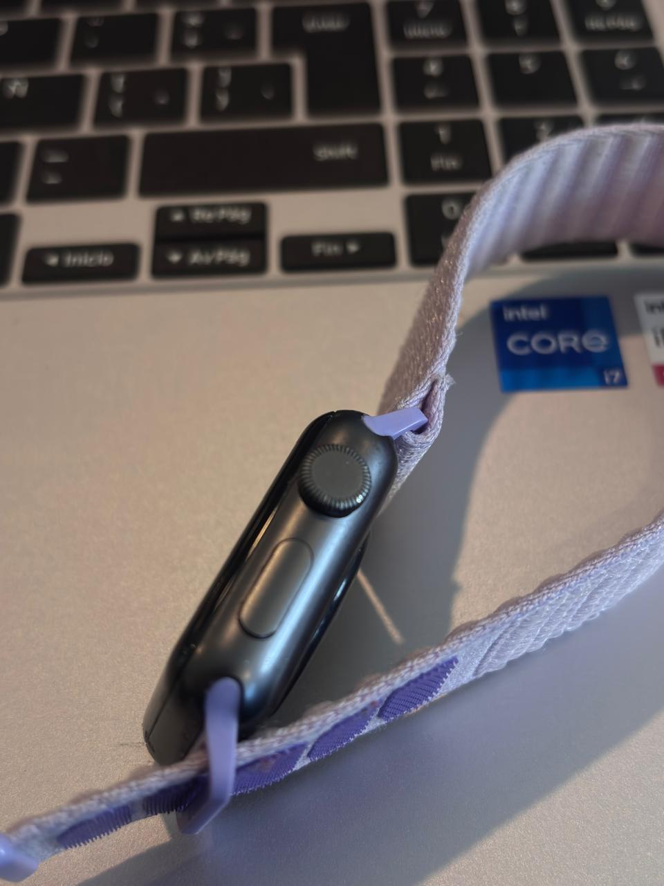
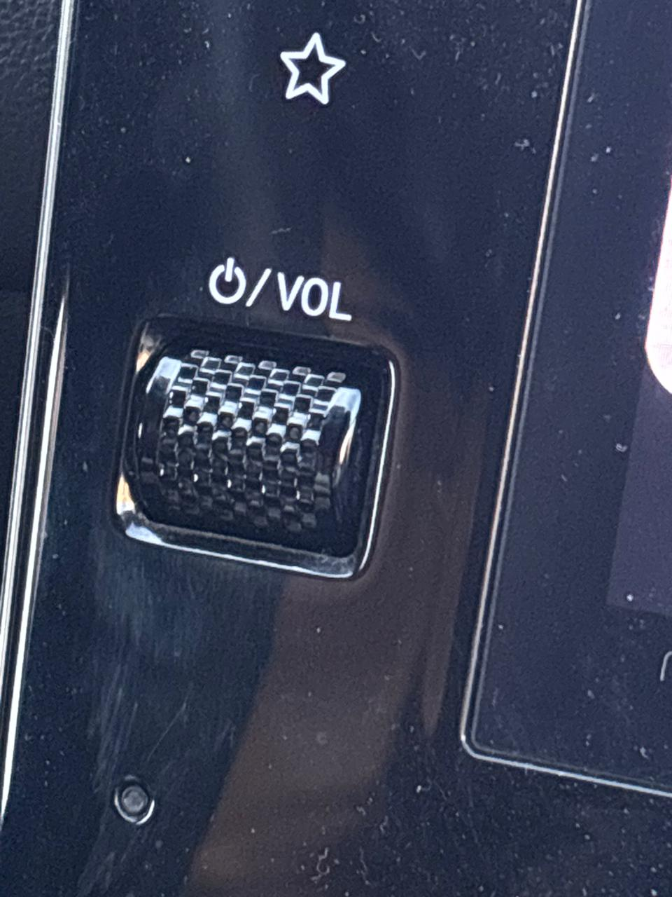
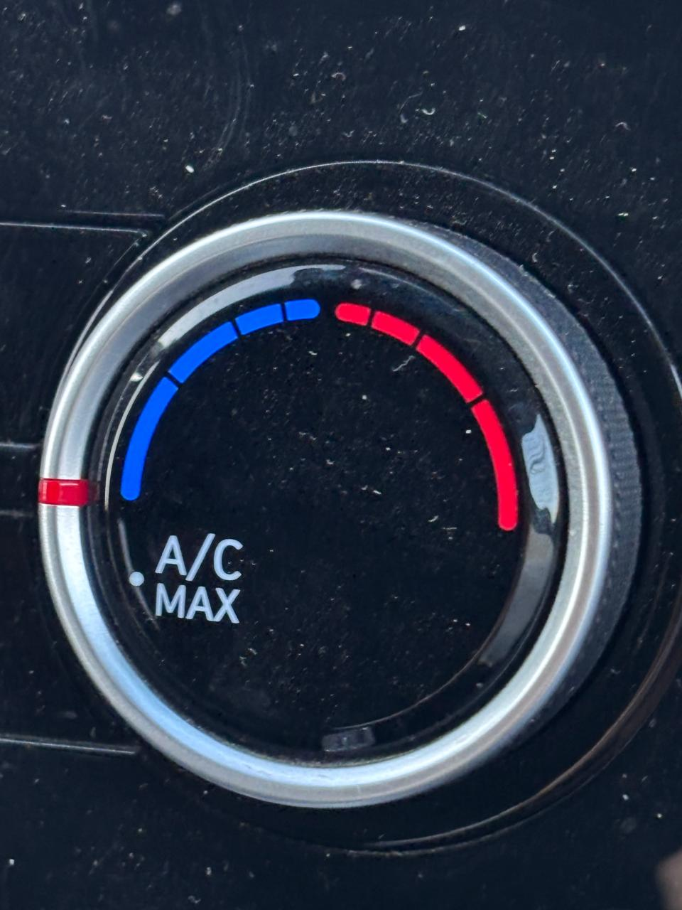
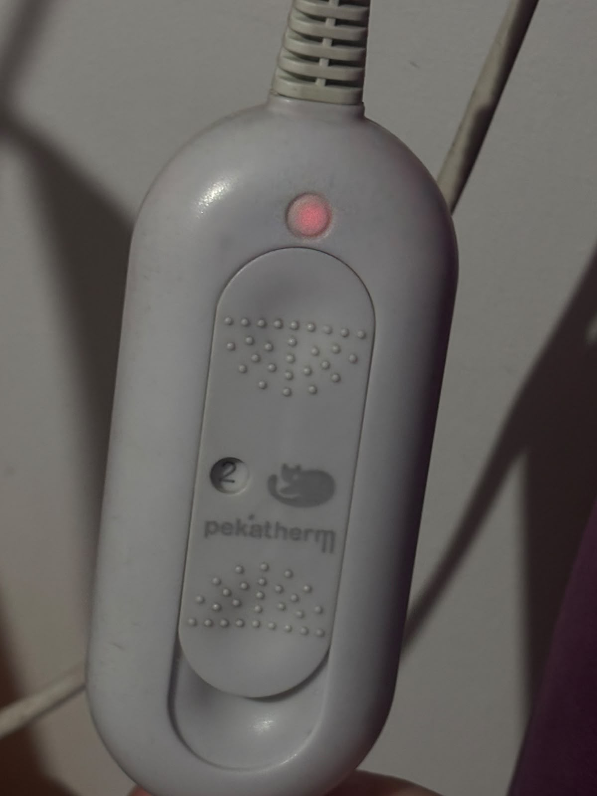

# sesion-08a

## apuntes sesión

En esta clase seguimos trabajando con clases, pero ahora aplicándolas a cosas más concretas como las luces.

Las clases sirven para modelar objetos y ordenar mejor el código. La idea es definir qué cosas tiene un objeto y qué puede hacer, para después poder crear muchas instancias sin tener que escribir todo desde cero cada vez.

Una clase se puede pensar más o menos así:

```cpp
class Algo {
public:

    // atributos
    bool
    int

    // métodos
    void hacerAlgo();

};
```

Atributos = los datos o características que tiene el objeto.

Métodos = las acciones que puede hacer.

Constructor = sirve para crear una instancia de la clase y darle los valores iniciales que necesita.

Por ejemplo:

```cpp
class Lucecita {
public:

    bool encendido;
    int brillo;
    bool parpadea;

};
```

Para describir una lucecita necesitamos pensar qué información realmente importa.

encendido → puede estar prendida o apagada, entonces sirve un bool.

brillo → puede tener distintos valores, entonces usamos un int. Por ejemplo, podría ir de 0 a 255.

parpadea → también puede ser true o false, así que nuevamente sirve un bool.

También podemos tener muchas instancias de una misma clase:

```cpp
Lucecita luzNavidad[100];
```

Los [100] indican que tenemos 100 lucecitas. Todas son de la clase Lucecita, pero cada una puede tener valores distintos.

Por ejemplo, una puede estar encendida y otra apagada, o pueden tener distintos niveles de brillo.

También podemos usar una clase dentro de otra clase. Por ejemplo:

```cpp
class EspantaCuco {
public:

    int precio;
    Lucecita lucecita;
    Sensor sensor;

};
```

Entonces EspantaCuco tiene sus propios atributos, pero además tiene una Lucecita y un Sensor. Es como ir armando objetos más complejos usando clases que ya tenemos.

Constructor

Volvimos a repasar que el constructor tiene el mismo nombre que la clase.

```cpp
class Lucecita {
public:

    Lucecita() {

    }

};
```

Lucecita() es el constructor porque tiene exactamente el mismo nombre que la clase.

En general, el constructor sirve para que cuando creemos una instancia podamos entregarle los datos que necesita.

También pueden existir varios constructores con distintos parámetros.

Métodos y atributos

Los métodos pueden trabajar con los atributos de la misma clase.

Por ejemplo, si tenemos:

```cpp
bool encendido;
```

podemos tener un método que cambie ese estado.

La idea es que los atributos guardan información y los métodos hacen cosas con esa información.

::

Los dos puntos dobles sirven para indicar que algo pertenece a una clase.

Por ejemplo:

```cpp
void Perilla::actualizar() {

}
```

significa que actualizar() pertenece a la clase Perilla.

Esto aparece especialmente cuando tenemos la clase separada en un archivo .h y un .cpp.

GP

GP significa General Purpose.

Son pines que podemos utilizar para conectar diferentes cosas y configurarlos según lo que necesitemos, como botones, LEDs o sensores.

ADC

ADC significa Analog to Digital Conversion.

Sirve para convertir una señal analógica en un valor que podamos usar en el código.

Esto es importante para cosas como el potenciómetro, porque una perilla no solamente tiene dos estados. Puede estar en muchos puntos intermedios.

Entonces:

muevo la perilla
↓
cambia el voltaje
↓
ADC lee ese valor
↓
lo transforma en un número
↓
podemos usar ese número en el código

Por ejemplo, ese número podría servir para controlar el brillo de una lucecita.

LEDs

Para usar un LED normalmente necesitamos una resistencia que limite la corriente. Vimos valores como 220 Ω y 1 kΩ.

El potenciómetro funciona de otra manera y normalmente podemos usarlo sin una resistencia externa cuando lo estamos ocupando como divisor de voltaje.

También vimos que existen LEDs con más patitas que permiten controlar distintos colores, por ejemplo rojo, verde y azul.

Nombres

Hay que tratar de no hacer nombres imposibles de leer. Los nombres deberían explicar lo que hacen, pero sin terminar con una frase eterna que nadie quiera escribir JAJJA.

Al final, la idea general que me quedó es:

atributos → información que tiene el objeto

métodos → cosas que puede hacer

constructor → cómo se crea y con qué valores parte

clase → modelo que después podemos usar para crear distintas instancias


## encargos

encargo-08a:

1. tomar muchas fotos, mínimo 3 por cada uno de los 3 elementos que estudiamos hoy: perillas, botones, y luces. subir las fotos a su README como respuesta a este encargo, y describirlas textualmente, para con esa info complejizar nuestras clases programadas este viernes.


### Observación de perillas, botones y luces

Para este encargo observé objetos que tengo en mi casa y en mi auto que tienen perillas, botones y luces. Me fijé principalmente en qué hace cada elemento y cómo creo que podría funcionar si tuviera que programarlo de una forma sencilla.

---

#### Perillas

**Apple Watch**



La perilla del Apple Watch es la Digital Crown. Se puede girar para moverse por la pantalla, por ejemplo para subir o bajar dentro de una lista, y también se puede presionar para seleccionar o volver a ciertas funciones.

Si tuviera que programarla de forma muy básica, me imagino algo como: si la perilla gira hacia un lado, aumenta un valor, y si gira hacia el otro, lo disminuye. Si además se presiona, podría ejecutar otra acción.


**Radio del auto**



La perilla de la radio sirve principalmente para regular el volumen. Al girarla hacia un lado el volumen aumenta y hacia el otro disminuye. Además, al presionarla tiene otra función.

Pensándolo de manera amateur, sería parecido a tener un valor que va subiendo o bajando dependiendo de hacia dónde giro la perilla. 


**Aire acondicionado del auto**



La perilla del aire acondicionado sirve para regular una de sus funciones, dependiendo de hacia dónde la gire. Al moverla puedo cambiar el nivel que quiero.

Yo lo programaría como una variable que cambia según la posición de la perilla. Por ejemplo, si giro hacia la derecha, el valor aumenta y si giro hacia la izquierda disminuye.


---

### Botones


**Apple Watch**


La Digital Crown también funciona como botón cuando se presiona. Esto hace que una misma pieza tenga dos formas de interacción: girarla o presionarla.

De una forma muy sencilla, podría tener una condición que diga que si se detecta una presión, se realiza una acción diferente a cuando se detecta un giro.


**Radio del auto**


La perilla de la radio también se puede presionar, por lo que además de funcionar como perilla funciona como botón.

Me imagino que podría ser algo como: si la perilla se gira, cambia el volumen, pero si se presiona, hace la función correspondiente al botón, en este caso encender o apagar la radio.


**Mouse**


El mouse tiene botones que sirven para seleccionar, abrir o realizar distintas acciones dependiendo de dónde se haga clic.

De forma muy básica, podría programarse para que al detectar que el botón está presionado haga una acción, y cuando no esté presionado no haga nada.


---

### Luces


**Calientacamas**


El calientacamas tiene una luz que indica que está encendido y conectado. Es una luz bastante simple porque sirve principalmente para mostrar su estado.

Me imagino que podría funcionar con una condición muy básica: si el aparato está encendido, la luz se prende; si está apagado, la luz se apaga.


**Alargador**



El alargador también tiene una luz que indica cuando está encendido y conectado.

Podría programarse de una forma parecida al calientacamas: si está activado, la luz queda encendida y si se desactiva o desenchufa, la luz se apaga.


**Router**


El router tiene varias luces que muestran diferentes estados de la conexión. Dependiendo de lo que esté pasando, una luz puede parpadear, ponerse roja o apagarse.

Este fue el que me pareció más interesante para pensar cómo programarlo. Podría imaginarlo con distintas condiciones: si hay conexión, una luz queda encendida; si está intentando conectarse, parpadea; y si hay algún problema, se pone roja o se apaga.


2. partir del ejemplo de hoy, que está subido en codigos/ de hoy, y hacer que las luces parpadeen. para eso, definir parpadeo de forma paramétrica.


## lectura

### PAG 75-90

En estas páginas sigue desarrollando la idea de que la poesía generada por computador no es simplemente azar. El programa funciona a partir de reglas, bases de palabras y decisiones tomadas previamente por una persona. Por eso, aunque el computador produzca el resultado, sigue existiendo una intervención humana importante.

También me llamó la atención la idea de que el poema generado por computador es una mezcla entre el algoritmo y la interfaz. No solamente importa el texto que genera el programa, sino también cómo ese texto aparece y cómo el lector lo experimenta.

Después comienza el capítulo sobre poesía visual y cinética. Acá el computador empieza a utilizarse para que las palabras puedan moverse, transformarse y ocupar el espacio de maneras que antes no eran posibles. Esto hace que el poema no sea solamente algo para leer, sino también algo para mirar.

El autor vuelve a relacionar estas obras con antecedentes como la poesía concreta, Mallarmé, el dadaísmo y otras formas de poesía visual. Me llamó la atención que incluso cuando aparece una tecnología nueva, muchas de las ideas ya existían antes y simplemente encuentran otra forma de desarrollarse.

También habla de cómo la poesía digital puede romper con la lectura tradicional, porque el texto puede cambiar, moverse o incluso generar distintas versiones. Entonces la experiencia del lector también se vuelve parte de la obra.

### Citas

> “The generation of a computer poem is a fusion between the software/algorithm and the interface.” (p. 81)

> “The computer became a convenient tool to manipulate the appearance and presentation of text.” (p. 86)
