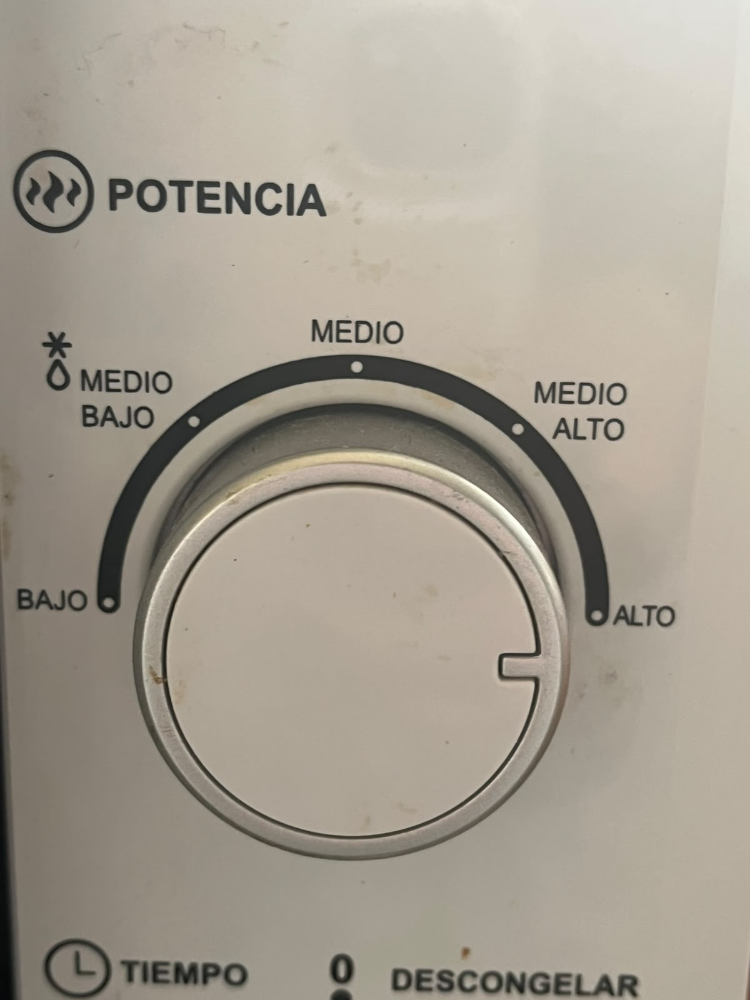
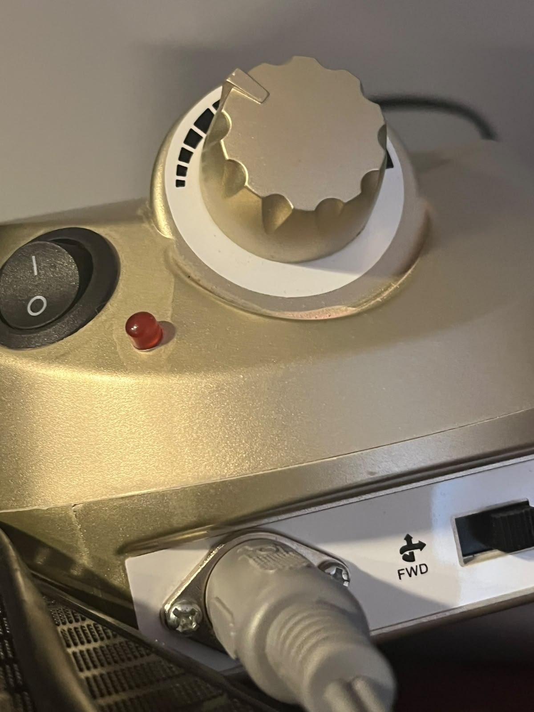
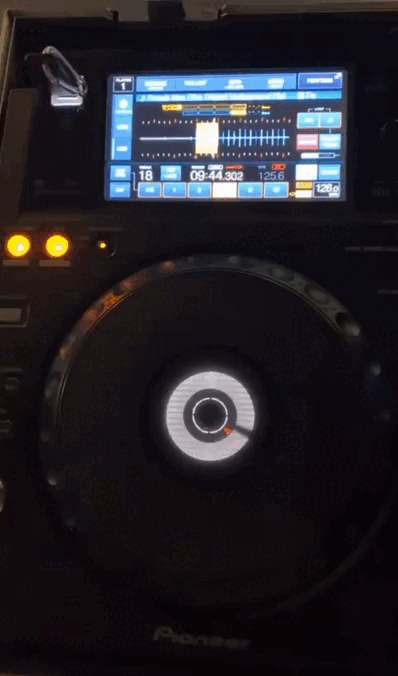
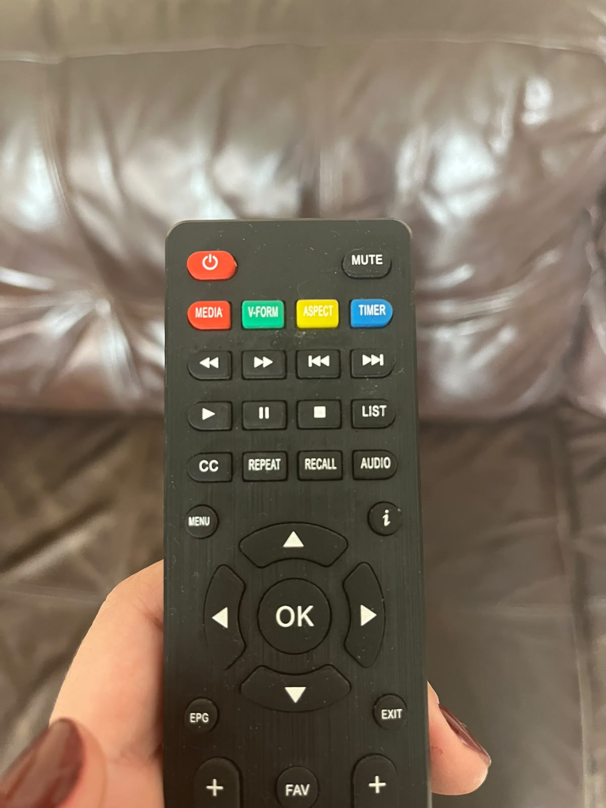
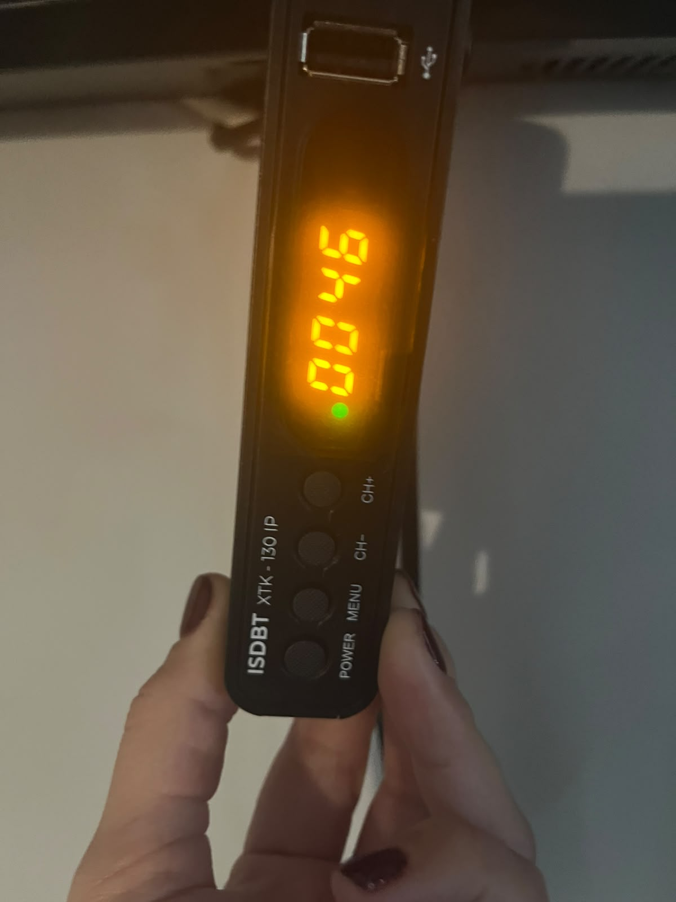
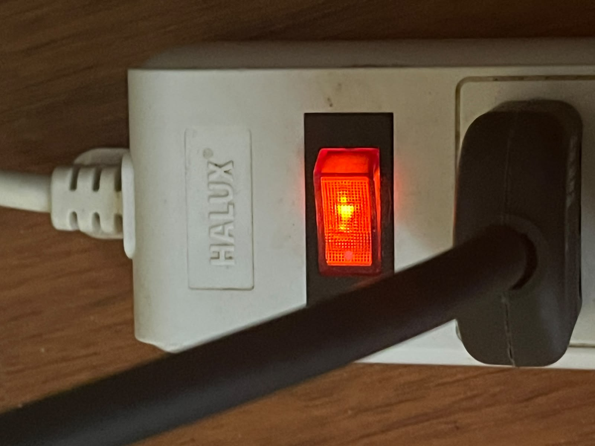
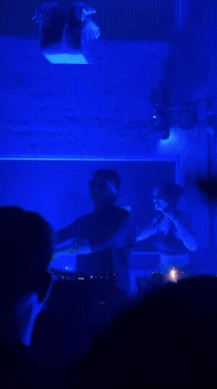
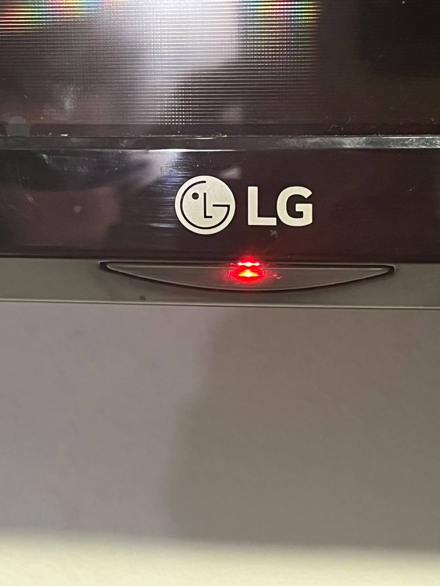
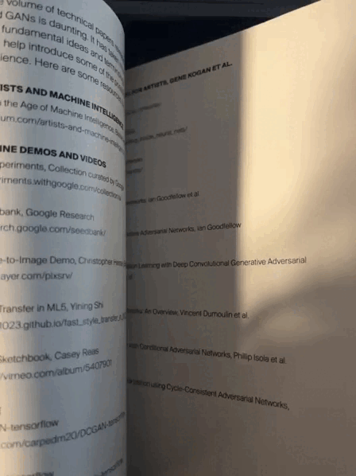
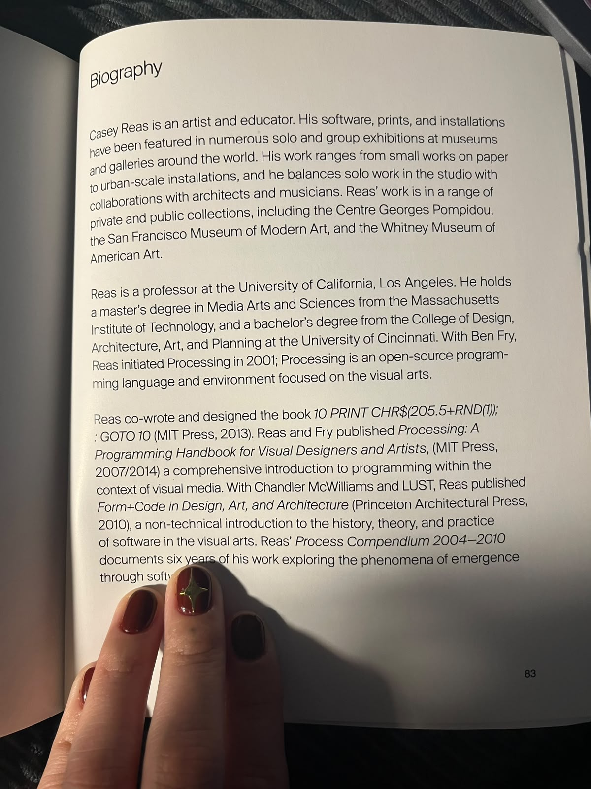

# sesion-08a

## apuntes sesión

**Nota personal:** No asistí a clases, pero isipm08 me compartió sus apuntes.  

- Se revisaron conceptos vistos en clases anteriores.  
- Tema central: **Lógica de las clases** en programación orientada a objetos (OOP).  

- **Clases y personas:**  
  - Aunque hablamos de “personas”, en este contexto se modela a Isi como una clase.  
  - Una clase es una **aproximación simplificada de la realidad**.  

- **Crear y clasificar:**  
  - A las clases se les asignan **atributos** (ej. forma) y **métodos** (funciones).  
  - El **constructor** permite crear objetos a partir de la clase.  

##  Wokwi
Durante la clase se trabajó un ejemplo práctico:  
- Programar un **botón + perilla + luz**.  
- Proyecto: [Wokwi – botón, perilla y luz](https://wokwi.com/projects/477140774861255681)  

**Material complementario:**  
- [Repositorio Perilla](https://github.com/piruetasxyz/Perilla)  
- [Repositorio Botón](https://github.com/piruetasxyz/Boton)  

- **OOP (Programación Orientada a Objetos):** base conceptual de la sesión.  
- **WikiData:** se mencionó como ejemplo de base de datos vinculada a Wikipedia.  
- **Promesas en H:** idea de cómo se cumplen funciones.  
- **C++:** cómo implementa lo que promete.  
- **ADC:** resolución de 12 bits (0–4095) → valores de potenciómetro en binario.  

## “Caja Negra”
- Se explicó que una **caja negra** es cualquier sistema cuyo funcionamiento interno se desconoce.  
- Lo importante es lo que entra (**input**) y lo que sale (**output**).  
- Se mencionó la **filosofía de las cajas negras** y se compartió un texto relacionado:  
  - [Vilém Flusser – Hacia una filosofía de la fotografía](https://monoskop.org/images/8/8d/Flusser_Vilem_Hacia_una_filosofia_de_la_fotografia.pdf)  

- [Marc Augé – Los no lugares](https://designblog.uniandes.edu.co/blogs/dise2609/files/2009/03/marc-auge-los-no-lugares.pdf)  

## encargos

1. tomar muchas fotos, mínimo 3 por cada uno de los 3 elementos que estudiamos hoy: perillas, botones, y luces. subir las fotos a su README como respuesta a este encargo, y describirlas textualmente, para con esa info complejizar nuestras clases programadas este viernes.
# 1. Perillas

**Foto 1: Perilla de potencia del microondas**  
Esta perilla permite regular la potencia del microondas.  

**Foto 2: Perilla de regulación**  
La perilla del drill para uñas sirve para controlar la velocidad y la potencia del micromotor

**Foto 3: DJ**  
El equipo de DJ tiene un control circular para manipular funciones musicales y tiene millones de perillas.  

  
  
  

# 2. Botones

**Foto 1: Control remoto**  
El control remoto tiene varios botones para encender, cambiar canales y ajustar volumen.  

**Foto 2: Botones de un receptor de televisión**   
tiene botones físicos y una pantalla que muestra información.  

**Foto 3: Interruptor luminoso**  
e encender/apagar un dispositivo; la luz roja indica que está encendido.  

  
  
  

# 3. Luces

**Foto 1: Luces**   
luces azules de un carrete, que parpadean y parpadean junto con la música tecno.  

**Foto 2: Luz indicadora de un televisor**  
La luz roja indica el estado del televisor.  

**Foto 3: Luces indicadoras de un equipo de DJ**  
Las luces amarillas y blancas muestran la actividad del equipo.  

  
  
  

2. partir del ejemplo de hoy, que está subido en codigos/ de hoy, y hacer que las luces parpadeen. para eso, definir parpadeo de forma paramétrica.

## lectura

  
  
 

Lo que más me gustó de Making Pictures with GANs fueron las imágenes. Mezcla lo digital con lo poético. Mucha gente se asusta con estas cosas, porque piensan que las máquinas van a reemplazar al artista, pero yo siento que ya son parte de nuestro mundo. En este libro me gustó la forma en que Reas lo trabaja: como una herramienta para imaginar distinto.

Al final, cuando aparece la parte biográfica de Casey Reas, con frases como “Reas’ work ranges from small works on paper to urban-scale installations” y “Processing is an open-source programming language and environment focused on the visual arts”, sentí que era un buen cierre. Me recordó que detrás de todo este trabajo con algoritmos hay un artista que lleva años explorando cómo el código puede ser arte. Esa mezcla entre lo personal y lo técnico le da al libro un sentido completo.
