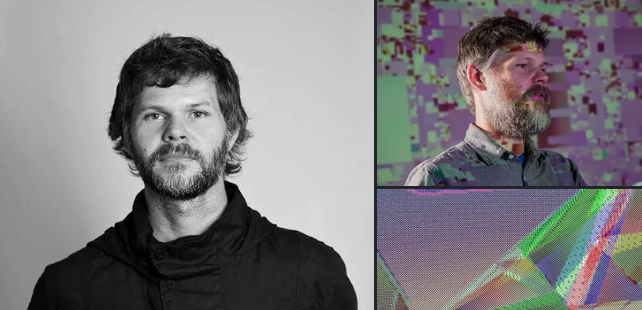
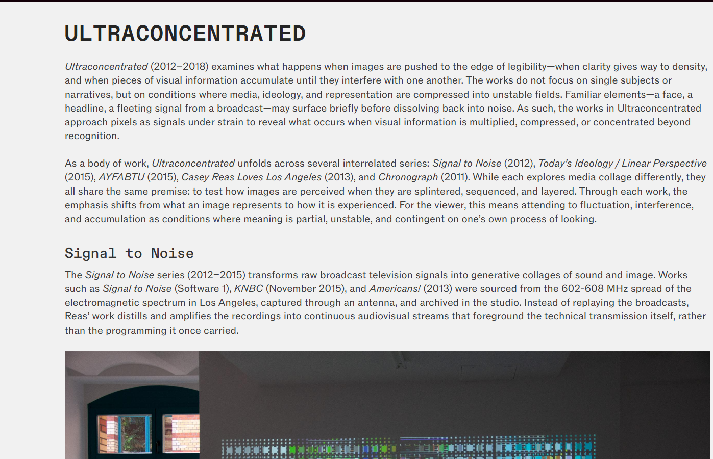

# sesion-09a

## apuntes sesión
al principio conversamos sobre el proyecto 2 que sería el viernes 30 de octubree
-escribir una clase (perilla obotón), la cual otro grupo la tiene que usar
2 perillas
-2 botones pulsadores (pueden haber más pero que no sean pulsadores)
-controlar luz, sonido, pantalla
referencia a algún PC pre 2010
-cuidar lenguaje, materiales, colores
-lenguaje interfásico (Mónica Jacobo Gui Bonsiepe)
-carcasa puede ser cartón o impresión 3d
-diagrama usuario de solo lo que visualiza el usuario,
-diagrama software
-diagrama hardware
-prototipar wokwi
-máquinas tributo a un cierto computador antiguo
# KiCad

Durante la clase vimos  KiCad para el desarrollo de esquemas electrónicos y diseño de PCB. En mi caso, ya tenía experiencia utilizando este programa gracias al trabajo realizado el semestre pasado, por lo que varias de las herramientas y flujos de trabajo ya cachaba un poquitito másss.

## Conceptos principales

- El archivo `.sch` corresponde al esquema electrónico. Aquí se representan las conexiones entre los componentes y sus valores eléctricos. En esta etapa la apariencia visual no es la prioridad.
- El archivo `.pcb` corresponde al diseño físico de la placa. En esta vista sí es importante la distribución y organización de los componentes.
- Es fundamental guardar los cambios constantemente para evitar perder trabajo.
- En las propiedades de cada componente es recomendable registrar información adicional, como precios y enlaces de compra.
- CAD significa *Diseño Asistido por Computadora*.

## Componentes utilizados

- `Module:RaspberryPi_Pico_Common_Unspecified` → Raspberry Pi Pico.
- `SW_Push` → Pulsador.
- `D_LED` → Diodo LED.
- Resistores → Componentes que aportan resistencia eléctrica.
- Capacitores → Componentes que almacenan carga eléctrica y poseen capacitancia.

## Atajos y comandos útiles

- `A` → Insertar símbolos y buscar componentes.
- `M` → Mover elementos.
- `T` → Agregar texto o documentación.
- `V` → Modificar valores.
- `G` → Tomar y desplazar elementos conectados.
- `E` → Abrir propiedades.
- `L` → Crear etiquetas de red.
- `R` → Insertar resistencias.

## Recurso trabajado en clase

- https://github.com/disenoUDP/mi-primer-esquematico

## Ref

- https://misaaaaaa.github.io/imagen-talvez/magos.html
- https://afagaleria.cl/artistas/delight-lab/?v=5bc574a47246
- https://github.com/misaaaaaa/1byteDreamer
- https://github.com/piruetasxyz/plexo
- https://dl.acm.org/doi/pdf/10.1145/2460625.2460711

## lectura

Después de terminar Making Pictures with GANs, me dieron ganas de seguir investigando a Casey Reas y encontré su página web https://reas.com . Me gustó porque permite ver muchos de sus proyectos y entender mejor cómo trabaja con la programación, las imágenes y los sistemas generativos. ha trabajado durante muchos años explorando distintas formas de crear arte con software. En la página aparecen proyectos muy variados que muestran su interés por los procesos, la experimentación y la tecnología. El que más me llamó la atención fue Ultraconcentrated, porque trabaja con muchísimas imágenes e información visual hasta que casi no se pueden reconocer. se pueden ver patrones de colores y formas que parecen señales digitales proyectadas en una pared.
