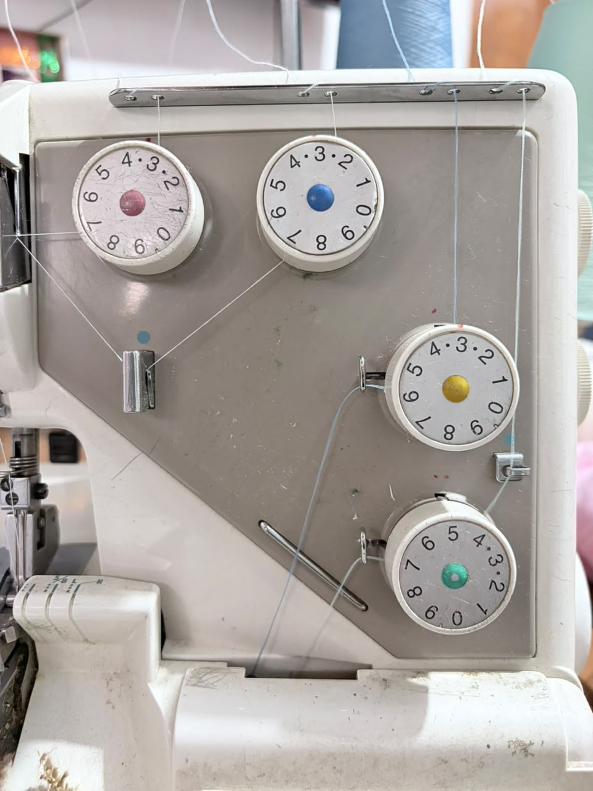
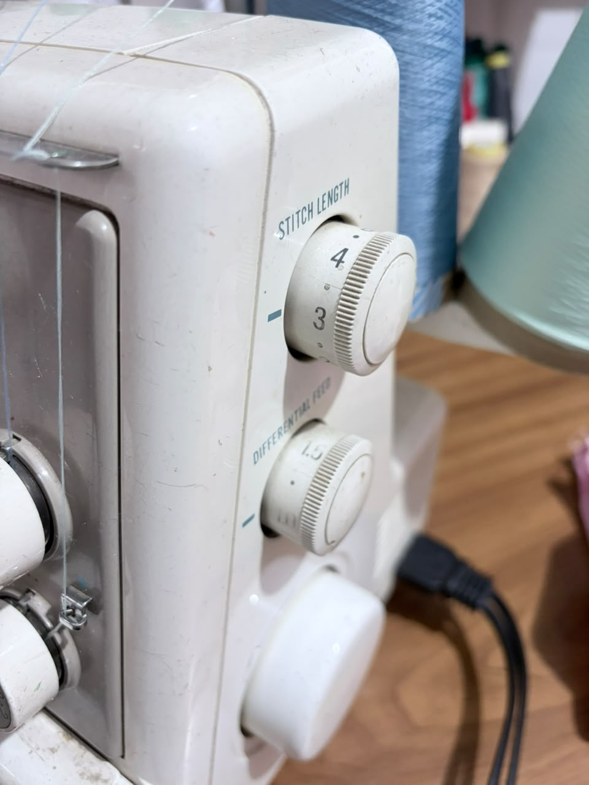
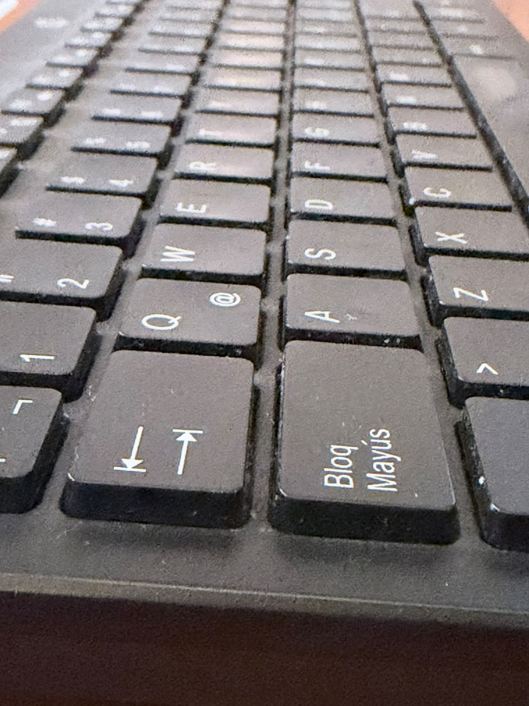
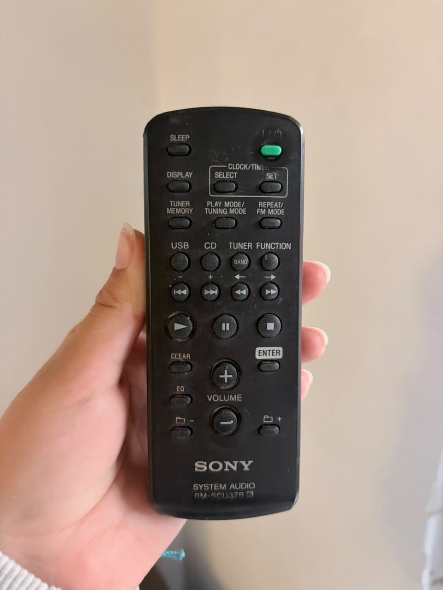
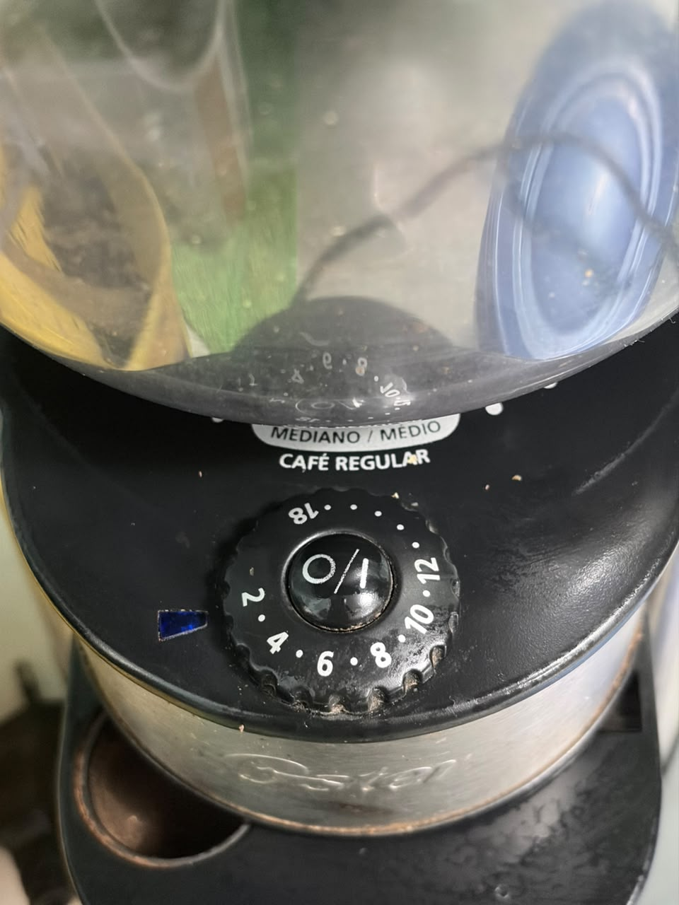
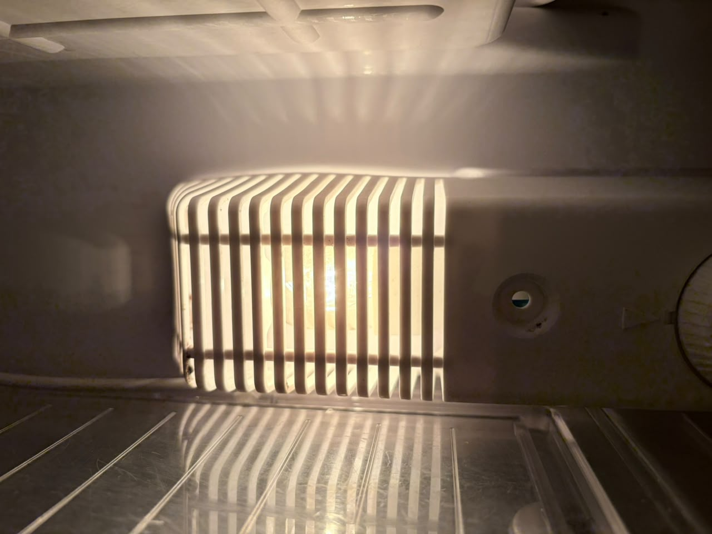
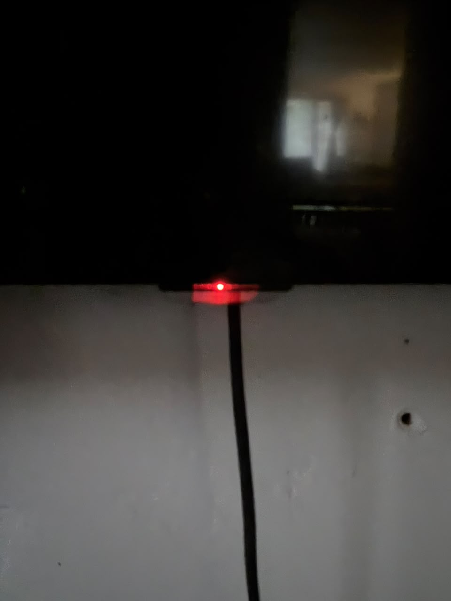
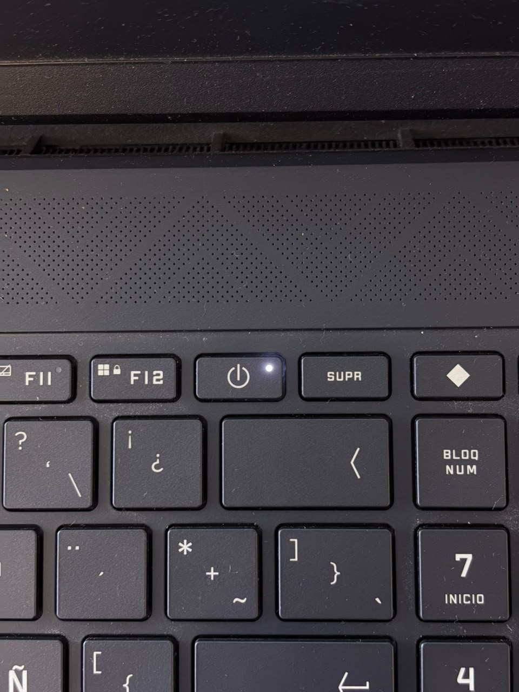

# sesion-08a

## apuntes sesión

Clase - Atributos - Metodos

Led puede ser una clase con variables:
* Encendido o Apagado
* Parpadeo
* Umbral
* Brillo

**OOP**: *Programación orientada a objetos (Object oriented programming)*

Archivos 
* **h** para saber qué hace
* **cpp** saber cómo lo hace

## encargos

encargo-08a:
#### Parte 1
|Tipo|Objeto|Foto|Características|
|-|-|-|-|
|Perilla|Maquina overlock||Perilla con un inicio y un fin, cada uno identifica a cual hilo pertenece, está pensado para ser utilizada de frente|
|Perilla|Maquina overlock||Perilla con un inicio y un fin, cada uno identifica las características de la puntada, además esta está pensada para verla de forma lateral, la perilla tiene una textura en su lado derecho para tener mayor agarre de esta|
|Botón|Teclado||Conjunto y arreglo de push button organizadas en filas y columnas, cada una ligada a un carácter, o cierta combinación genera otro carácter|
|Botón|Control de radio||Push button que al mantener da una señal propia de cada botón, cada una con características propias que aluden a la función|
|Perilla y Botón|Moledor de cafe||Perilla y botón, perilla la cual tiene características de rosca y con números para identificar, push button con signos para identificarlo ambas funciones están totalmente ligadas, ya que una es para medir la cantidad de café y el otro es para encender la máquina y que inicie la instrucción entregadas|
|Luz|Refrigerador||Luz que identifica si el refrigerador está abierto y encendido, gracias a que no está en contacto con el botón|
|Luz|Tele||Luz que identifica si la tele está apagada, se ve la luz en color rojo|
|Luz|Computador||Luz que identifica si el computador está prendido|

#### Parte 2
En base al [Wokwi de clase](https://wokwi.com/projects/477140774861255681) que trabajamos en clases: 

  Le pregunté a Claude que me ayudará a agregar una luz, además especifique que me gustaría que con la perilla se defina el periodo de tiempo en ms, logrando esto:

1) En lucecita.h se agrega
   
```cpp
void alternar();   // para poder dar la acción de parpadear
```

2) En Lucesita.cpp se agrega
   
```cpp
void Lucecita::alternar() {

  // estado prendida se apaga
  // estado apagada se prende
  // gracias al if y else hace este cambio
  if (Lucecita::prendida) {
    Lucecita::apagar();
  } else {
    Lucecita::prender();
  }
```

3) En el main.cpp reemplazar el while (true)

```cpp
  while (true) {


    // leer perilla parpadeo
    parpadeo.leer();


    // la perilla va de 0 a 4095
    // periodo entre 50 y 1000 ms
    // izquierda período menor osea rapido, derecha periodo mayor osea lento
    uint32_t periodo = 50 + (parpadeo.posicion * 950) / 4095;


    // cuantos más lleva el programa corriendo
    uint32_t ahora = to_ms_since_boot(get_absolute_time());


    // si ya pasó el periodo, cambiar de estado
    if (ahora - ultimoCambio >= periodo) {
      ultimoCambio = ahora;
      luz.alternar();
      printf("periodo: %d ms\n", periodo);
    }

    // mini pausa
    sleep_ms(1);
```

quedando así [Wokwi de tarea](https://wokwi.com/projects/477711490516125697)


## lectura
