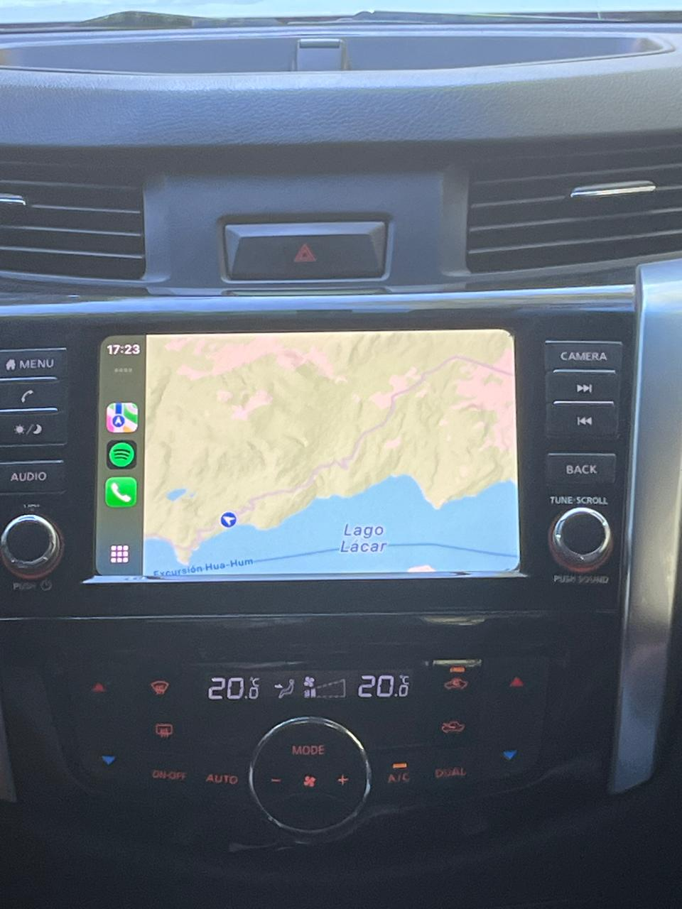
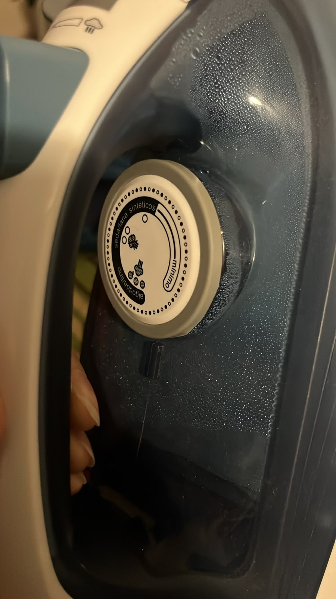
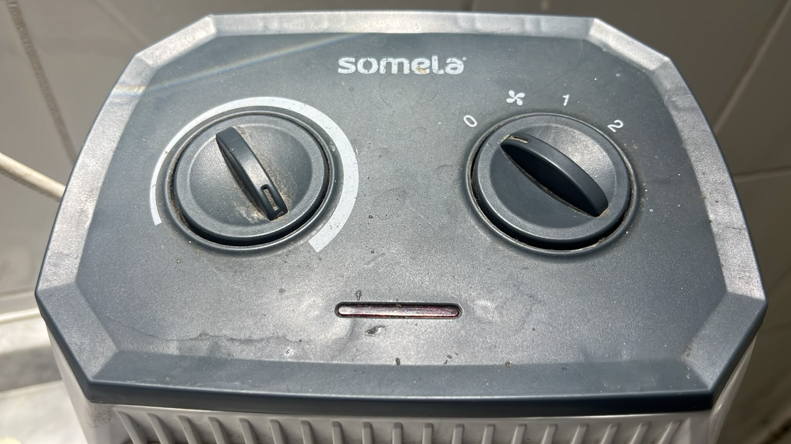
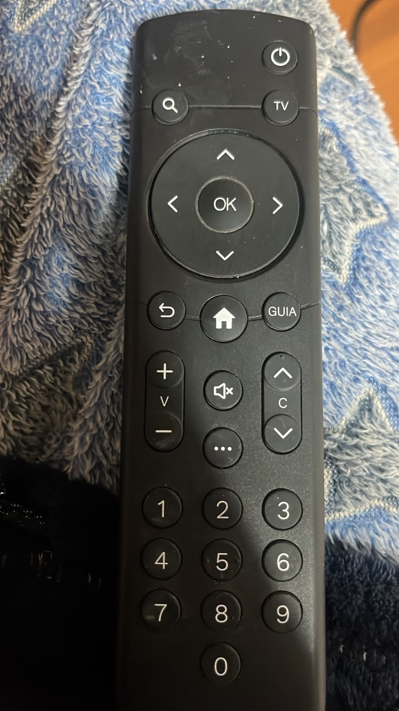
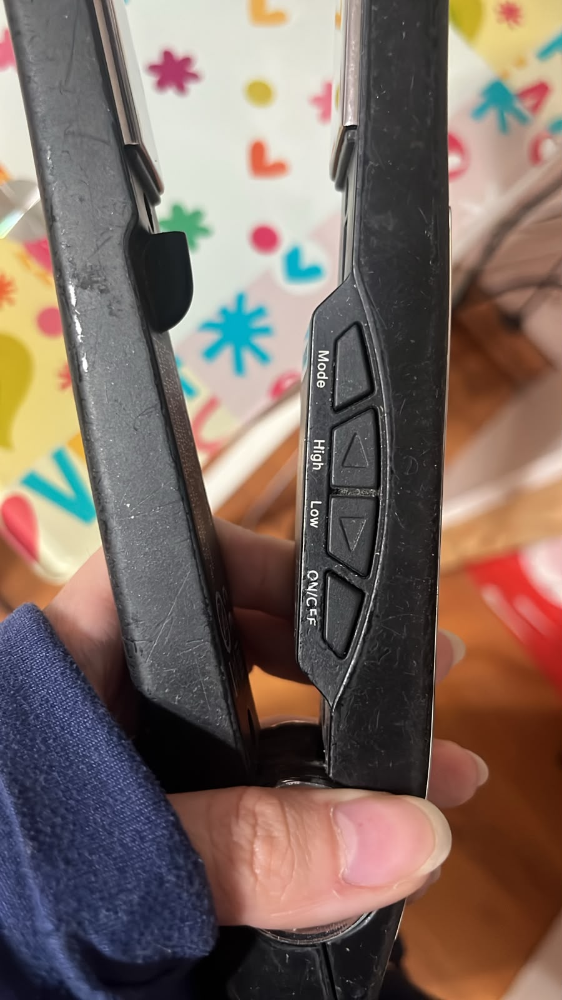
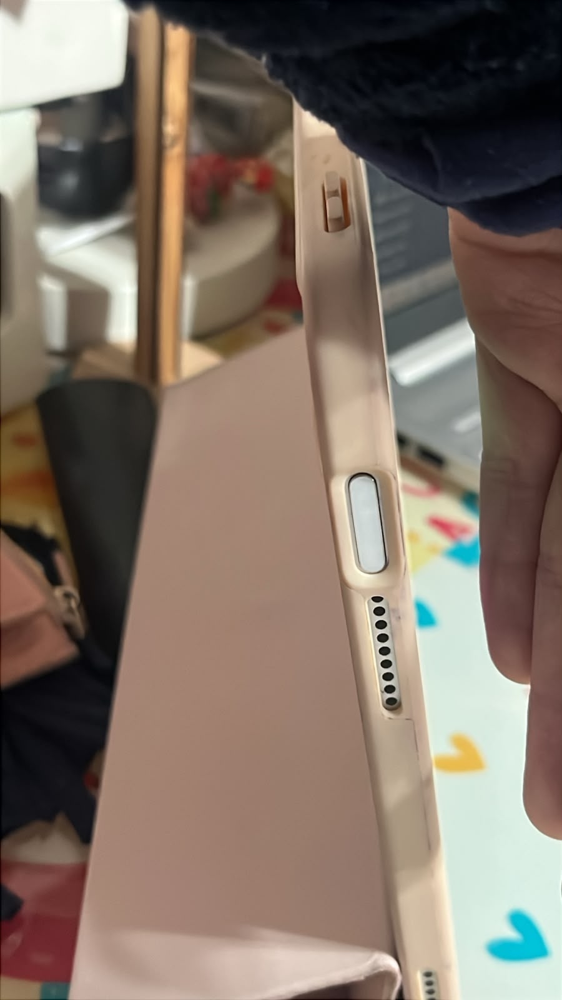
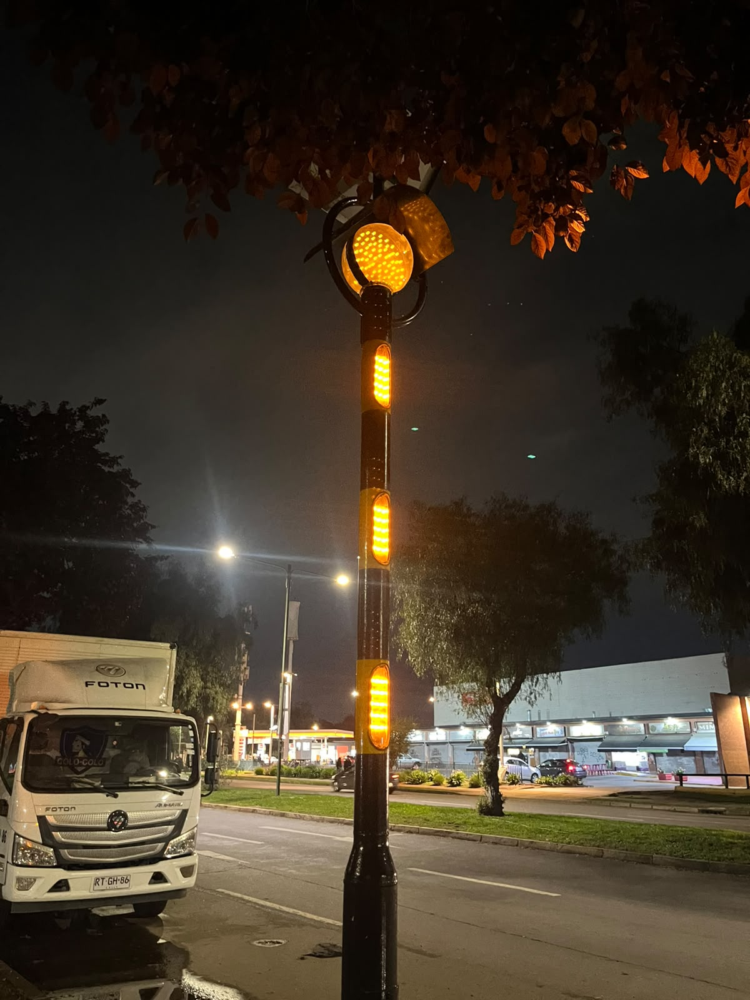

# sesion-08a

## apuntes sesión

06.10.26 8a

clase lucecita 


encendido (si/no)
resumido


umbral (hacia arriba encendido, hacia abajo apagado)


brillo (255-0)


parpadeo ->tiempo


LuzNavidad = Lucecita[100];
[1
0
1
0
1
0]


color = {rojo, verde, azul


EspantaCuco
int precio;
Lucecita espantada;
Sensor lumínico;


Clase Helado{
}int precio
cremosidad


mandar por discord fotos de perillas y botones para poder programarlos
microcontroladores y salidas 
ejemplo en woki: 

```cpp
// hay 3 elementos
// lucecita
// perilla
// pulsador

// lucecita necesita R de 220
// perilla necesita nada
// pulsador necesita R de 10k

// entradas
// o sensores
// perilla - posicion rotacional / giro
// pulsador - si o no hay presion

// salidas
// o actuadores
// lucecita

// ya pero y?

// pulsador: prender y apagar todo
// potenciometro: frecuencia de parpadeo

// lucecita: prender y apagarse
// segun lo que diga boton y perilla

// por lo tanto
// boton tiene dos estados
// prendido y apagado

// perilla va a tener
// una posicion que va a ser
// usada por el sistema
// para impactar en parpadeo lucecita


#include <stdio.h>
#include "pico/stdlib.h"

#include "Boton.h"
#include "Perilla.h"
#include "Lucecita.h"

int main() {
  stdio_init_all();


  // instanciar Boton llamado pulsador
  // a partir de la clase Boton
  // con el parametro
  Boton pulsador(7);

  // lo mismo pero con perilla
  Perilla parpadeo(26);

  Lucecita luz(6);


  while (true) {
    
    // leer perilla parpadeo
    parpadeo.leer();

    // si perilla esta izquierda
    // led apagado
    // si perilla esta derecha
    // led prendido

    if (parpadeo.posicion < 4096 /2) {

      luz.apagar();
    } else {
      luz.prender();
    }

   
    printf("%d\n", parpadeo.posicion);
    sleep_ms(250);
  }
}
```

el constructor toma un valor y lo guarda
.h: ifndef, endif, clases, atributos, constructores
.cpp: prefijos :: y {}
cajas negras, entradas y salidas, 
encargo: 3 fotos perillas, botones y luces y descripciones 
hacer que una luz parpadee


## encargos

encargo-08a:

1. tomar muchas fotos, mínimo 3 por cada uno de los 3 elementos que estudiamos hoy: perillas, botones, y luces. subir las fotos a su README como respuesta a este encargo, y describirlas textualmente, para con esa info complejizar nuestras clases programadas este viernes.

### perillas

 
perilla para controlar la temperatura del aire acondicionado, hacia la derecha es más caliente y a la izquierda más frío el aire, la perilla tiene un tope, al llegar al extremo de cada variable no gira más y por ende ese el máximo de cada variable y solo se puede mantener o girar a la dirección contraria.


perilla para plancha de ropa, al igual que la anterior, esta perilla tiene tope, al girarla por completo a la derecha se tiene el máximo valor de temperatura caliente y al contrario el mínimo valor, siendo de 230° a 90° respectivamente.


este calefactor tiene dos perillas, la primera es para elegir la temperatura o intensidad y la segunda para elegir, el estado (prendido/apagado), viento frío, y el 1 o 2 es para la frecuencia en la que sale el aire

### botones


este objeto tiene multiples botones pero yo lo elegí por el botón "ok" ya que tiene muchas funciones dependiendo en qué se encuentre la pantalla, pero por lo general sirve para seleccionar


este objeto lo elegí por el botón de "mode" ya que al igual que el anterior sirve para distintas funciones, dependiendo de cuantas veces lo presiones, si lo precionas una vez puedes elegir en que unidad de medida va a estar la temperatura, si lo mantienes presionado puedes elegir en cuanto tiempo se programa el apagado automático.


este botón es para el encendido y apagado del dispositivo, pero a la vez reconoce la huella digital para poder desbloquearlo, si se presiona el botón y se pone la huella correcta, se desbloquea, pero si presionas el botón y no esta la huella indicada , se prende pero no se desbloquea.

### luces

este semáforo ubicado en república controla el paso peatonal cada 20 segundos, cuando la luz se pone en verde


este farol ubicado en las calles de republica está programado para a cierta hora, 6pm aprox se enciende para iluminar en la oscuridad de la noche y se apaga a las 6am aprox.


este semáforo de advertencia, parpadea su luz cada 1 segundo para advertir a los conductores 


2. partir del ejemplo de hoy, que está subido en codigos/ de hoy, y hacer que las luces parpadeen. para eso, definir parpadeo de forma paramétrica.

### parpadeo link wokwi

https://wokwi.com/projects/477359119674439681

#### main.cpp

```cpp
// hay 3 elementos
// lucecita
// perilla
// pulsador

// lucecita necesita R de 220
// perilla necesita nada
// pulsador necesita R de 10k

// entradas
// o sensores
// perilla - posicion rotacional / giro
// pulsador - si o no hay presion

// salidas
// o actuadores
// lucecita

// ya pero y?

// pulsador: prender y apagar todo
// potenciometro: frecuencia de parpadeo

// lucecita: prender y apagarse
// segun lo que diga boton y perilla

// por lo tanto
// boton tiene dos estados
// prendido y apagado

// perilla va a tener
// una posicion que va a ser
// usada por el sistema
// para impactar en parpadeo lucecita


#include <stdio.h>
#include "pico/stdlib.h"

#include "Boton.h"
#include "Perilla.h"
#include "Lucecita.h"

int main() {
  stdio_init_all();


  // instanciar Boton llamado pulsador
  // a partir de la clase Boton
  // con el parametro
  Boton pulsador(7);

  // lo mismo pero con perilla
  Perilla parpadeo(26);

  Lucecita luz(6);


  while (true) {
    
    pulsador.leer();
    parpadeo.leer();

    if (pulsador.presionado) {
      // mapear 0..4095 -> 200ms..2000ms
      // 200 ms = parpadeo rápido, 2000 ms = parpadeo lento
      int periodo = 200 + (parpadeo.posicion * 1800) / 4095;

      luz.parpadear(periodo);  
    } else {
      luz.apagar();
      // resetear el estado interno del parpadeo para que arranque limpio
      luz.estado_parpadeo = false;
    }

    printf("posicion perilla=%d\n", parpadeo.posicion);
    sleep_ms(10);   // loop rápido, ya no 250 ms
  }
  }

```

#### boton.h

```cpp
#ifndef BOTON_H
#define BOTON_H

// esto lo agregamos para GPIO
// general purpose input output
#include "hardware/gpio.h"


// Boton.h
// declaraciones de la clase Boton


// definir clase Boton
class Boton {

  // todo publico
  // nada de andar privatizando
  public:

  // atributos
  bool presionado = false;
  int duracionPresionado = 0;
  int patita;


  // constructor
  Boton(int nuevaPatita);

  // metodos
  void leer();
  void presionar();
  void soltar();

};

#endif
```

#### boton.cpp

```cpp
// Boton.cpp
// implementaciones de la clase

// importar el archivo header
#include "Boton.h"

// constructor
Boton::Boton(int nuevaPatita) {

  // guardar el valor
  Boton::patita = nuevaPatita;

   // inicializar patita
  gpio_init(Boton::patita);
  // la patita es entrada
  gpio_set_dir(Boton::patita, GPIO_IN);
}

void Boton::leer() {
    // leer boton
    Boton::presionado = gpio_get(Boton::patita);
}

// metodos
void Boton::presionar() {
  Boton::presionado = true;
  // queda pendiente calcular
  // cuanto rato lleva presionado
}
  
void Boton::soltar() {
   Boton::presionado = false;
   Boton::duracionPresionado = 0;
}
```

#### lucecita.h

```cpp
#ifndef LUCECITA_H
#define LUCECITA_H

// esto lo agregamos para GPIO
// general purpose input output
#include "hardware/gpio.h"


class Lucecita {
  public:

  // atributos
  int patita;
  int prendida = false;

  unsigned long ultimo_cambio = 0;
  bool estado_parpadeo = false;

  // constructor
  Lucecita(int nuevaPatita);

  // metodos
  void prender();
  void apagar();
  void parpadear(int periodo_ms);

};


#endif
```

#### lucecita.cpp

```cpp
// importar el archivo header
#include "Lucecita.h"
#include "pico/stdlib.h"   
#include "pico/time.h"     


// constructor
Lucecita::Lucecita(int nuevaPatita) {
  

  // guardar el valor
  Lucecita::patita = nuevaPatita;

  // inicializar patita
  gpio_init(Lucecita::patita);

  // la patita es salida
  gpio_set_dir(Lucecita::patita, GPIO_OUT);
 
  // partir apagada
  Lucecita::apagar();

}

// metodos
void Lucecita::prender() {


  // hacer true la variable interna
  Lucecita::prendida = true;

  // usar la variable para prender
  // con gpio_put que es de raspico sdk
  gpio_put(Lucecita::patita, true);


}

void Lucecita::apagar() {

   // hacer false la variable interna
  Lucecita::prendida = false;

  // usar la variable para prender
  // con gpio_put que es de raspico sdk
  gpio_put(Lucecita::patita, false);
}

void Lucecita::parpadear(int periodo_ms) {
    unsigned long ahora = to_ms_since_boot(get_absolute_time());

    // cada medio período cambia de estado
    if (ahora - ultimo_cambio >= (unsigned long)(periodo_ms / 2)) {
        if (estado_parpadeo) {
            apagar();
        } else {
            prender();
        }
        estado_parpadeo = !estado_parpadeo;
        ultimo_cambio = ahora;
    }
}
```


## lectura

"Hoy día controlamos el brillo, volumen y canal de un aparato de televisión; mañana podremos variar el sexo, la violencia y la tendencia política."

"Pero en un mundo digital estas diferencias se desdibujan o, en algunos casos, desaparecen: todo son bits. Pueden ser bits de radio, bits de televisión o bits de comunicación marítima, pero siguen siendo bits que se pueden mezclar y susceptibles de ser utilizados de forma múltiple como multimedia."

Negroponte dice que en el futuro la televisión no será así, sino que será solo bits, o información digital, el espectador podrá ver cuando quiera y en el orden que quiera películas o escuchar música, por lo tanto tendrá el control y personalizará lo que ve, porque todo es información manipulable.
