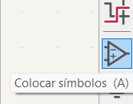
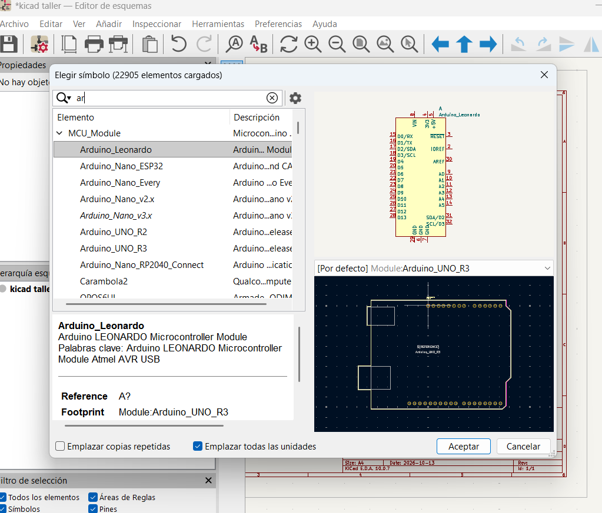
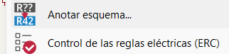
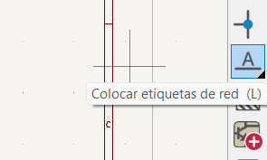

# sesion-09a

## apuntes sesión

13.10.2026 9a

### Software Kicad

Es para diseñar esquemáticos, declarar la topografía. Teoría de grafos. Qué se conecta con qué. Se lee de izquierda a derecha. 
Abrimos Kicad, creamos un archivo, abrimos el archivo .sch, doble click en el rectángulo de abajo para setear tamaño de hoja, titulo, fecha de modificación<<, registro de información de la hoja. Chip rp

este es para poner simbolos

el de arriba es la promesa (como se ve simbólicamente) y el de abajo es como se ve en la realidad

módulo: abstracciones de cómo se ven los componentes
MCU Module, seleccionar, doble click, click en el mapa y queda posicionado, otro click y se pueden seguir agregando más elementos, plac, potentiometer, GND, +3v3, resistencia, push button, led. Para rotarlo se selecciona y se puede girar respecto al eje x y el eje y apretando la tecla x y la tecla y respectivamente. Con el comando t agregamos texto. Todos los componentes tienen un cuerpo que es rojo, tienen una referencia que es este caso (R1) y un valor que es R. La referencia es la inicial de la clase R, y el valor también sería la cantidad o atributo, todos los componentes tienen esas tres cualidades: cuerpo, referencia, valor. Por lo general la referencia no se cambia (el nombre que tiene por defecto). Con comando d se van creando más elementos del mismo, y se van numerando solas 

para anotar todos los cambios hechos. para editar el valor está el atajo v. El atajo m desconecta y mueve los elementos, el atajo g no lo suelta y lo mueve. cuando un valor no tiene un sufijo para dejarlo claro se pone una R, ej 220, 220R. los textos son para describir un poco el rol del circuito.

### etiquetas
Para buenos modales, entrada a la izquierda, a la derecha salida y para eso vamos a utilizar etiquetas

 

Botón y potenciómetro a la izquierda, el sistema de una perilla que no está conectado físicamente con un cable a la placa, se puede conectar con una etiqueta a la placa.
La placa física se diseña aparte, lo anterior son como las instrucciones de armado.

ver paneles biblioteca símbolos oled  

## encargos

## lectura
