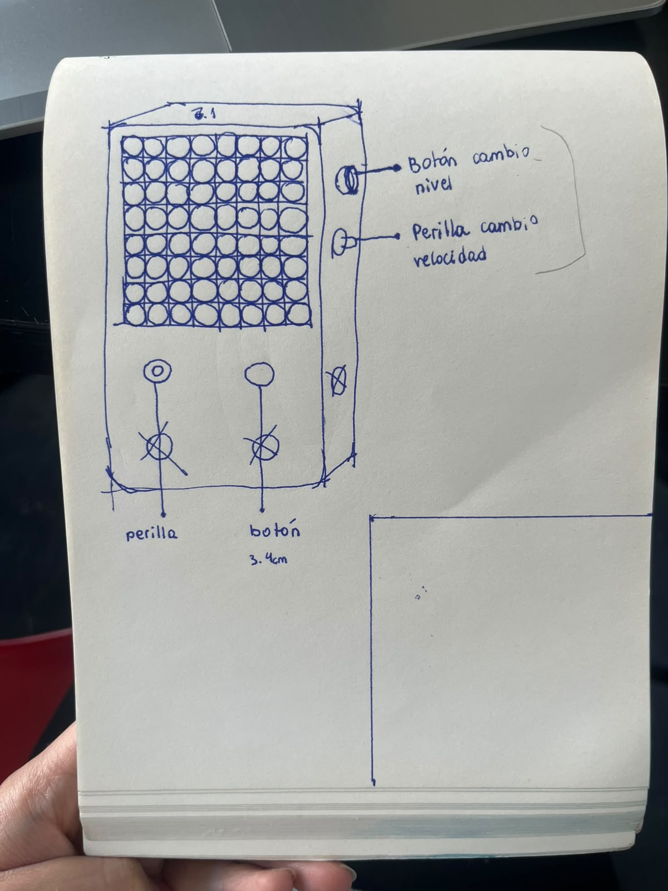

# sesion-10b

## apuntes sesión

### Avance del proyecto 02

En esta clase ya teníamos definida la idea, Tomás trajo un primer código funcionando. Hablamos con el otro grupo (al que debemos hacer las clases de las perillas) para entender bien lo que querían.

  -perilla 1: aumneta la velocidad del juego (dentro del rango)
  -perilla 2: viajar en la selección del personaje (4 personajes)

Después estuvimos averiguando donde comprar los componentes (Matriz LED RGB 8x8, interruptor MTS-102) estos los compramos en Afel con el descuento de estudiante UDP, el Santi fue a comprarlos. Yo hice un boceto de como se vería el proyecto considerando la Game Boy Color como inspiración y dónde posicionaremos los botones y perillas:

## encargos

## lectura
