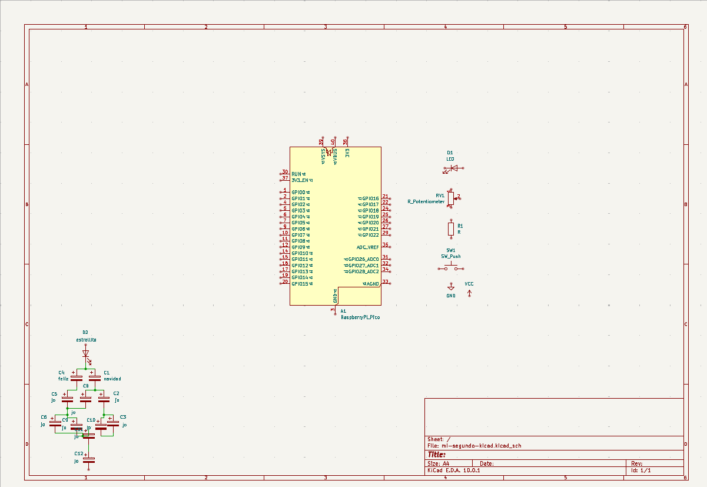

# sesion-09a

comenzaremos a trabajar en el siguiente proyecto, partimos por armar grupos de 4 y 1 de 3.

c/grupo escribirá 1 clase (perilla o botón)
c/grupo comparte su clase

mínimo 2 perillas
mínimo 2 botones... pulsadores, pero igual se pueden usar otros 

máq. comp. de cartón o impresión 3d
que controlan luz / sonido / pantalla

referencia a algún P.C. pre 2010

cuidar lenguaje, materiales, colores
interfásica (mónica jacobo, gui bonsiepe)

la presentación oral deberá planificars, ej:

- hablaremos 2 min de perillas
- 2 min de botones
- mencionaremos nuestros errores de inmediato y mostraremos la vulnerabilidad, o no y lo mencionamos al final.
- la decisión de la interfaz, etc.

3 puntos grupales:

1. documentación: readme, diagramas de flujo, bibliografía, prompts
2. código
3. interfaz

3 puntos individuales:

1. presentación oral
2. bitácoras
3. bitácoras

## apuntes sesión

### KiCad

se presenta KiCad, este software ya lo conocía porque trabajamos en él durante el semestre pasado en taller de máq. electrónicas para diseñar nuestras plaquitas :)

los esquemáticos (.sch) son solo para indicar dónde se encuentran las conexiones, que valores tienen estas conexiones, aquí no nos importan las formas de las líneas, ni los colores, ni nada de lo visual

(.pcb) no lo ocuparemos pero a estos si les importa el diseño de nuestro esquemático de una manera más visual, organizacional, y comprendiéndolo desde lo físico, aquí vemos desde el tamaño y forma de la pcb hasta cada conexión de cobre.

mi-primer-kicad ya existe en el semestre pasado, entonces lo llamé mi-segundo-kicad y tiene compañía de un arbolito navideño explosivo de capacitores porque ya se siente la víspera, totalmente necesario

## encargos

## lectura
