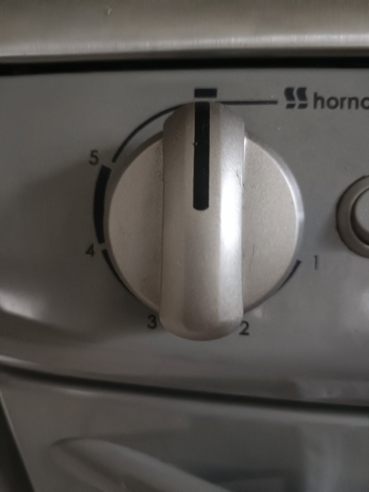
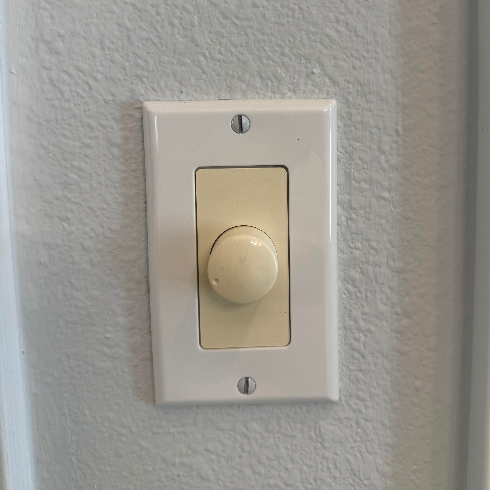
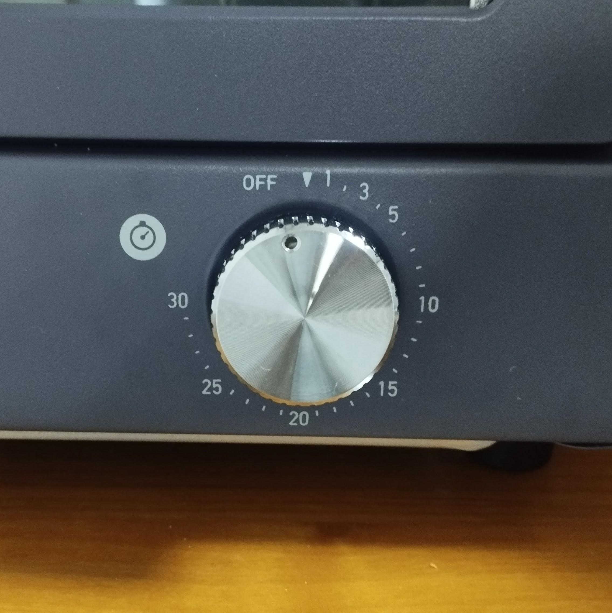
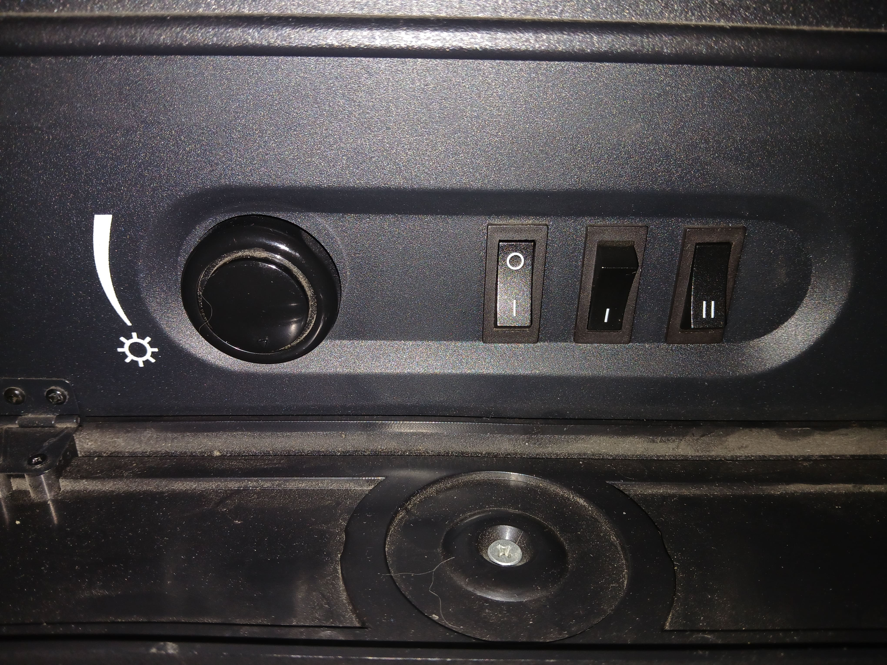
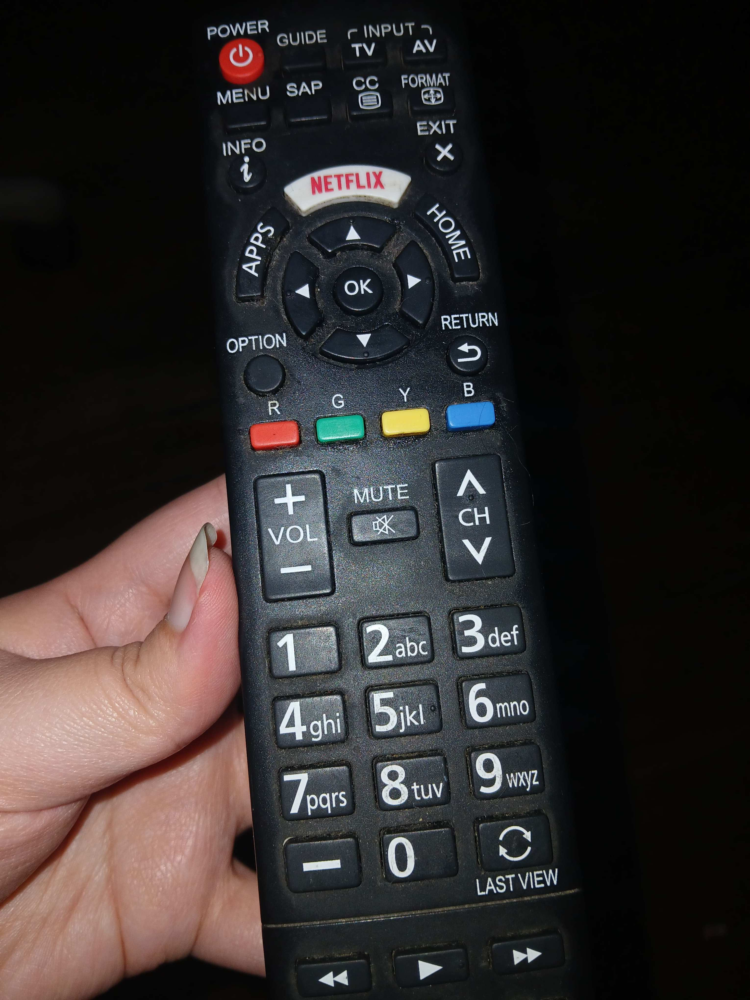
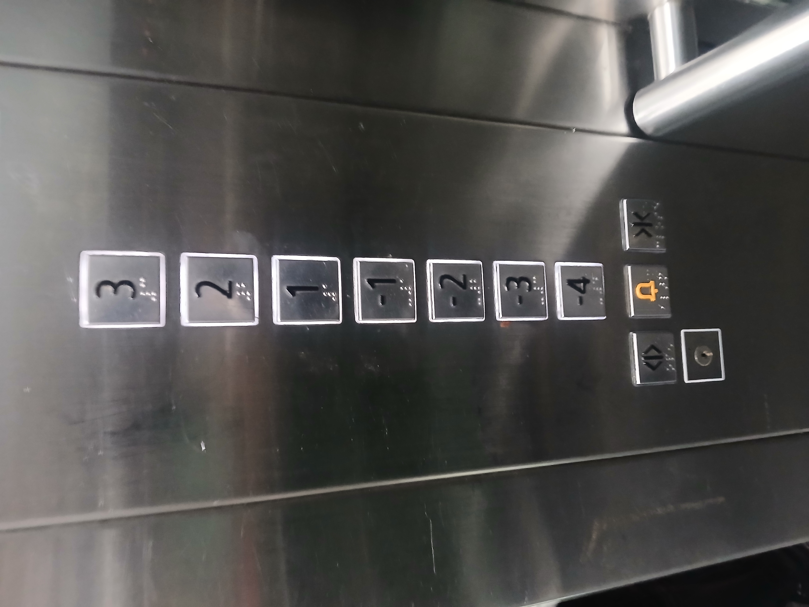
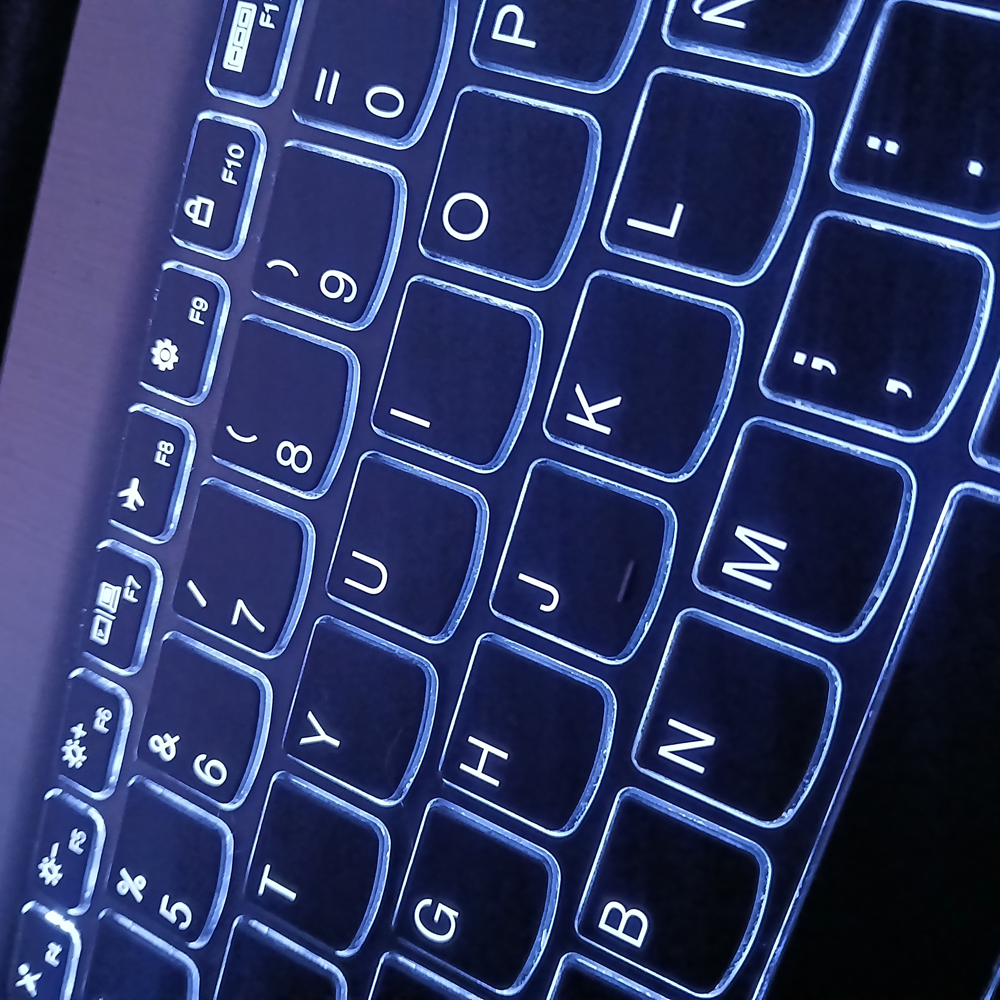
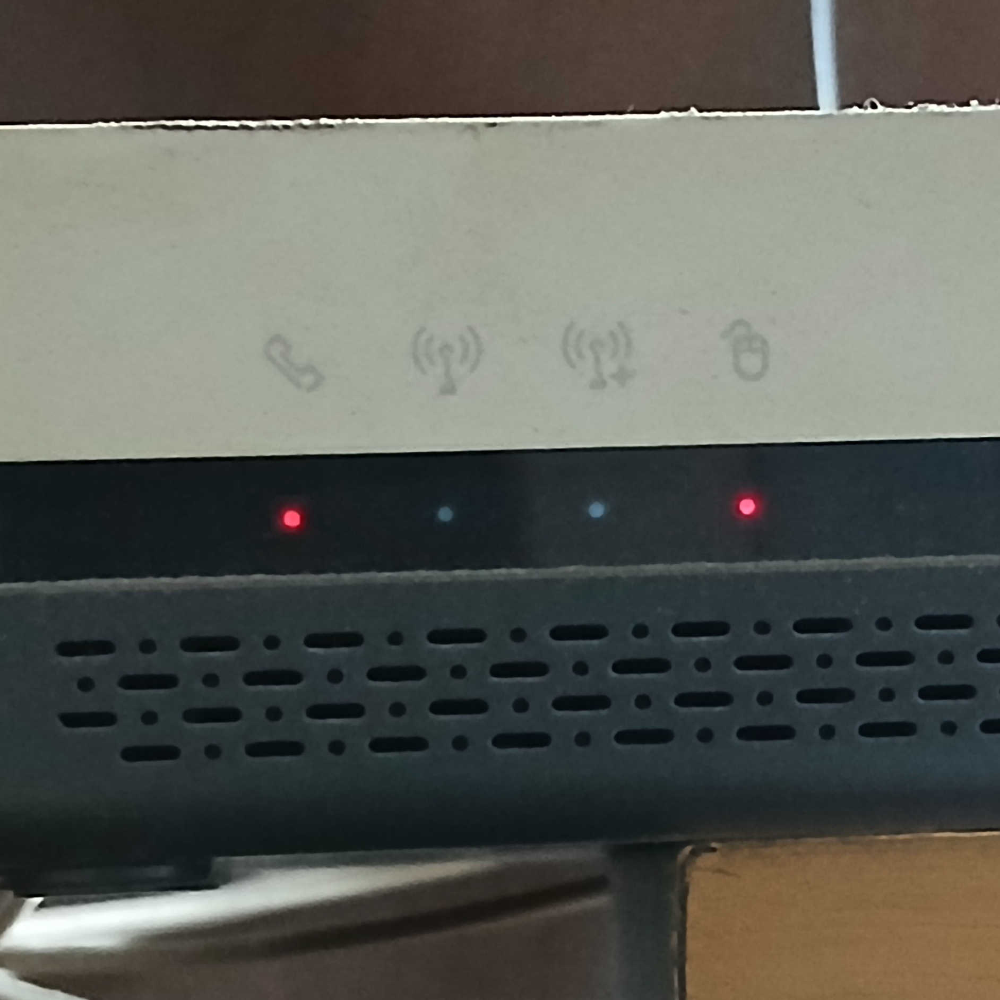
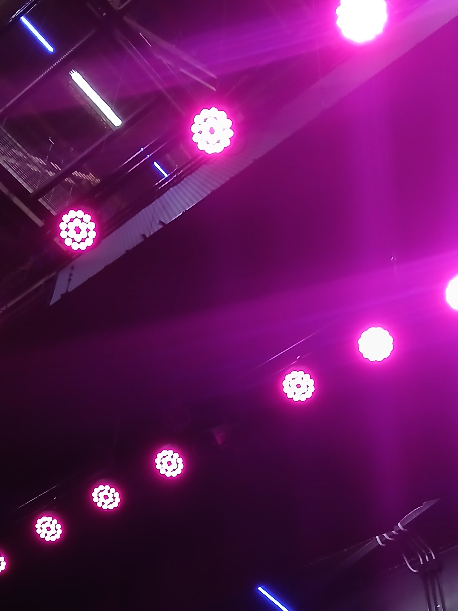

# sesion-08a

2026.10.06

## apuntes sesión

No asistí a esta clase, así que los apuntes son basados en los repos de mis compañeres jiji

---

### Clase repaso

Las clases se componen en atributos y métodos, allows subclases

```cpp
class Algo {
    
    // atributos
    bool esAlgo;
    int cuantoAlgo;

    // metodos
    void algo();

}
```

### Clase LED

- Dos estados de encendido para la luz: si o no

- Brightness ranges from 0 to 255

- Se define según el umbral (&uarr; on / &darr; off)

- Can parpadear, pero depende del tiempo

Eg. `LuzNavidad = Lucecita[100];`

- Colores RGB (rojo, verde, azul)

- Botón &harr; Lucecita &harr; Usuario &harr; Botón (cíclico)

[Pinout LED RGB](./imagenes/rgbled-pinout.jpg)

```cpp
class EspantaCuco {

int precio;
Lucecita espantadora; // instancia
Sensor luminico;

} 
```

```cpp
class Helado {

int precio;
cremosidad;
vegano;

}
```

---

- OOP &rarr; **O**bject-**O**riented **P**rogramming

- `.h` &rarr; son declaraciones (dice qué hace)

- `.cpp` &rarr; son definiciones (cómo lo hace lo que dice hacer ¿¿¿)

## encargos

encargo-08a:

1. tomar muchas fotos, mínimo 3 por cada uno de los 3 elementos que estudiamos hoy: perillas, botones, y luces. subir las fotos a su README como respuesta a este encargo, y describirlas textualmente, para con esa info complejizar nuestras clases programadas este viernes.



&uarr; **Perilla 1**: Horno tradicional de mi casa. Regula la temperatura dentro del horno, aunque no tiene ninguna indicación de cuáles son dichas temperaturas lol. Se puede rotar hacia la izquierda en un arco de casi 270°



&uarr; **Perilla 2**: """Switch""" de luz en la casa de una amiga. Cambia la intensidad de la luz principal de la pieza, desde una luz tenue casi apagada, hasta un brillo completo. Se puede rotar 360° grados, pero se siente un tope en cada extremo (oscuridad vs. iluminado)



&uarr; **Perilla 3**: Tostador en la casa de una amiga. Regula el tiempo que se mantiene encendido. Solo puede rotarse hacia un lado (derecha), although asumo que técnicamente si se puede rotar de vuelta, pero quizás dañe el mecanismo del "reloj" interno



&uarr; **Botón 1**: Estufa eléctrica en mi casa. Como contexto, la estufa enciende una luz que simula la imagen de una estufa a leña. El primer (izquierda) switch enciende esta luz y la estufa en sí, pero no genera calor; el segundo switch comienza a generar calor, y el tercer switch aumenta la intensidad del calor generado. Cabe mencionar que el último switch depende del segundo, es decir no hace nada si ese está apagado. También se puede apreciar una perilla pero no le encuentro el uso ya que nunca he logrado notar una diferencia al rotarla, solo que apaga la estufa si la giro completamente a la izquierda



&uarr; **Botón 2**: Control remoto de TV. Los botones de volumen y cambio de canal están conectados por una membrana¿¿, físicamente si es posible presionar ambos botones a la vez (+ y - volumen, o &uarr; y &darr; canal), pero el control solo registra el primer botón que hizo contacto



&uarr; **Botón 3**:



&uarr; **Luces 1**: Teclado de mi notebook. Tiene la misma intensidad y color a lo largo de todo el teclado. No se puede cambiar el color (que yo sepa), pero si se pueden apagar o atenuar un poco



&uarr; **Luces 2**: Router de wi-fi de mi casa. Tiene cuatro luces que varían entre azul y rojo. Cuando se reinicia el router, las luces parpadean por un momento antes de permanecer encendidas. Cuando todo funciona como debe, las cuatro luces aparecen azules



&uarr; **Luces 3**: Luces de un escenario en Matucana 100. Esta es una foto que tenía desde antes, así que no puedo recordar cuando explicaron las especificaciones en sí, pero creí que aún así valdría la pena incluir aquí

2. partir del ejemplo de hoy, que está subido en codigos/ de hoy, y hacer que las luces parpadeen. para eso, definir parpadeo de forma paramétrica.

## lectura
