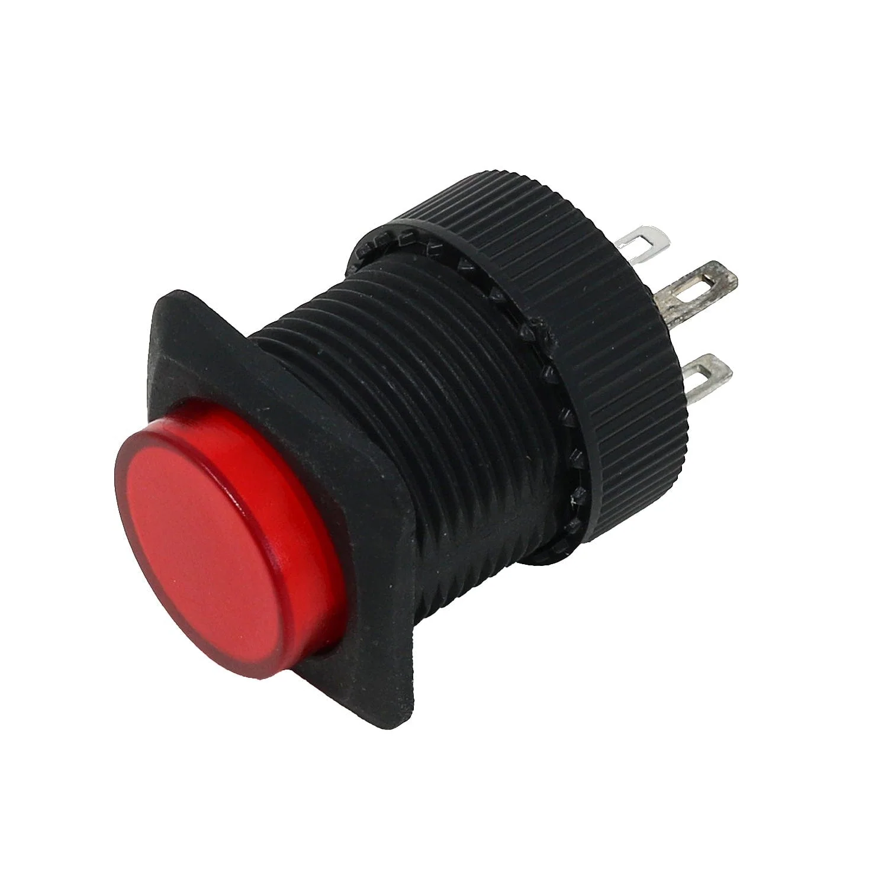
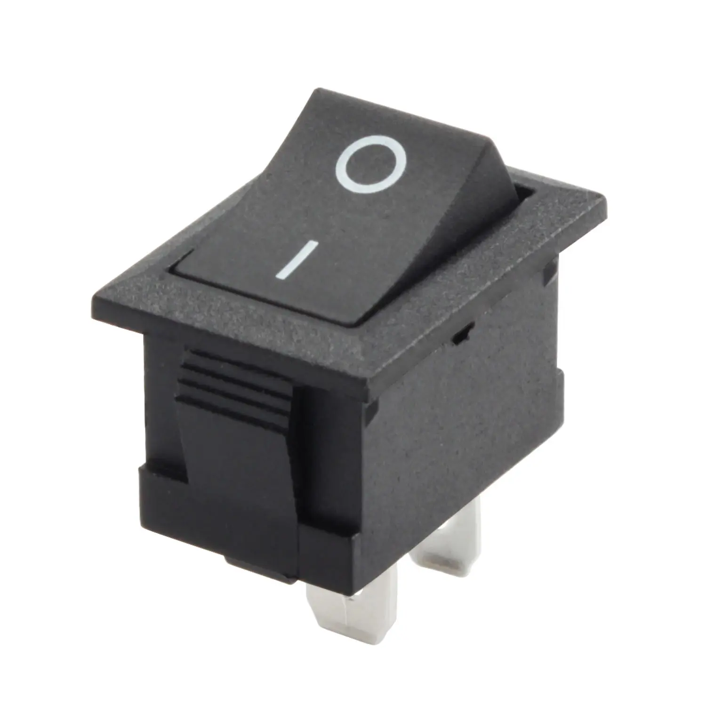

# sesion-08b

2026.10.09

## apuntes sesión

Debido a que ha llovido torrencialmente durante toda la semana, trabajaremos modalidad remota :skullemoji:

---

Botón LATCH &rarr; se mantiene en el estado en el que se presiona

Encuentro curioso que cuando busco fotos del latching switch, me salen imagenes muy distintas a lo que yo recuerdo haber visto en la clase lol. Aparentemente el nombre del tipo de botón específico que recuerdo es "rocker switch" which makes sense given the shape, pero cabe en la definición del latching switch anyway

&uarr; Latching switch

vs.

&uarr; Rocker switch

DIP 

Revisamos el repo de piruetasxyz, específicamente el de [botones](https://github.com/piruetasxyz/Boton) y [perillas](https://github.com/piruetasxyz/Perilla)

[Video de la clase de Wokwi](https://youtu.be/3rPzC8b9JSg)
