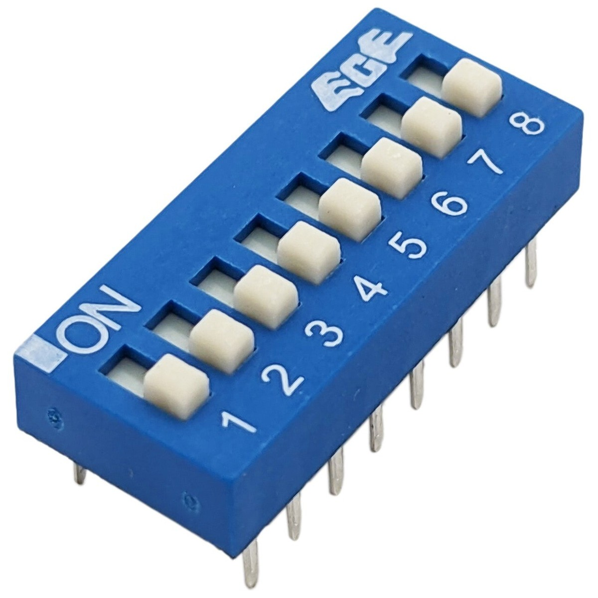
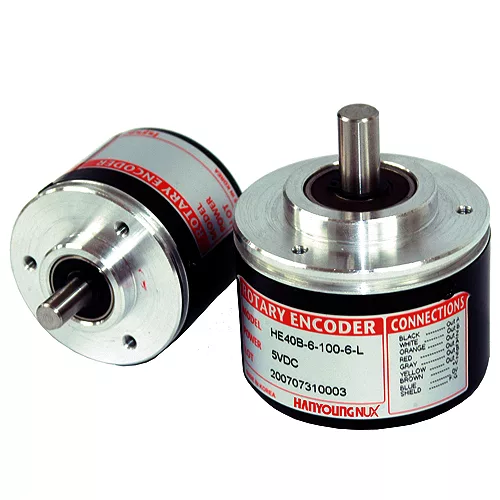
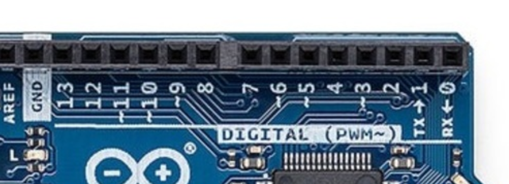

# sesion-08b

2026.10.09

## apuntes sesión

Debido a que ha llovido torrencialmente durante toda la semana, trabajaremos modalidad remota :skullemoji:

### Revisión del encargo pasado

Botón LATCH &rarr; se mantiene en el estado en el que se presiona

Encuentro curioso que cuando busco fotos del latching switch, me salen imagenes muy distintas a lo que yo recuerdo haber visto en la clase lol. Aparentemente el nombre del tipo de botón específico que recuerdo es "rocker switch" which makes sense given the shape, pero cabe en la definición del latching switch anyway


&uarr; Latching switch

vs.


&uarr; Rocker switch

DIP switch (**D**ual **I**n-line **P**ackage) &rarr; conjunto de interruptores en una sola pieza. Cada switch se puede activar o desactivar independientemente. Size, colour and shape comunica distintos usos



&uarr; DIP switch

Encoder &rarr; parece potenciómetro, pero no lo es (duh), rota infinitamente ya que no tiene un tope físico



&uarr; Encoder

### Clase Wokwi

[Wokwi que trabajamos en clase](https://wokwi.com/projects/477413398813766657)

Primero definimos el pseudocódigo i.e. escribir en palabras comunes qué planeamos hacer en el código y el behaviour expected

Aarón agregó el umbral de tiempo presionado (2 seg) por sugerencia de Misaa, en referencia al botón que vio alguien en un gimnasio (see: [isiidoraadiiaz sesion-08a](https://github.com/disenoUDP/dis8645-2026-2-procesos-2/tree/main/07-isiidoraadiiaz/sesion-08a))

La idea es: hay un LED conectado a un botón, el LED no hace nada si no pasa nada. Entre los 0s y 2s de apretado (el botón), el LED prende de a poco; después de los 2s, el LED parpadea "HOLA" en código morse (. . . . / - - - / . - . . / . -)

(Random fun fact about me: en el brazo izquierdo tengo tatuada una frase en código morse :cowboyemoji: , es una referencia cringe a una canción de una banda que me gusta)

Necesitamos 3 versiones, la básica hace que el botón encienda y apague el LED, una que haga la rampa (la luz se prende de a poco), y otra que haga el HOLA en morse

En métodos (de `Lucecita.h`) hay que básicamente hacer un diccionario para escribir HOLA en morse, porque necesitamos el punto ( . ) y la raya ( - ), y asociar cada letra a una combinación de estos carácteres

Creamos la luz en `main.cpp`

```cpp
Lucecita luz(7);
```

También hay que agregar la rampa en `Lucecita.h`

```cpp
void rampear();
```

Y definir esta rampa en `Lucecita.cpp`

```cpp
void Lucecita::rampear() {
```

Ya que en el código no está definido nada sobre cuánto tiempo está presionado el botón, hay que agregar eso

```cpp
int intensidad = 0; // en Lucecita.h
```

```cpp
void Lucecita::rampear() {
    Lucecita::intensidad = Lucecita::intensidad + 1;
    // permite llamar a rampear y que aumente por si solo
}
```

```cpp
luz.rampear(); // en el loop de main.cpp
```

Surge un error (intencional), hay que definir el límite de esta rampa, así que agregamos un mínimo y un máximo en los atributos

```cpp
int minimoIntensidad = 0;
int maximoIntensidad = 1024;
```

Además de cómo se comporta la luz en referencia al límite

```cpp
    if (Lucecita::intensidad > Lucecita::maxIntensidad) {
        Lucecita::intensidad = Lucecita::maxIntensidad;
    }
```

Hasta aquí, el LED ni el botón están usando `Lucecita::intensidad`, así que arreglamos eso

```cpp
void iluminar(); // en Lucecita.h
```

```cpp
while (true) {

    // leer sensores

    // tomar decisiones
    luz.rampear();

    // emitir por actuadores
    luz.iluminar();
    
}
```

La simulación primero no funcionó porque no sabía cómo se ilumina

```cpp
void Lucecita::iluminar() {
```

PWM &rarr; cuando algo digital emula algo análogo

Hay que decirle a la placa que pueda hacer PWM (`#include "hardware/pwm.h"`)

En las placas (eg. Arduino UNO R4), se ven que algunas salidas digitales son capaces de PWM, estas están marcadas con una virgulilla al lado



[Video de la clase de Wokwi](https://youtu.be/3rPzC8b9JSg)

---

Algo muy random que aprendí escribiendo mis apuntes; tiendo a usar &rarr; &uarr; &darr; &larr; frecuentemente y siempre se me olvidaba cómo escribir cada flecha porque lo leía como una secuencia extraña de letras, pero en mi último googleo tratando de recordar cada código, noté que simplemente es primera letra dirección + arrow lol. &rarr; es **r**ight **arr**ow, &harr; es **h**orizontal **arr**ow, and so on
