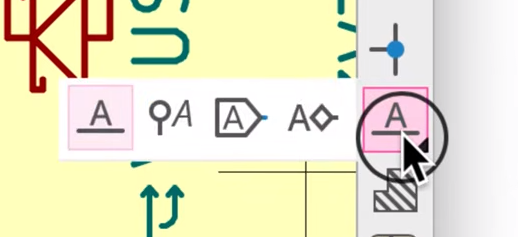

# sesion-09a

2026.10.13

## apuntes sesión

Con los cuatro que habíamos en la sala, Aarón definió? que el mejor momento para evaluar la ""solemne"" es la semana subsiguiente i think

### Bloque 9:00 - 11:00

Para el proyecto-02 hay que conformar grupos de cuatro, aunque va a haber un (1) grupo de tres anyway

- Cada grupo escribe una clase (perilla o botón)

- Cada grupo comparte su clase

- Mín/máx dos perillas, mín/máx dos botones pulsadores

- Cartón o impresión 3D

- Controlar luz/sonido/pantalla

- Referenciar algún PC pre-2010

- Cuidar lenguaje (interfásico), materiales, colores

---

Versiones de software v X.Y.Z &rarr; lo que yo entiendo es: X big change que rompió el código anterior, Y agregó algo, y Z es bug fixing

&uarr; esto se llama [SemVer](https://semver.org/) (semantic versioning)

---

La clase de KiCad [streamed by Misaa](https://www.youtube.com/watch?v=iI2J38TAtJc)

Ya que he usado KiCad anteriormente, anotaré solamente lo que no recordaba del todo, o directamente no sabía

Hotkeys: X flips horizontally, Y flips vertically

Si hago selecciono de arriba hacia abajo, se selecciona solo las partes que están dentro de la sección; de abajo hacia arriba se selecciona el componente completo

Algunas herramientas tienen una esquina que indica que contienen más subherramientas, estas se acceden manteniendo apretada la herramienta principial

## lectura
