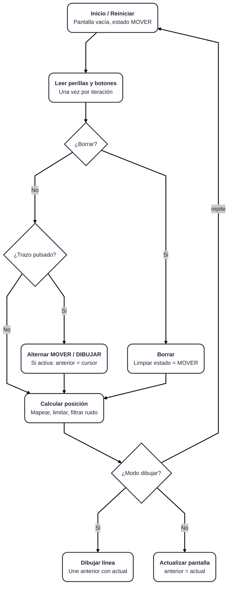
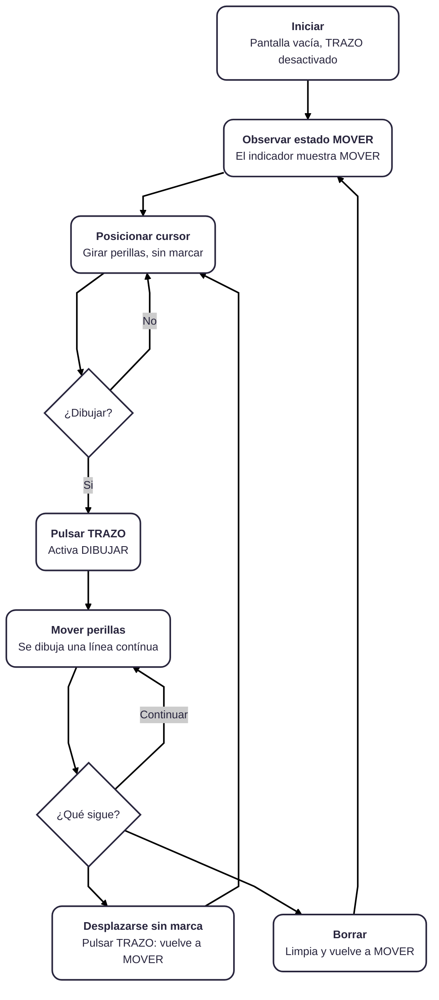
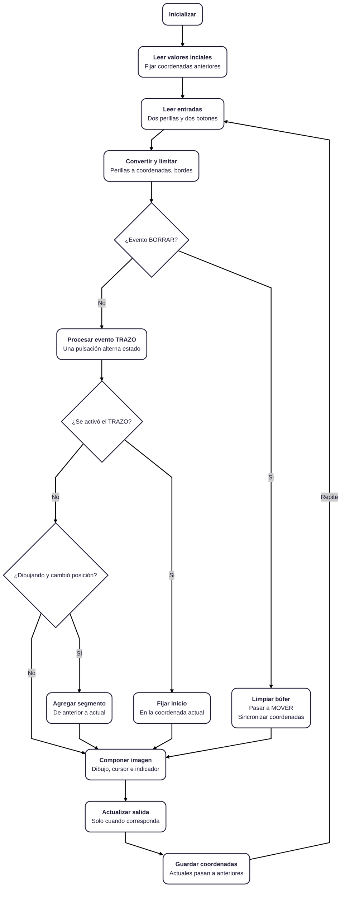

# sesion-11a

2026.10.27

## apuntes sesión

Realicé la primera versión del diagrama de flujo del proyecto. Primera vez que hago uno en markdown lol así que aprendí un nivel muy básico del syntax de `mermaid`

---

Esta primera versión era un diagrama más generalizado, así que ahora voy a diferenciar entre el diagrama de flujo del usuario, y el flujo del programa

### Diagrama de flujo del usuario

### Diagrama de flujo del programa

## lectura
