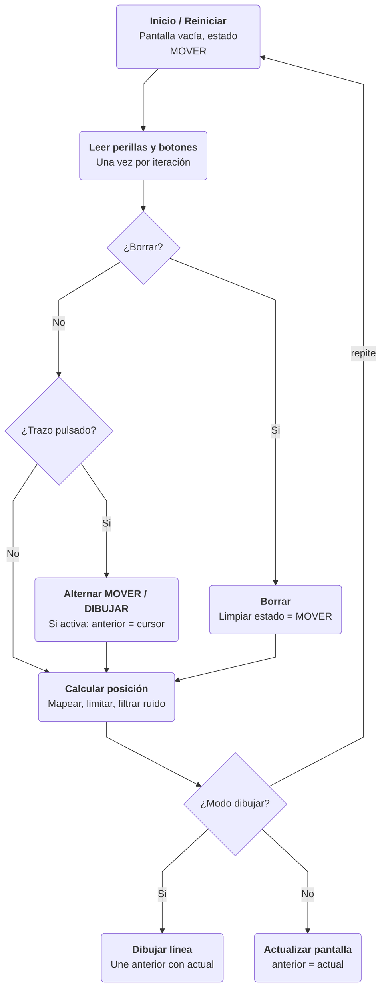

# sesion-11a

2026.10.27

## apuntes sesión

Realicé la primera versión del diagrama de flujo del proyecto. Primera vez que hago uno en markdown lol así que aprendí un nivel muy básico del syntax de `mermaid`

## lectura
