# sesion-08a

## apuntes sesión

En esta sesión se le dio el foco a repasar y despejar dudas en relación a las clases en C++. 

De este repaso la verdad rescato:

- Detallar a futuro...

 

Pero la verdad, en este repaso general no me enfoque porque eran elementos que ya comprendía, por lo que mi atención estuvo en terminar un proyecto personal.

Este proyecto consta de 4 osciladores de onda cuadrada, estos funcionan en base a compuertas NAND retroalimentadas. Por lo que se denomina **soNANDo**

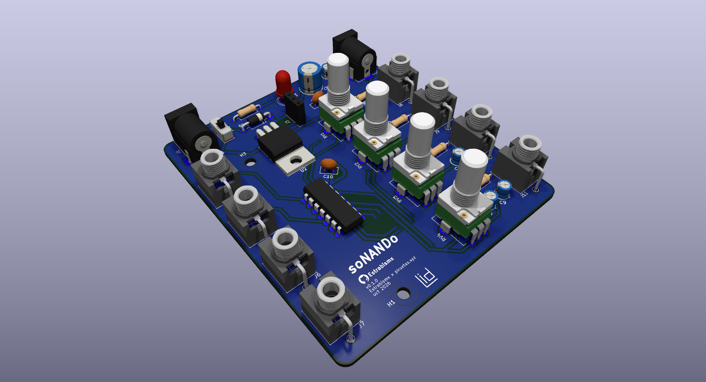
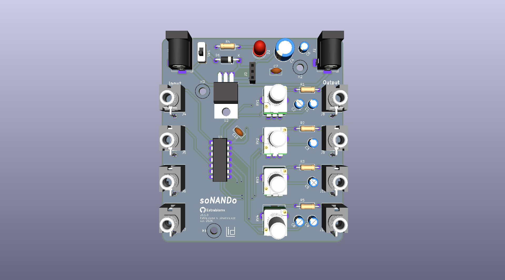
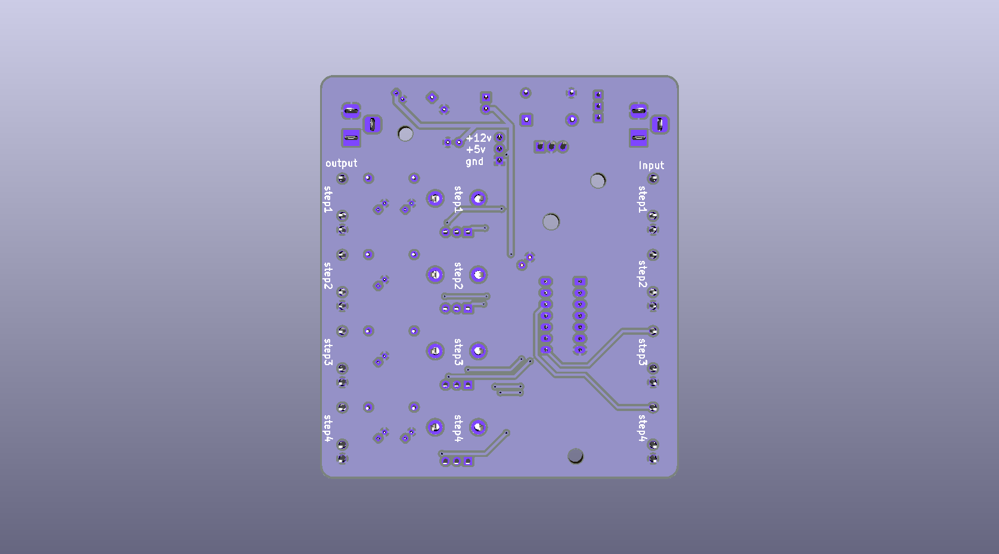

Llevo trabajando en un repositorio donde explicar de mejor manera todo este proyecto

>[!NOTE]
>
>El repositorio se ubica en https://github.com/Estrabismx/vco_4step

 

Igualmente, mientras realizaba este proyecto se me ocurrio la idea de buscar una manera de conectar el proyecto de taller, es decir, el sampler secuenciador con sintetizadores análogos. Por lo que investigaré como lograr conexiones entre este módulo con el futuro peoyecto...

 

## encargos

encargo-08a:

1. tomar muchas fotos, mínimo 3 por cada uno de los 3 elementos que estudiamos hoy: perillas, botones, y luces. subir las fotos a su README como respuesta a este encargo, y describirlas textualmente, para con esa info complejizar nuestras clases programadas este viernes.

### perilllas

| # | imagen | descripción |
| - | ------ | ----------- |
| 1 |  | Esta perilla no consta de inicio ni fin, pero el dispositivo que lo utiliza (computador) _recuerda_ la posición en la que queda. Sumado a todo esto se puede presionar, por lo que consta de un _bóton_ que se puede accionear |
| 2 | 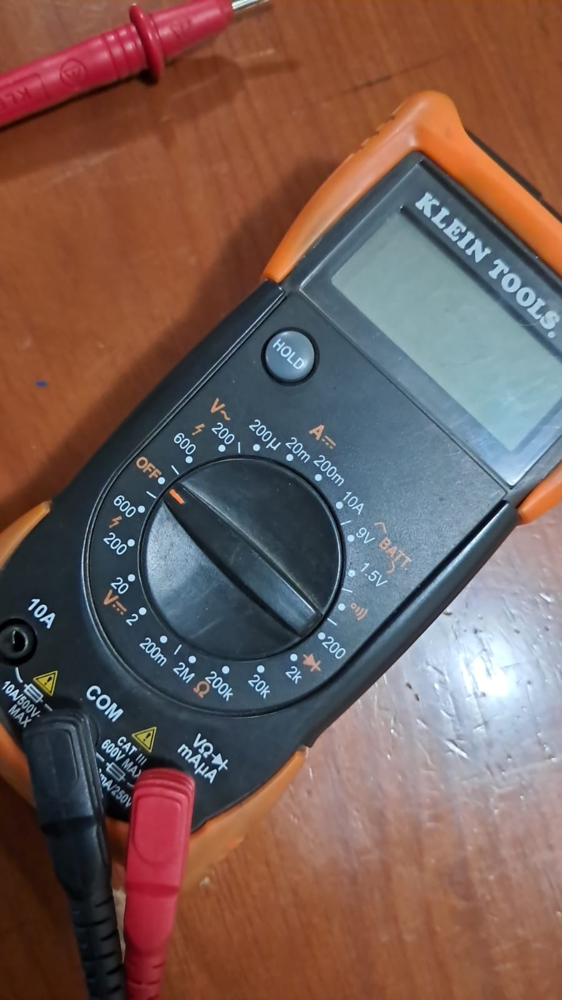 | Acá la perilla posee 20 posiciones definidas en las que puede rotar, pero además tampoco posee un inicio y un fin en su recorrido. A diferencia del ejemplo anterior, existe una sección que cumple la función de seleccionador, por lo que tiene un punto de referencia importante en su posición|
| 3 | 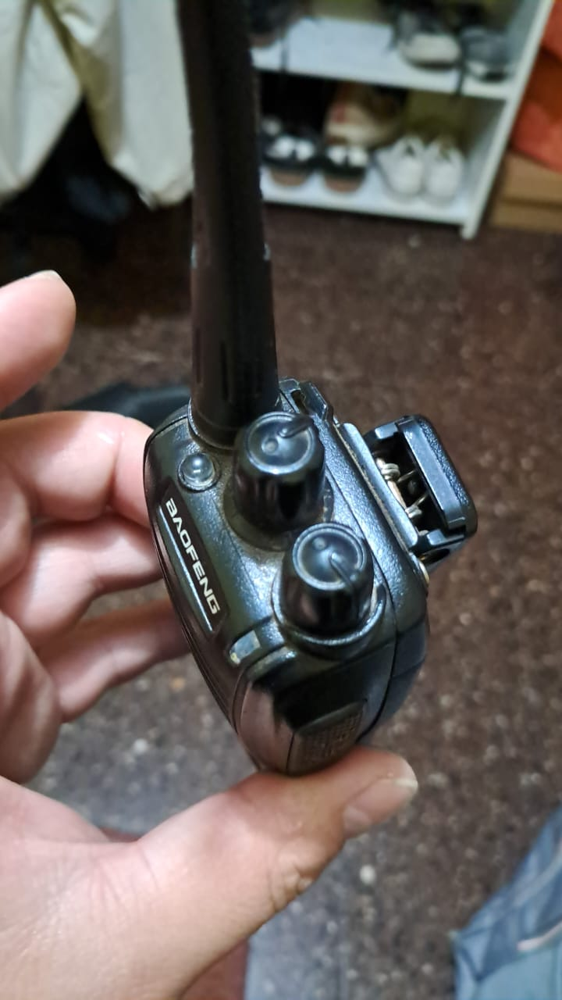 | En este caso tenemos dos ejemplos en uno. El primero corresponde a un selector de canales, muy similar al casoa anterior, la diferencia radica en que aquí si posee un inicio y fin en el recorrido   El segundo es bastante parecido a un potenciometro común, solo que acá existe una pequeña _traba_ al inicio del recorrido, que una vez superada inicia su normal funcionamiento. Esta sección sirve a modo de interruptor, ya que este controla el volumen |

### luces

| # | imagen | descripcion |
| - | ------ | ----------- |
| 1 | 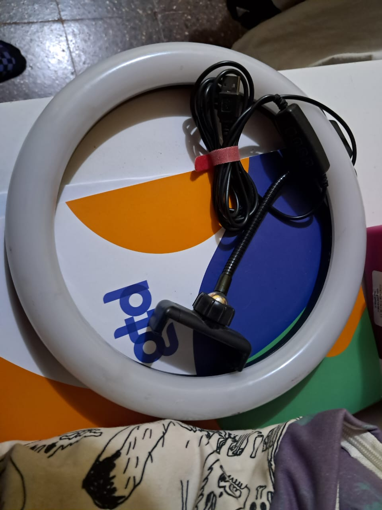 | Este aro de luz led posee 2 modos, los que van desde menor a mayor intencidad y el control de la calides de la luz. El encendido es constante, es decir que no posee ningún modo de secuencia u oscilación |
| 2 | 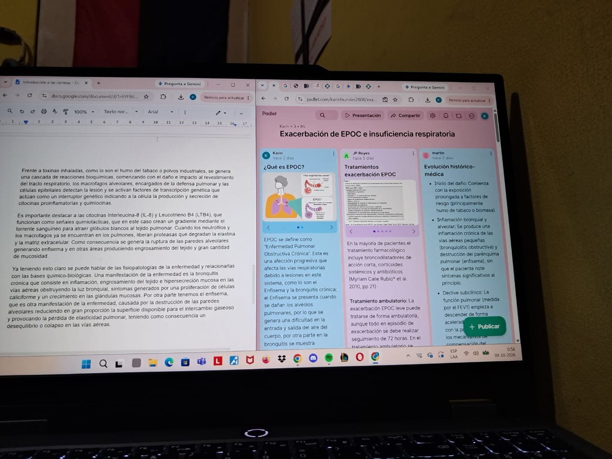 | La pantalla de un computador está compuesta de luces Red, Blue y Green. Estas según su intensidad pueden generar imagenes. Además poseen una luz blanca que "_retroilumina_", por lo que si están las RGB apagadas, igualmente se percibe algo de luz |
| 3 | 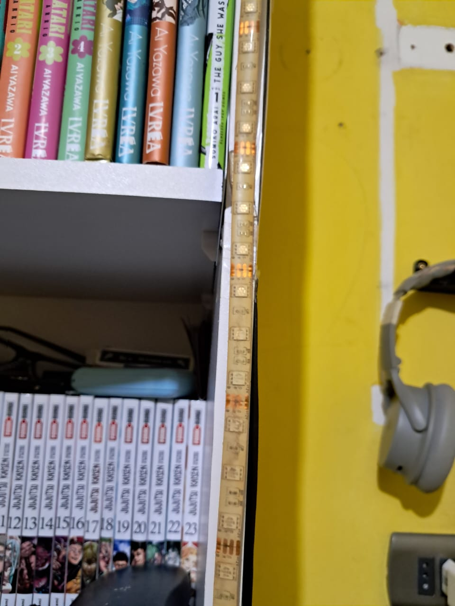 | Una tira de luces led posee 3 colores en un solo encapsulado, pudiendo controlar de manera individual cada uno de ellos

### botones 

| # | imagenes | descripción |
| - | -------- | ----------- |
| 1 | 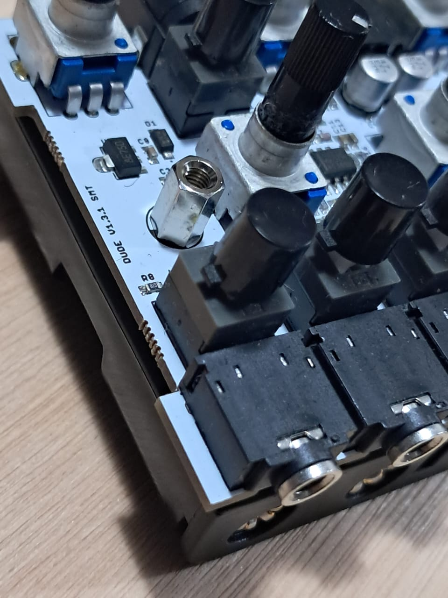 | En este caso consta de un botón que "_recuerda_" su posición. Se podría definir como interruptor |
| 2 | 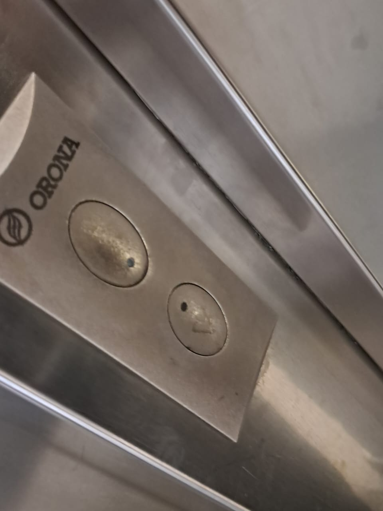 | Botón pulsador que al ser presionado mantiene encendida una luz por un periodo de tiempo variable
| 3 | 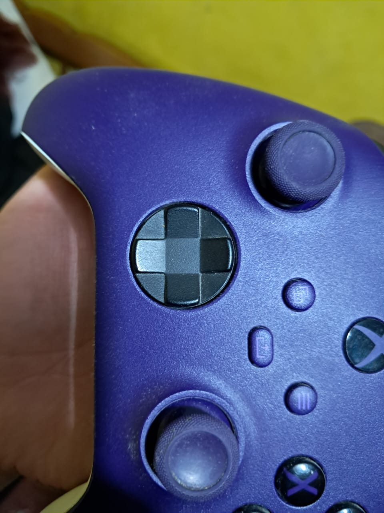 | Esta cruceta, es un conjunto de botones, que pueden ser presionados, existen 8 posibles opciones a presionar | 

### caso extra

Realizando el ejercicio me percaté y no supe como definir un Joystick, ya que permite movimiento como una perilla, pero su funcionamiento es similar a un botón que detecta presión al desplazarlo en cada dirección

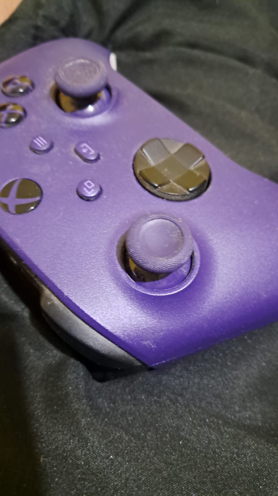

2. partir del ejemplo de hoy, que está subido en codigos/ de hoy, y hacer que las luces parpadeen. para eso, definir parpadeo de forma paramétrica.

Me fui en volá https://wokwi.com/projects/477369782983665665

 

## lectura

Antes de comenzar con información sobre la lectura, voy a comentar 2 ideas que he rondado sobre este ejercicio.

1. Me percaté que en la semana de receso al no leer, _perdí el hilo_ sobre el libro. Por lo que me hace pensar en como estructurar mi dia a dia para seguir ejercitando este hábito, pensaba en incluso volver a libros que ya he leido. Por ejemplo, cada cierto tiempo leo libros que a mis 12 - 14 años me llamaron la atención, solo por el ejercicio de leer y ver las cosas con una perspectiva diferente. 

2. Este libro me ha costado leer por la barrera del idioma, ya que normalmente me toma 1 a 2 semanas un libro de este tipo, con lenguaje medianamente técnico, no tan extenso y relacionado directamente a temas de mi interés. Considero que poseo un nivel medio de íngles pero me percaté que en contextos poco formales, esto por aprenderlo mediante convivir en internet, por ende quiero ampliar mi dominio de este idioma y especialmente en el áreas relacionadas al diseño, es por esto que aprovechando que en "_Computers that made the world_" no se utiliza lenguaje excesivamente complejo, me enfocaré en entender y comprender cada parrafo. Esto tomará tiempo y no podré leer todo el libro, pero si es necesario volver a leer cada cápitulo, hasta que tenga interiorizado y no requiera de un diccionario por una palabra desconocida en cada oración.

>[!NOTE]
>
> Quiero destacar que todos los apuntes fueron realizados durante mi estadia en un campamento scout, por lo que no fueron muy extenos, pero me enfoque en entender lo que leí (como se explica antes) y reflexionar las ideas ya mencionadas

### Vocabulario

- Sowing: sembrar
- Grab crane: grua cuchra 
- WardRobe: ropero
- straight forward: directo

### Zuse Z3

Konrad Zuse recibió un juego mecánico modular, esto fue la piedra inicial para la primera computadora binaria electromecánica.

Esta fue posible gracias que la ayuda de su familia y amigos, ya que las empresas y universidades no confiaron en su proyecto.

Esta máquina competia de igual a igual contra sus contemporáneos. Lo malo es que en Berlin no hubo tanto énfasis en estas tecnologías y diversas personas consideran que si hubiera surgido en UK o USA tendría la misma fama que la máquina de Turing o la ENIAC

Volviendo a su juventud, llego a realizar una grua cuchara que manejaba sobre su ropero, esto fue una clara muestra de su obsesión con la resolución mecánica a problemas. Sumado a esto, poseia una gran habilidad con el dibujo, es por esto que poseia diversas opciones de carreras universitarias:

- Urbanismo
- Ingeneria
- Arquitectura

Lastimosamente eligio ingeneria, pero como dicen los lolos, soltó tremendo facto _"Doric and Ionic columns left me cold"_

> Leer "The Computer - My Life"