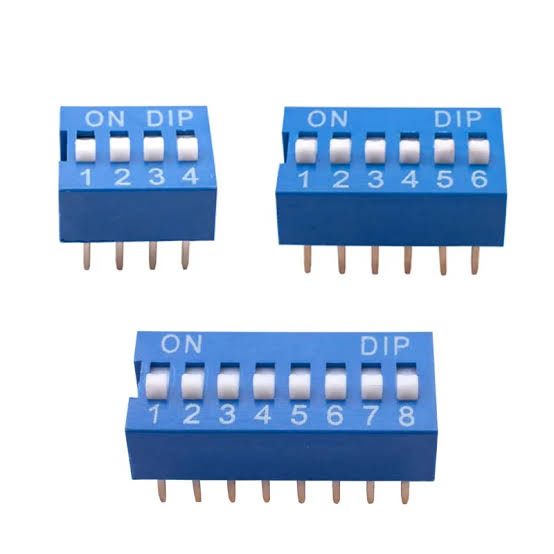
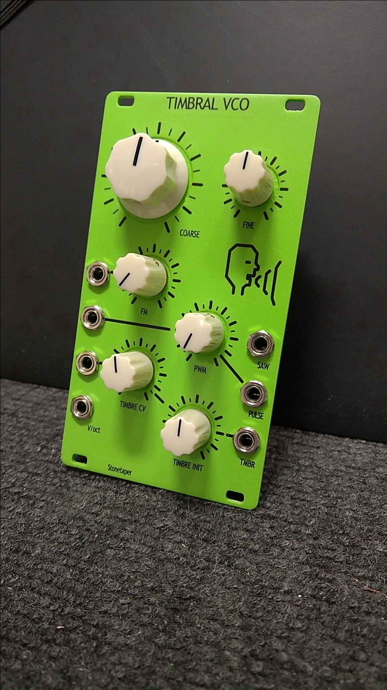
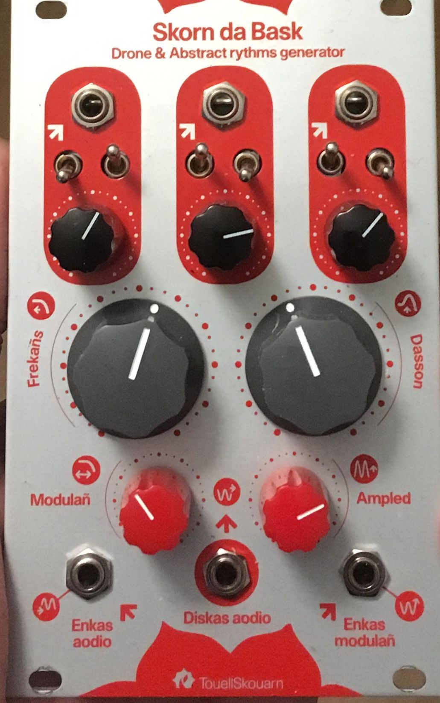
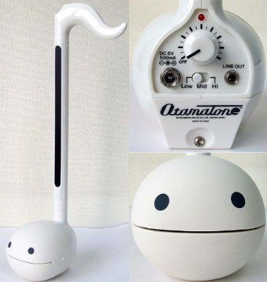
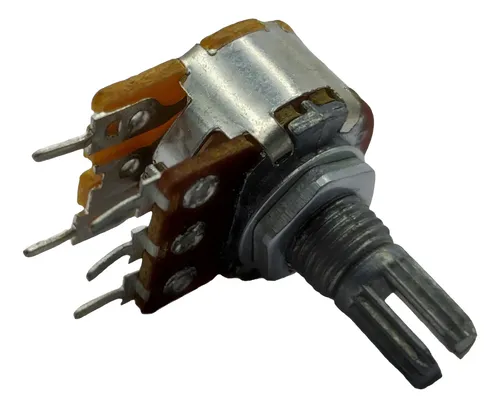
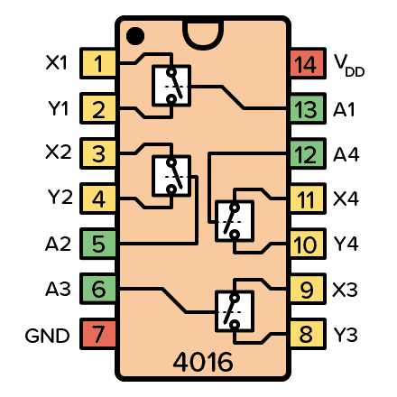

# sesion-08b

## apuntes sesión

Esta sesión fue online pipipi... Pero eso no significo que no estuviera interesante.

Iniciamos revisando el encargo de tipos de botón, perillas y luces. De esto considero relevantes los siguientes puntos:

### Latch

Corresponde a un tipo de interruptor, un botón que recuerda su estado. A diferencia de un "_pushboton_", este tipo de sensor mantiene su estado hasta que se vuelve a presionar.

Además, es una manera de programar _pushboton_, donde fisicamente el botón solo es presionado una vez y el microcontrolador recuerda el estado

 

### Dip Switch

Siguiendo con la línea de interruptores, se mencionaron la existencia de los "_dip switch_". Estos corresponden a un encapsulado con múltiples interruptores, posee un tamañao similar a un integrado

 

### Tamaños > Función 

Existe una relación directa entre el tamaño y su función, en este caso, su importancia (parece ser que existe una relación entre forma y función). Dentro de esto tambien podemos mencionar la relación de colores con significados, como puede ser:

- Rojo: _atao_
- Verde: _todo bien_ / _estoy prendido_
- azul: _estoy prendido_ / _hay corriente_

 

### Pote + switch

En algunos objetos es importante que algo se mantenga encendido, además que pueden controlarse 2 elementos con un solo elemento.

Por ejemplo, en los _otamotone_ se enciende al subir el volumen, ya que el potenciómetro posee una sección que sirve de interruptor, a este se le conoce como:

- Potenciómetro con switch de 5 pines

 

### MAX7219

### Multiplexores (mux - demux)

### CD4051

> 8 canales > 3 selectores

### pwm slice

### rising edge

### CD4016

Mientras fundia mi cerebro observando reels de Instagram, me apareció un video interesante [LINK](https://www.instagram.com/reel/DeFCKFeoP2W/?srtk=MTJmczB3b2NmM3J3NQ==)

Este video se observa un sintetizador que posee "_botones_", es decir, 4 SPST. Tambien es conocido como Conmutador analógico cuádruple

## encargos

Me quise ir en volá xd, ya que sé que veremos KiCad y realizaremos el esquema y pcb del microcontrolador del raspi, descargue el repo [franbu](https://github.com/piruetasxyz/frambu) de [piruetas.xyz](https://github.com/piruetasxyz) donde hay una plantilla para trabajar con dicho chip.

>Tarea propia, investigar sobre el chip y como se relaciona con la placa de desarrollo  

## lectura
