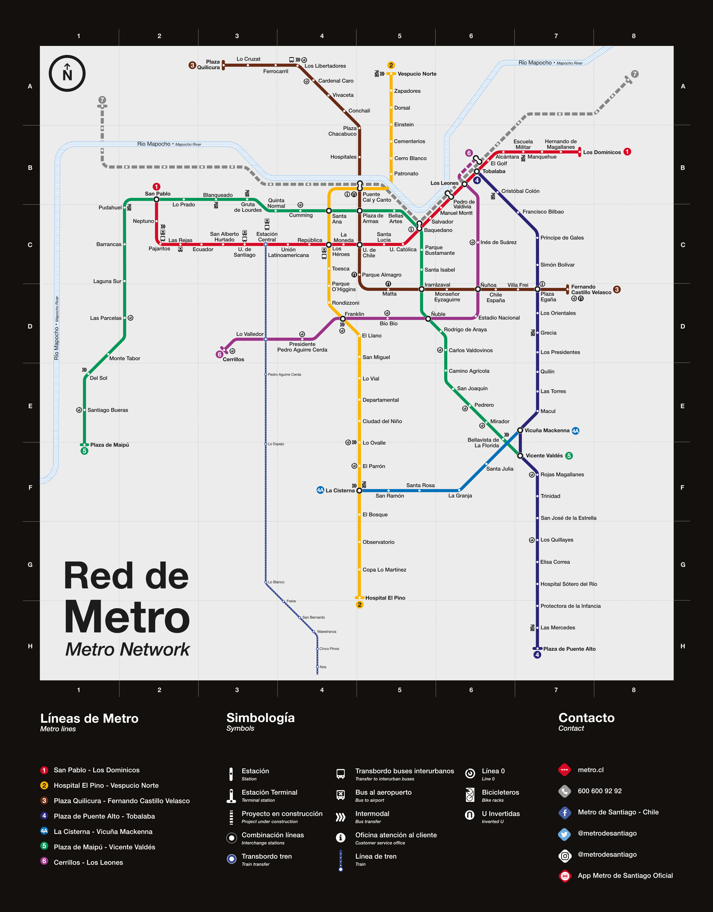
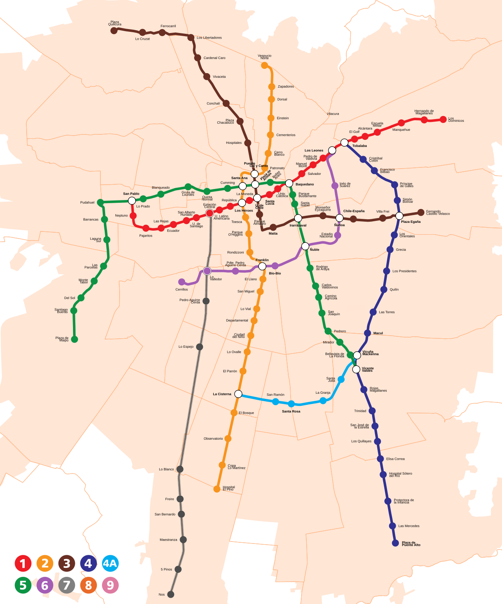
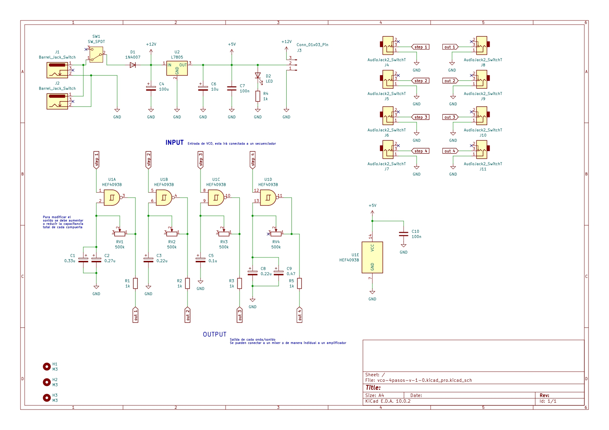
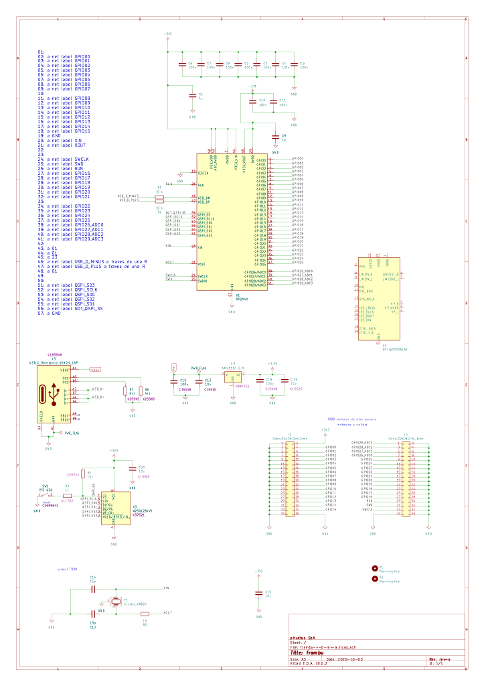
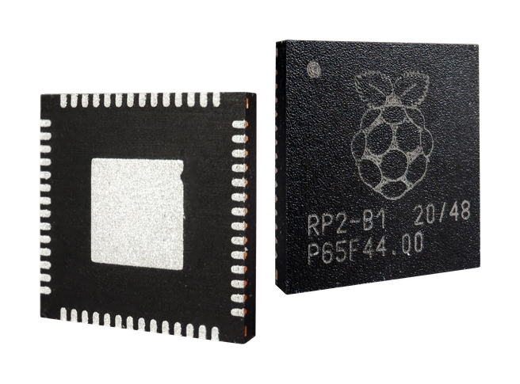
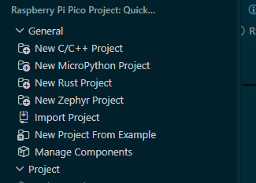

# sesion-09a

## apuntes sesión

### SemVer

El Versionado Semantico corresponde a un estándar de numeración de software con el formato `x.y.z`

- `x` (MAJOR) Cambios grandes que hacen incompatible el uso con otra versión que no posea el mismo número
- `y` (MINOR) Son funciones menores que no generan problemas directos con diferentes versiones
- `z`(PATCH) Son correcciones de errores o `bugs`

 

El ejemplo que se me vino inmediatamente a la mente fueron las versiones de Minecraft Java

Ya que tenemos la `1.4.2`, la `1.12.1` o `1.21.5`. Estas son conocidas en la comunidad por sus índices `x.y` mayoritariamente, pero en sectores más especializados al área técnica de este videojuego es importante el dígito `z`, ya que diversos `exploit` aprovechan errores o inconsistencias especificas

> Mi versión preferida siempre será la 1.7.2
>
>> Recuerden no descargar nada de Softonic :( 

 

### Esquemáticos

Dedicamos parte de la sesión a entender la representación conceptual que son los esquemáticos. Estos estan cercanos a lo que es el mapa del Metro de Santiago que conocemos

 

Como observamos, el mapa que es el utilizado oficialmente difiere del segundo que se ve, ya que este no deja de ser una abstracción que permite comprender las conexiones entre puntos/nodos.

En el caso de la electrónica tenemos elementos similares, estos nos indica que puntos electricos se conectan entre si

En los próximos proyectos haremos este simil de instructivo de las conexiones que tendrá nuestra Raspberry Pi Pico

 

### RP2040

Este IC corresponde al cerebro principal de nuestra _Raspi_, en el futuro desarrollaremos la placa/PCB que va alojar este chip

 

### Post clase

Quise intentar cargar mi código de Wokwi en una Raspberry Pi Pico 2W, para ello traté de descargar los archivos y utilizar la opción de `Import Project` 

> 

Esto salió mal, tuve muchos problemas para lograr compilarlo

Finalmente por consejo de Aaron, probe un código simple de _`Led Blink`_. Además de crear todo el projecto desde 0 con la opción `New C/C++ Project`.

Al probar este ejemplo y siguiendo las instrucciones de Gemini logré hacer funcionar el led. El problema vino cuando quise probar el código de [Wokwi](https://wokwi.com/projects/477369782983665665)

Intente conectar mi Raspberry Pi Pico 2W, solo que al conectarla en mi computador, este ya no la leía ni encendia el led. Obviamente me asuste y creí haber quemado la placa, probe conectando otra Raspi que encontré en el LID, y está si lo reconocio.

Seba me recomendó que buscara como resetear la Raspi para probar si se solucionaba el problema de conexión. Al consultarlo en Internet, me recomendó:

"_Reinicio_

_1. Desconecta el cable USB del Raspberry Pi Pico 2W._
_2. Mantén presionado el botón BOOTSEL en la placa._
_3. Conecta el cable USB a tu computadora mientras sigues presionando el botón._
_4. Suelta el botón BOOTSEL. Aparecerá una unidad de almacenamiento masivo en tu computadora llamada RPI-RP2."_

Una vez que mi computador ya reconoció la raspi, pude cargar el código funcional

https://youtube.com/shorts/g2rrdvaafEE 

## encargos

## lectura

### Colossus

- shrouded: oculto
- unsung: anónimo
- embassy: embajada
- thermionic: termoiónica (efecto Eddison)
- briefly: brevemente
- weaponry: armas
- cipher: cifrar

Colossus estuvo bajo el mayor de los secretos, ya que su origen se remonta a la 2da guerra mundial. Es por esto que erroneamente se le considera a la ENIAC el origen de la computación moderna. 

Lo impresionante de esta computadora era el uso de tubos de vacio, los precursores de los transistores (el componente que sostiene la electrónica actual), este genero mucha desconfianza entre sus pares, ya que es similar a un foco incandescente

Otro punto importante fue su velocidad de procesamiento, calculando 5000 caracteres por segundo, los que obviamente para la época se _redactaban_ en hojas perforadas, en estas se definian los caracteres mediante perforaciones, pudiendo albergar cerca de 80 bytes por tarjeta

---

>Lastimosamente no he podido avanzar y profundizar lo suficiente en la lectura, mi estado de salud no es el mejor estos dias la verdad

---