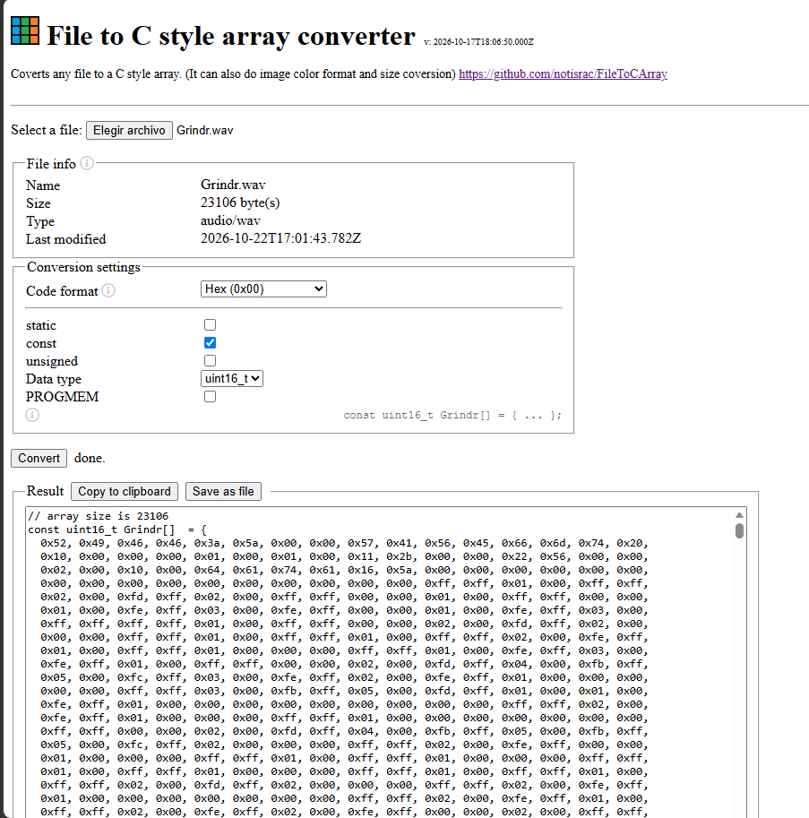

# sesion-10a

## apuntes sesión

En esta sesión, se trabajó con modalidad online y fue una revisión grupal. En nuestro caso, fuimos los 3eros en ser revisados. Igualmente estuve al tanto de lo que se escribia por Discord, donde revise lo que enviaron

- [Display 4 Matriz Led Verde 8x8 Max7219 SPI](https://afel.cl/products/display-4-matriz-led-verde-8x8-max7219-spi)

Esta matriz de led utiliza un multiplexor, es decir que mediante 2 canales se envia información para controlar cada led, de esta manera no debemos tener 256 canales (total de leds)

 

- [Allison Parrish: Recent and Selected Work](https://portfolio.decontextualize.com/)

Compilado de proyectos de Allison, muchos de ellos trabajan con el IC 2040. Recordando este microcontrolador corresponde al cerebro de la Raspberry Pi Pico

> [Allison’s Bootleg Cart](https://abc.decontextualize.com/) Me encantó, ya que mi cariño por el mundo de los videojuegos, pero más específicamente por el _modeo_ o la realización de elementos para _hackear_  hardware retro. Espero profundizar esto en algún momentp

 

- [Sam Lavigne](https://lav.io/) 

Recuerdo que aaron me enseño esta web portafolio y más específicamente https://lav.io/projects/new-york-apartment/. Acá Sam recopila **todos** los datos de arriendo y estructura una lógica de visualización de datos interactiva, pudiendo "fusionar" todos los departamentos en uno, calculando cuando te demorarias en pagar cada uno, etc...

Este portafolio lo tengo constantemente en mi memoria, ya que es un gran referente de las cosas que se pueden llegar a lograr con el código

 

- [How to speak machine](https://drive.google.com/file/d/1jdlTussK-nnjx7-pNHt1AHZHUXFPDMnk/view)

Este libro puede servir para entender la lógica detrás de lo que es y no es un computador personal, concepto clave del proyecto-02

 

- [Bleep-Drum](https://github.com/BleepLabs/Bleep-Drum)

Desarrollaron una máquina percusiva que utiliza 4 sonidos y 2 modificadores. Este referente es clave para lo que queremos lograr, igualmente nos acercamos a la versión que está en el LID para explorar y ver las posibilidades de lo que es posible

Utiliza un microcontrolador ATM, más exactamente el que utilizaban los Arduino Uno R3

 

- [oficina del sonido](https://www.oficinadesonido.org/)

Referente similar al anterior, no profundizo aún en este. Lo dejo para un futuro

 

- [Windows 95](https://www.youtube.com/watch?v=I3Ak5VgyEoc)

El sonido de inicio de Windows 95 desarrollado por Brian Eno nos plantea el oceano de infinidades que pueden ocurrir en pocos segundos. De esto, además consideramos el como la sonoridad evolucionó con la computación

 

## encargos

### MAX98357A

Como parte del desarrollo del proyecto, tratamos de realizar pruebas de audio con el MAX98357A, el cual es un chip que amplifica el audio bajo el protocolo I2S

Este posee 5 pines:

| n° | pin | funcion | GPIO |
| -- | --- | ------- | ---------- |
| 1  | VIN | corresponde a la alimentación de la placa, funciona con 2.5V a 5.5V | VBUS |
| 2  | GND | ground | GND |
| 3  | BCLK | Bit Clock, reloj de bit continuo para sincronización de bits de audio | 26 |
| 4  | LRC | World Select, reloj que define entre L y R | 27 |
| 5  | DIN | Data In, datos de audio **multiplexada** | 28 |
| 6  | GAIN | ganancia de +9dB estándar | ❌ |
| 7  | SD | Shutdown / Mode,  sin conectar mezcla L + R | ❌ |

### audio.h

Para transformar archivos de audio en un conjunto de datos legibles para un microcontrolador, se utilizo el formato RAW al que traducimos en un _`array`_  para C. Esto se logró gracias a [ File to C style array converter](https://notisrac.github.io/FileToCArray/)

Y como se ve en la imagen, esos fueron los parametros que se utilizaron para tener un `array`, el que luego fue utilizado mediante `#include`

## lectura

### Complex Number Calculator

- Mercury arc telephone: Teléfono de arco de mercurio. Tecnología temprana de telecomunicación de alta potencia que utilizaba válvulas de arco de mercurio para manejar señales eléctricas

- Enhanced: Mejorado

- Effort: Esfuerzo

- Pursuit: Búsqueda

- Oil drop: Gota de aceite

- Wherewithal: fondos para realizar un proyecto

- Whilst: Mientras

- Nailed: Logradp

- a+bi: Notación de números complejos (a es el natural y bi el imaginario)

- Rather: Bastante

- Decipher: Descifrar

- Squiggles: Garabatos (lineas xd)

- Floating-point numbers: Corresponde a los decimales, es lo mismo que la variable `float`

- Debugging: Proceso de identificar, aislar y depurar `bugs`

- Wastebasket: Papelero

 

En este cápitulo se nos plantea nuevamente una gran dificultad humana, calcular números complejos. Como viene siendo en otras ocasiones, el ser humano está destinado a realizar operaciones matemáticas.

A raiz de esto nace la "Modelo I", a fines de los años 40 (años complejos para el mundo en general), está es una máquina electromecánica ya que funciona mediante relés. Esta fue una transición de las máquinas calculadoras mecánicas de engranes

Algo bastante relevante fue el `Modelo K`, este fue construido en el año 1937 por George Stibitz reciclando componentes de otros aparatos, tal como lo fuerón los relés de telefonos de su anterior trabajo en Bell Labs. El hito de esto fue la utilización de la lógica de Boole (o lógica boolena) para crear una máquina sumadora en *base 2*, algo tan importante que hoy en día el computador en el que estoy redactando esto, la utiliza...

Quiero rescatar algo bastante curioso, su nombre proviene de que la realizó en su **K**itchen

> "Lo denominé 'Model K' porque lo construí sobre la mesa de la cocina (kitchen table) de nuestra casa"
>
>>George Stibitz

Este libro me hace plantearme diversas preguntas, una de las más relevantes es ¿Que es un computador? me gustaría llegar al nivel de estudio para proponer mi visión, ya que por lo que he visto en el libro, existen muchaaaaaaas visiones...