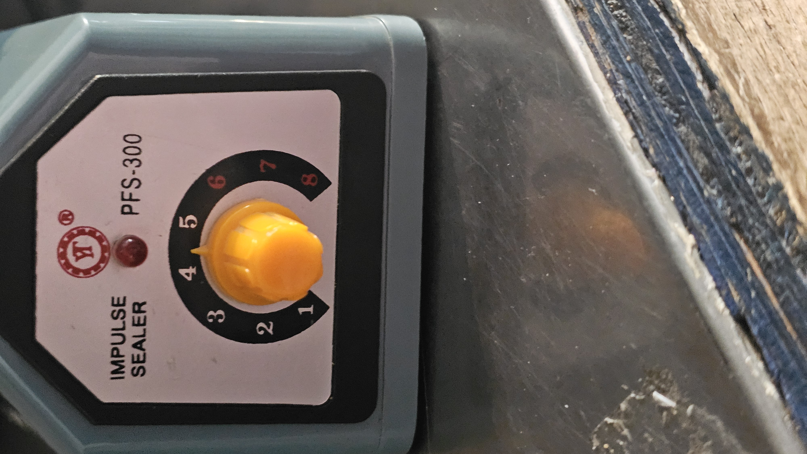
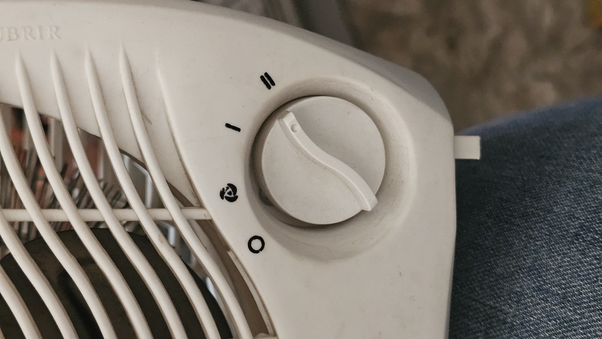
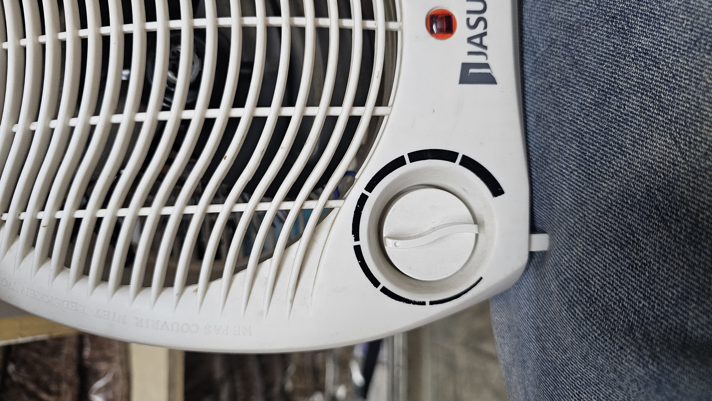
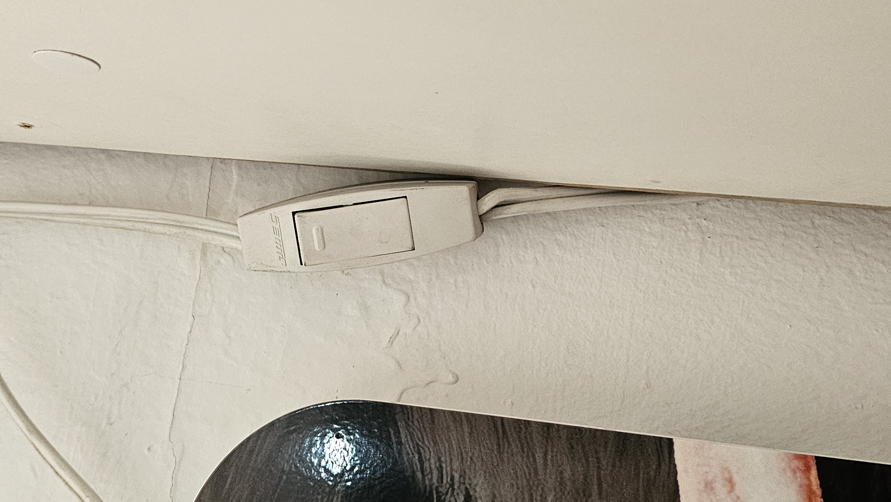
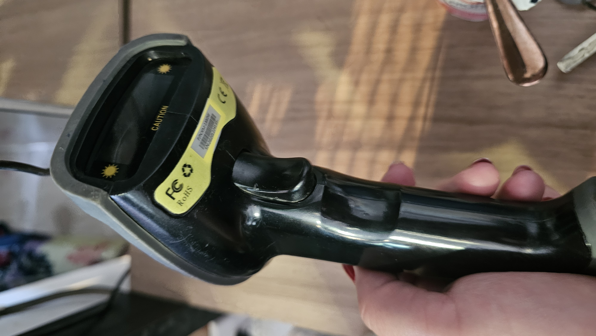
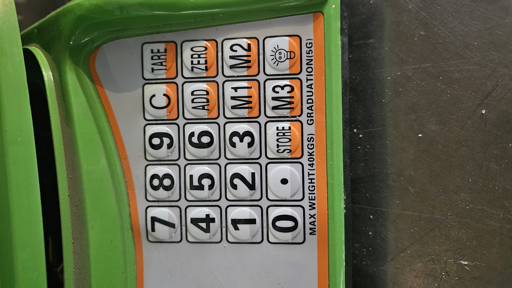
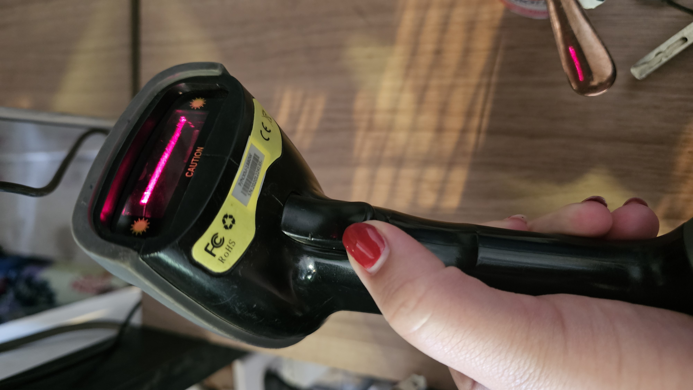
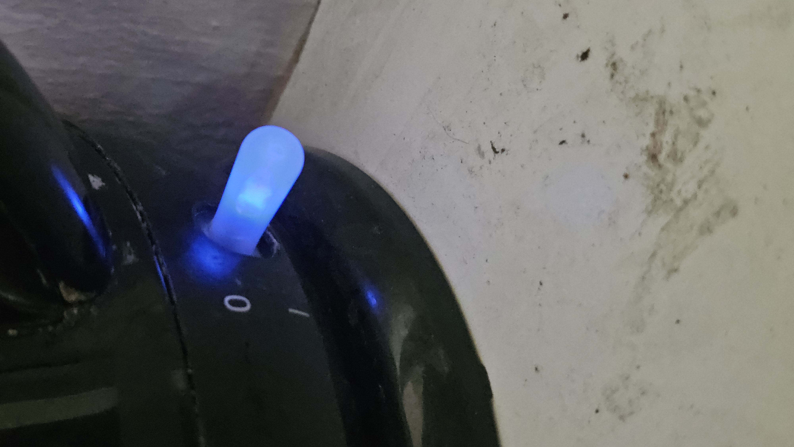

# sesion-08a

## apuntes sesión

### Repaso: la lógica de las clases

En esta clase se repasó cómo pensar con clases antes de meterse al código.

- **Clase**: una categoría general, no una cosa concreta. Ejemplo de la clase: "persona" es la clase, y Isi es una persona, o sea, un objeto de esa clase. Nadie se llama "persona".
- **Modelar**: hacer una aproximación burda de la realidad. No lo vamos a trabajar tanto.
- **Crear y clasificar**: con una clase se crean objetos y se agrupan por categorías.
- **Atributos**: lo que tiene el objeto; funcionan como diferenciadores entre un objeto y otro.
- **Métodos**: lo que hace el objeto (su función).
- **Constructor**: el método que crea objetos a partir de la clase. Se ejecuta una sola vez, al crear el objeto, y le da sus valores iniciales.

Flujo: clase → constructor → objeto → atributos (cómo es) + métodos (qué hace)

**OOP** (Object Oriented Programming, programación orientada a objetos): en vez de escribir instrucciones sueltas, se crean objetos con sus propias características y acciones. Así el código queda ordenado y no se repite.

---

### El LED como clase

Un LED se puede pensar como una clase con variables como:

- **Encendido o apagado**
- **Parpadeo**
- **Umbral**
- **Brillo**

Con un solo molde (`Lucecita`) se pueden crear varios objetos:

```cpp
Lucecita luz(6);     // un LED en el pin 6
Lucecita luzDos(5);  // otro LED en el pin 5
```

---

### Archivos .h y .cpp

Cada clase se separa en dos archivos.

| Archivo | Qué hace | Idea |
|---|---|---|
| `.h` (header) | Declara qué tiene y qué puede hacer la clase | Las "promesas" |
| `.cpp` | Escribe cómo hace lo que promete | El código real |
| `main.cpp` | Usa las clases con `#include "Lucecita.h"` | Lo que el programa hace |

- **Include guard**: cada `.h` empieza con `#ifndef NOMBRE_H` y `#define NOMBRE_H` y termina con `#endif`. Evita que el archivo se cargue dos veces y cause errores.
- **Prefijo `Lucecita::`**: en el `.cpp` indica que la función pertenece a la clase.

Orden para escribir: `.h` primero → `.cpp` después → repetir con cada clase → `main.cpp` al final

---

### Wokwi: botón + perilla + luz

En clase se hizo un ejercicio en Wokwi para programar un botón, una perilla y una luz funcionando juntos.

- Wokwi de la clase: https://wokwi.com/projects/477140774861255681
- Material complementario, las clases `Perilla` y `Boton`:
  - https://github.com/piruetasxyz/Perilla
  - https://github.com/piruetasxyz/Boton

**ADC** (conversor analógico-digital): el potenciómetro (la perilla) entrega valores de 0 a 4095. Eso es resolución de 12 bits: 2^12 = 4096 valores posibles, en binario.

---

### Caja negra

Se le llama **caja negra** a cualquier sistema o aparato cuyo funcionamiento interno no se conoce, poniendo el énfasis en lo que entra (input) y lo que sale (output).

Flujo: input → caja negra → output

---

### Referencias que se mencionaron en clase

- **Wikidata**: la base de datos de Wikipedia.
- Marc Augé, *Los no lugares*: https://designblog.uniandes.edu.co/blogs/dise2609/files/2009/03/marc-auge-los-no-lugares.pdf
- Vilém Flusser, *Hacia una filosofía de la fotografía* (sobre la filosofía de las cajas negras): https://monoskop.org/images/8/8d/Flusser_Vilem_Hacia_una_filosofia_de_la_fotografia.pdf

---

## Encargos

1. Tomar muchas fotos, mínimo 3 por cada uno de los 3 elementos que estudiamos hoy: perillas, botones y luces. Subir las fotos al README como respuesta a este encargo y describirlas textualmente, para con esa info complejizar las clases programadas de este viernes.

| Tipo | Objeto | Foto | Características |
|---|---|---|---|
| Perilla | Selladora de plástico |  | Perilla que regula el calor con que se sella la bolsa; va de 1 a 8. |
| Perilla | Calefactor (perilla de intensidad) |  | Perilla que regula la intensidad, o sea la velocidad con que sale el calor, y también el encendido y apagado. |
| Perilla | Calefactor (perilla de temperatura) |  | Otra perilla del mismo calefactor, que regula la temperatura. |
| Botón | Interruptor de la luz LED de la vitrina |  | 	Interruptor que prende y apaga la luz LED que alumbra una vitrina chica. |
| Botón | Pistola lectora de códigos QR |  | Botón que, al apretarlo, prende el LED con el que se escanea el código. |
| Botón | Gramera |  | Botones y números para manejar la gramera. |
| Luz | Pistola lectora de códigos QR |  | LED que se prende cuando se aprieta el botón, para escanear. |
| Luz | Tetera |  | LED azul asociado a la palanquita de los botones. |
| Luz | Vitrina pequeña |  | Luz LED azul que alumbra una vitrina chica. |


---

## Lectura

**John Cage, *Anarchy*** (págs. 14 a 31, secciones 4, 5 y 6)

- *Qué entendí*: en estas páginas el texto habla de la libertad de cada persona y de que la libertad de uno depende de la libertad de todos. Se plantea un mundo con menos gobierno, menos poder y menos fronteras entre países, donde los recursos y la tecnología se comparten para que todos tengan lo que necesitan y puedan vivir libres. Me quedé con la idea de que el cambio no se logra con la fuerza, sino de a poco, cambiando la forma de organizarnos. También aparecen la plata, los negocios y la tecnología como cosas que hoy ponen límites a esa libertad. Para armar este resumen me ayudé con IA.
- *Cita interesante*: "we have only one mind" (p. 23), que en español sería "solo tenemos una mente". La entiendo como que todas las personas compartimos una especie de mente común, así que lo que le pasa a uno nos toca a todos y la libertad de cada uno no se puede separar de la libertad de los demás. Es mi interpretación, porque como el texto está armado con frases recortadas, cada una puede entenderse de diferentes formas.
