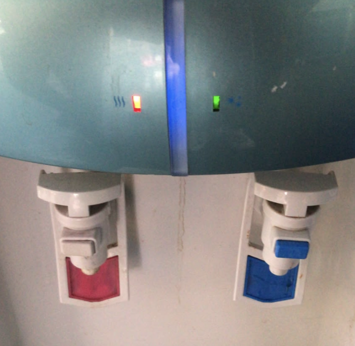
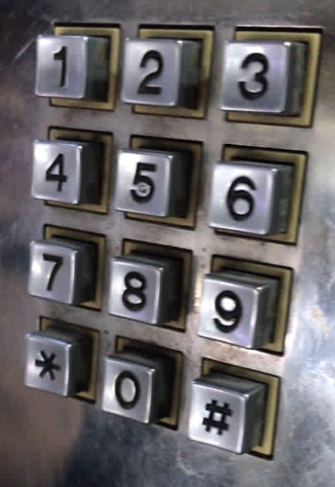
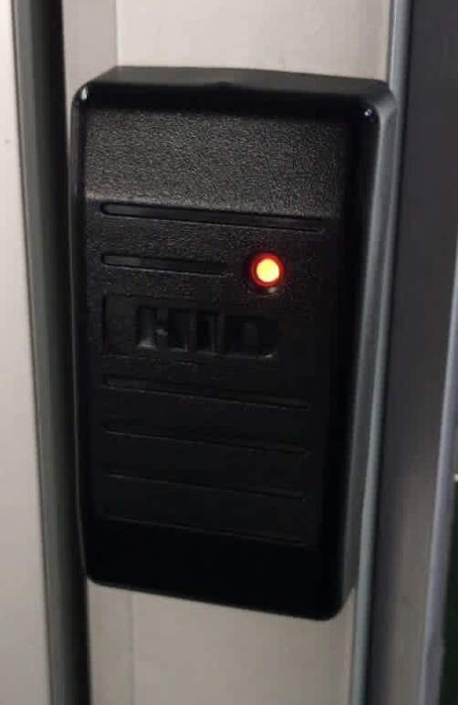
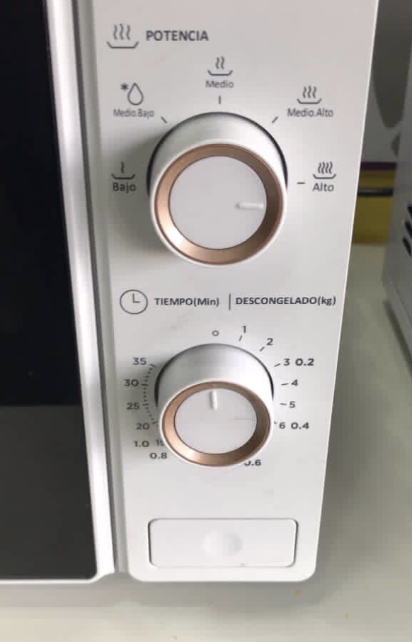
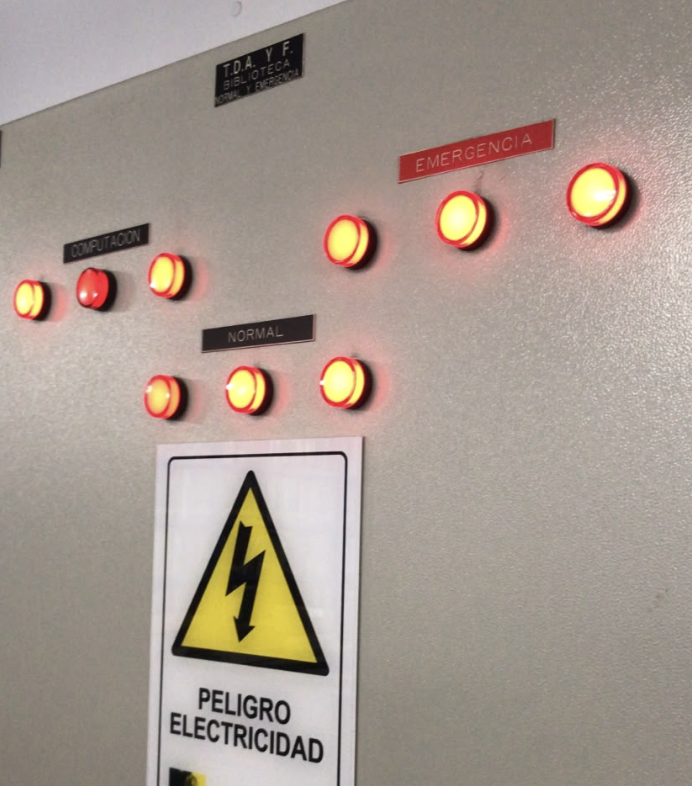

# sesion-08a

## apuntes sesión

En esta clase hablamos del constructor, que sirve para crear objetos a partir de una clase y darles los valores iniciales que necesitan. 

+ Una forma fácil de reconocerlo es que tiene exactamente el mismo nombre que la clase

```cpp
class Lucecita {
public:

    Lucecita() {
        
    }
};
```

En este caso, Lucecita() es el constructor porque se llama igual que la clase. Es parte de lo que permite crear objetos de ese tipo.

-. Clase Lucecita

Vimos como ejemplo una clase llamada Lucecita. Para crearla, primero tenemos que pensar qué características necesitamos guardar sobre ella.

Por ejemplo, podemos saber si está encendida o apagada, qué nivel de brillo tiene y si está parpadeando.


```cpp
class Lucecita {
public:
    bool encendido;
    int brillo;
    bool parpadea;
};
```

+ Encendido: usamos bool porque solamente existen dos posibilidades: true, si está encendida, o false, si está apagada.

+ Brillo: usamos int para guardar un número que represente el nivel de brillo.

+ Parpadeo: también usamos bool, porque necesitamos saber si la lucecita está parpadeando o no.

+ Estas características son los atributos de la clase, es decir, la información que podemos guardar sobre cada objeto.


-. Crear muchas lucecitas

Podemos crear muchos objetos que pertenezcan a una misma clase. Por ejemplo:


```cpp
Lucecita luzNavidad[100];

```
Los corchetes indican cuántos elementos queremos crear. En este caso, estamos creando un conjunto de 100 lucecitas.

Aunque todas pertenecen a la misma clase, cada una puede tener sus propios valores. Una puede estar encendida, otra apagada y otra tener un nivel de brillo diferente.

-. Ejemplo del Espanta Cuco

También vimos el ejemplo de un Espanta Cuco y pensamos qué elementos podría tener

```cpp

int precio;
Lucecita lucecita;
Sensor sensor;

```

La idea es que una clase puede contener objetos que pertenecen a otras clases. Por ejemplo, un Espanta Cuco podría tener un precio, una lucecita y un sensor.

Esto permite crear objetos más complejos a partir de componentes que ya definimos anteriormente, sin tener que construir todo desde cero.

-. LEDs y resistencias

Repasamos que, cuando conectamos un LED a un circuito, normalmente necesitamos una resistencia que limite la corriente para evitar dañarlo.

Algunos valores comunes de resistencias son:

220 Ω

1 kΩ

El valor que necesitamos depende del circuito y de sus componentes. Lo importante es entender que debemos controlar la corriente que pasa por el LED para que funcione correctamente.

-. Potenciómetro

El potenciómetro es un componente que permite variar un valor eléctrico al mover su perilla. Tiene tres terminales y, cuando se utiliza como divisor de voltaje, permite obtener distintos voltajes según la posición en la que se encuentre.

En esta configuración, generalmente no necesita una resistencia externa adicional para funcionar como divisor de voltaje, aunque el circuito completo puede requerir otros componentes.

El valor que entrega se puede leer como una entrada analógica en la placa. Esto permite utilizar la posición de la perilla para controlar otras cosas, como el brillo de un LED.


## encargos

encargo-08a:

1. tomar muchas fotos, mínimo 3 por cada uno de los 3 elementos que estudiamos hoy: perillas, botones, y luces. subir las fotos a su README como respuesta a este encargo, y describirlas textualmente, para con esa info complejizar nuestras clases programadas este viernes.

   
   
Encontré este dispensador antiguo en una oficina y cuenta con dos tipos de botones que funcionan a presión, ubicadas en la salida del agua. Al presionar cada botón activa la salida del agua correspondiente. Además, el dispensador incorpora dos luces indicadoras, una verde y otra roja, que identifican el agua fría y caliente. 

   

Un panel numérico de un teléfono antiguo,  compuesto por doce botones cuadrados que funcionan a presión, organizados en cuatro columnas y tres filas. Los botones incluyen los números del 1 al 9, además de los símbolos * y #, y el número 0. Cada botón presenta el número en su superficie.
   
   

Este es un sensor de acceso para puertas, es rectangular de color negro. En la superficie tiene un área para la lectura de tarjetas de acceso y permite desbloquear y abrir la puerta mediante el contacto de una tarjeta. Además, cuenta con una luz LED roja que funciona como indicador visual, roja cuando esta cerrado y verde cuando se abre. 

   

Es un microondas que cuenta con dos perillas que se giran, ubicadas en el panel de control. La primera permite regular el nivel de potencia y tiene indicadores con las opciones bajo, medio bajo, medio, medio alto y alto. La segunda perilla permite seleccionar el tiempo, con una escala en segundos que llega hasta 30, e incluye una escala de peso de 1 a 6 kilos. En la parte inferior del panel se encuentra un botón rectangular que, al presionarlo, permite abrir la puerta del microondas.

   

Este es un panel eléctrico de una biblioteca y es una estructura rectangular de color gris. En la parte superior indica “Computación”, acompañado de tres lED luminosos circulares de color rojo, que se encuentran encendidos. Al lado se encuentra una sección identificada como “Emergencia” y esta en rojo, también tiene tres LED encendidos de color rojo. Abajo dice "normal" y también cuenta con 3 LED de color rojo encendidos. El panel también incluye un cartel de advertencia con forma triangular, con un símbolo de un rayo y el texto “Peligro electricidad”, indicando riesgo eléctrico.

3. partir del ejemplo de hoy, que está subido en codigos/ de hoy, y hacer que las luces parpadeen. para eso, definir parpadeo de forma paramétrica.

## lectura


