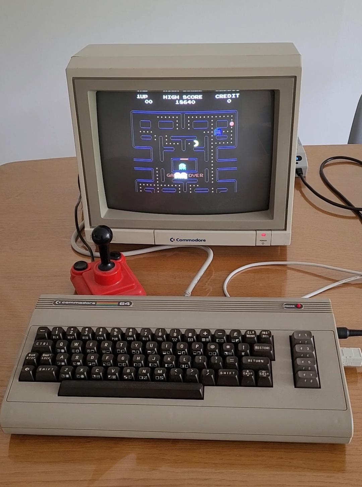
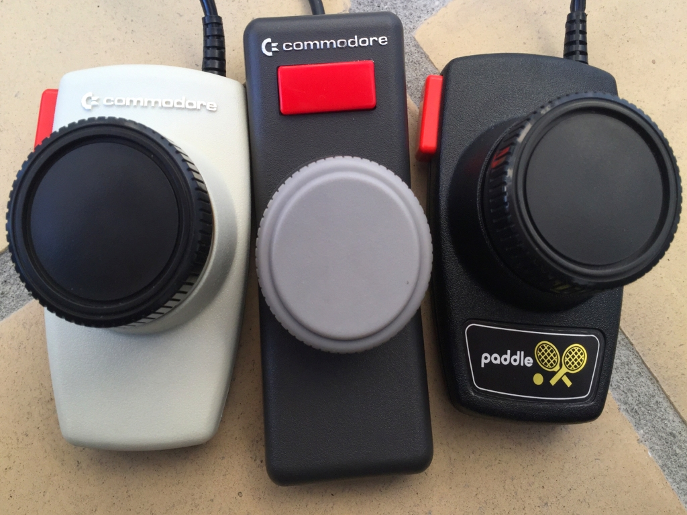

# sesion-09b

16-10-2026

## apuntes sesión

Estoy actualizando con apuntes que tengo de clases anteriores y las lecturas del libro, porque la práctica y algunas investigaciones individuales con código y cosas extra me han atrasado, pero dejaré la bitácora lo más completa posible con la mayoría de las cosas que tengo.

En esta sesión recuerdo que fui a clases y, con los compañeros de los dos grupos, vimos qué lugar habíamos elegido. En nuestro caso elegimos la perilla, por lo que a nuestro grupo acompañante le tocó la clase de los botones.

En verdad, no fue muy extensa la clase, ya que transcurría una marcha afuera y no sabía que la U estaba en paro o.O, por andar en otro mundo.

Sin embargo, revisé con ayuda de la IA un poco de las clases que habíamos hecho anteriormente con Wokwi y le pregunté al profesor de nuevo qué significaban los archivos .json, que vienen de **JSON (JavaScript Object Notation)**. Es un formato de texto ligero y estandarizado que se utiliza para almacenar e intercambiar datos de forma estructurada. Esto nos sirve para trabajar con el lenguaje que venimos estudiando en Procesos, que vendría a ser C++, para utilizarlo en la Raspberry.

Y una cosa extra: para crear imágenes con IA ayuda bastante poner una foto de referencia y pedirle que utilice una estructura en formato JSON para que las instrucciones sean más precisas, además de tomar en cuenta la referencia visual. Ahí como dato, porque me salió en un TikTok.

Ahora, sé que para esta clase nos pidieron investigar sobre un computador en específico y con nuestro grupo nos estuvimos hablando e indicando cuál computadora nos serviría y, como en el transcurso se nos ocurrió hacer una especie de juguete Etch A Sketch, pero digital, ya que es algo experimental y con él podemos usar lo requerido, que son 2 potenciómetros y 2 botones, pues elegimos el: COMMODORE 64. También teníamos otro que era el THEC64 Mini, pero yo investigaré más el COMMODORE 64, ya que se podían utilizar controles llamados **paddles**, que funcionaban mediante potenciómetros y es muy parecido a lo que queremos utilizar.

### Commodore 64 al Etch A Sketch digital: evolución del control gráfico mediante potenciómetros

### COMMODORE 64

  

- Computador elegido: Commodore 64
- Fabricante: Commodore Business Machines
- Año de lanzamiento: 1982
- Tipo: computador personal de 8 bits
- Relación con el proyecto: uso de controles físicos para interactuar con elementos gráficos en una pantalla.

El Commodore 64 es la elección para esta investigación porque no solamente fue un computador importante en la historia de la informática, sino que también permitía conectar controles giratorios conocidos como paddles, que utilizaban potenciómetros, este es el punto que más se relaciona con el Etch A Sketch digital que estamos desarrollando.

### 1. Historia del Commodore 64

El Commodore 64 fue presentado en enero de 1982 y comenzó a venderse en agosto del mismo año, su objetivo era acercar las computadoras a los hogares, ya que para esa época estos equipos eran bastante costosos.

Una de sus ventajas era que se podía conectar a un televisor, permitía jugar videojuegos, escribir programas y utilizar dispositivos externos, también incluía el lenguaje BASIC, con el cual los usuarios podían comenzar a programar directamente.

Fue uno de los computadores personales más vendidos de la historia y ayudó a que muchas personas aprendieran programación desde sus casas. 

### 2. Componentes y características

| Componente         | Característica                             |
| ------------------ | ------------------------------------------ |
| Procesador         | MOS Technology 6510, aproximadamente 1 MHz |
| Memoria RAM        | 64 KB                                      |
| Gráficos           | Chip VIC-II                                |
| Resolución gráfica | Hasta 320 × 200 píxeles                    |
| Colores            | 16                                         |
| Sonido             | Chip SID                                   |
| Programación       | BASIC 2.0                                  |
| Controles          | Teclado, joystick y paddles                |
| Almacenamiento     | Casetes y disquetes externos               |

- El VIC-II dejaba mostrar gráficos, caracteres y figuras en pantalla.

- El SID era conocido principalmente por producir sonido, pero también tenía una función importante para nuestra investigación: podía recibir y convertir señales de los potenciómetros. 

### 3. Los paddles y su funcionamiento

### PADDLES

  

Los paddles eran controles que se podían conectar al Commodore 64, especialmente para videojuegos, tenían una perilla giratoria y un botón. Por lo que se ve en imágenes rojo con estructura negra.

Dentro de cada paddle había un potenciómetro, que es una resistencia donde su valor cambia al girar la perilla.

El Commodore 64 utilizaba el chip SID para convertir esos cambios en valores digitales que el programa podía interpretar. Estos valores se podían leer desde dos registros llamados POTX y POTY, con valores de 0 a 255.

Esto permitía que el movimiento de una perilla se transformara en información utilizada por el computador, por ejemplo para mover un elemento dentro de un videojuego. 

### 4. Relación con nuestro proyecto Etch A Sketch digital

Nuestro proyecto busca recrear el funcionamiento de un Etch A Sketch, pero utilizando una Raspberry Pi Pico, dos perillas, dos botones y una pantalla digital.

La idea es que una perilla controle el movimiento horizontal (X) y la otra el vertical (Y): Al mover ambas al mismo tiempo, se podrían crear líneas diagonales y curvas.

**RELACIÓN ENTRE AMBOS SISTEMAS**

| Commodore 64 | Etch A Sketch digital |
|---|---|
| Paddles con potenciómetros | Dos perillas con potenciómetros |
| Conversión de valores mediante el chip SID | Lectura ADC en Raspberry Pi Pico |
| El programa controla los gráficos | El programa dibuja en pantalla |

Aunque el Commodore 64 no era un Etch A Sketch, sus controles permiten establecer una relación con nuestro proyecto, ya que ambos pueden utilizar cambios de posición para controlar elementos de una pantalla mediante programación.

Para nuestro diseño, se pueden utilizar las entradas ADC de la Raspberry Pi Pico, por ejemplo GP26 y GP27, para leer los potenciómetros. (esto es solo un ejemplo, pueden no ser los reales utilizados)

Los dos botones tendrían funciones diferentes: uno borrara el dibujo y el otro permitirá levantar o bajar el lápiz para desplazarse sin dibujar.

Lo último sería una función agregada por nosotros, no una característica del Commodore 64.

### 5. ¿Qué podemos rescatar del Commodore 64?

Lo interesante del Commodore 64 es que demuestra que desde los años ochenta ya se utilizaban componentes físicos para controlar acciones en una pantalla.

Para nuestra investigación podemos rescatar especialmente el uso de los potenciómetros, la conversión de valores analógicos a digitales y la programación que interpreta esos datos para realizar movimientos.

La diferencia es que actualmente contamos con microcontroladores como la Raspberry Pi Pico, que permiten trabajar directamente con entradas analógicas y desarrollar proyectos propios con componentes externos.

### En conclusión

Elegimos investigar el Commodore 64 porque tiene una relación con nuestro proyecto Etch A Sketch digital, principalmente por los controles llamados paddles.

Estos utilizaban potenciómetros para interpretar los movimientos de las perillas y transformarlos en información digital. Es una idea parecida a la que queremos aplicar con la Raspberry Pi Pico.

Aunque utilizamos componentes y programación diferentes, el principio de convertir movimientos físicos en acciones dentro de una pantalla se mantiene.

Esta investigación nos permite entender cómo se utilizaban antiguamente estos controles y cómo podemos adaptar esa idea para crear un sistema de dibujo digital.

### FUENTES DE INVESTIGACIÓN

1. Smithsonian – Historia del Commodore 64

https://www.americanhistory.si.edu/collections/object/nmah_334636

2. European Society for Computer Preservation – Características del Commodore 64

https://www.esocop.org/model.php?id=22

3. Manual técnico del Commodore 64 – Teclado, joystick y paddles

https://www.commodore.ca/manuals/funet/cbm/schematics/computers/c64/manual-html/Page_12.html

4. Commodore 64 Programmer's Reference Guide – Lectura de paddles

https://www.devili.iki.fi/Computers/Commodore/C64/Programmers_Reference/Chapter_6/page_346.html

5. Raspberry Pi – Documentación oficial de entradas ADC

https://www.raspberrypi.com/documentation/pico-sdk/hardware.html

## encargos

## lectura
