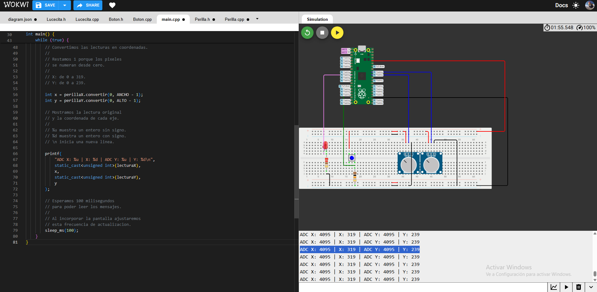
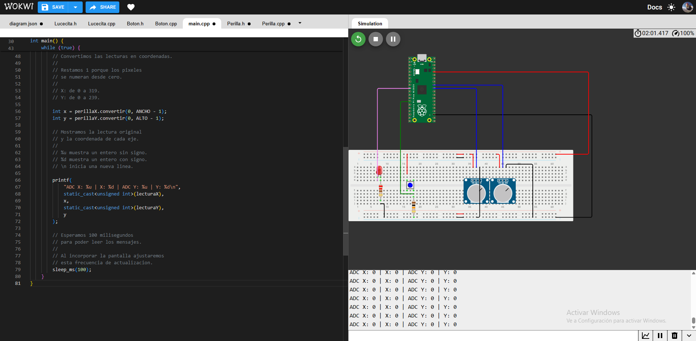
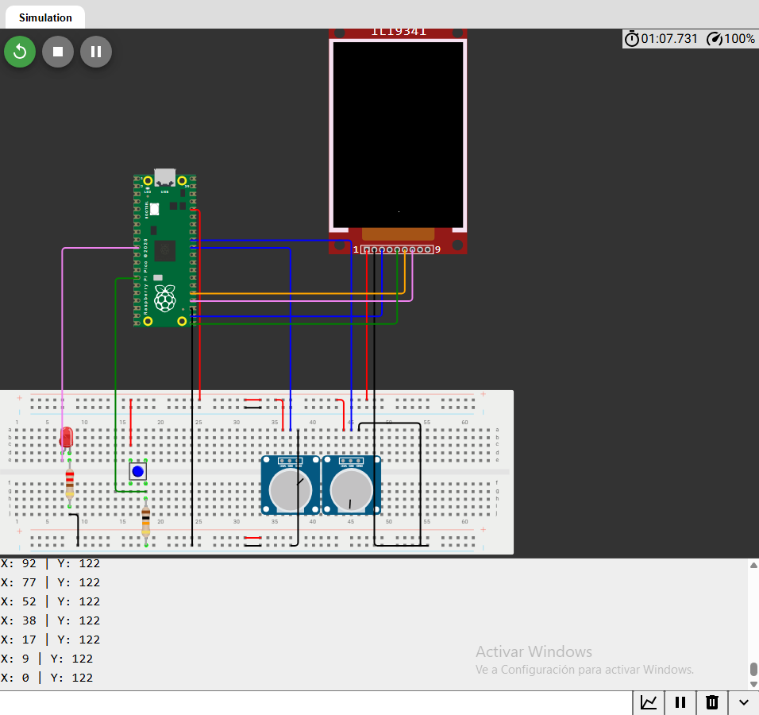
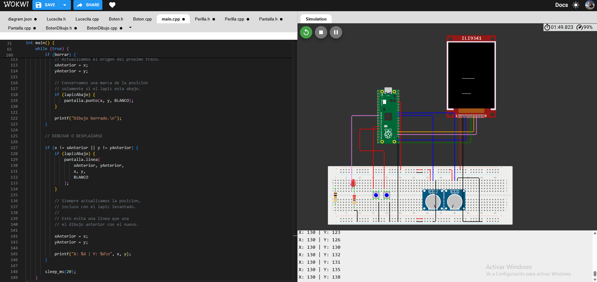
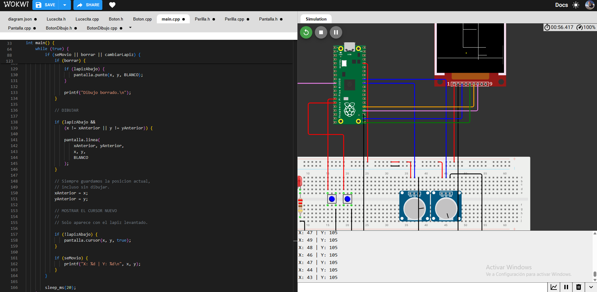

# sesion-10a

20-10-2026

## apuntes sesión

Para esta sesión había la oportunidad de tener una reunión por internet con los profesores reservando una hora o no por Discord, nosotros no tomamos una hora por lo cual no tengo mucho que colocar en este lugar sobre la sesión pero por mi parte colocaré aproximaciones sobre el proyecto Etch A Sketch digital e investigaciones individuales.

### Cómo funcionarán las perillas de borde a borde

**Mapeo de valores analógicos a coordenadas de pantalla**

Un potenciómetro normal tiene un recorrido limitado, como no gira 360° vamos a adaptarnos a su limitación. Podemos hacer que todo su recorrido físico corresponda exactamente a todo el ancho o alto de la pantalla.

Por ejemplo, si utilizamos una pantalla de 320 × 240 píxeles:

- Posición de la perilla	Eje X	Eje Y
- Inicio del giro	0 (izquierda)	0 (arriba)
- Mitad del giro	160 aprox.	120 aprox.
- Final del giro	319 (derecha)	239 (abajo)

Los píxeles se numeran desde cero. Por eso, el último píxel horizontal es 319 y el vertical es 239, no 320 y 240.

### El archivo Perilla.h

Este archivo declara qué información guarda una perilla y qué acciones permite realizar.

```cpp
#ifndef PERILLA_H
#define PERILLA_H

#include <stdint.h>

// Vamos a tener dos perillas.
//
// Ambas funcionan de la misma manera,
// pero cada una tendra su propio pin.
//
// Esta clase solo lee la perilla
// y convierte su lectura a otro rango.
//
// Mas adelante usaremos esos valores
// para controlar el lapiz de la pantalla.

class Perilla {
public:
    // ATRIBUTOS
    // Son datos que guarda cada objeto.

    // GPIO donde conectamos la senal.
    unsigned int pin;

    // Ultima lectura obtenida del ADC.
    uint16_t lectura;

    // CONSTRUCTOR
    // Recibe el GPIO que usara esta perilla.
    Perilla(unsigned int pinADC);

    // METODOS
    // Son acciones que puede realizar el objeto.

    // Prepara el GPIO para una lectura analogica.
    void iniciar();

    // Lee la perilla y guarda el resultado.
    // Devuelve un numero entre 0 y 4095.
    uint16_t leer();

    // Convierte la ultima lectura guardada
    // al rango que necesitemos.
    int convertir(int minimo, int maximo);
};

#endif
```
public: permite acceder a los atributos y métodos desde otras partes del programa, como main.cpp.

Las líneas #ifndef, #define y #endif evitan que se declare la misma clase varias veces si el archivo se incluye más de una vez.

#include <stdint.h> permite utilizar tipos como uint16_t, un entero sin signo de 16 bits, suficiente para guardar las lecturas de 0 a 4095.


### El archivo Perilla.cpp

Aquí escribimos cómo funciona cada acción declarada en el .h.

```cpp
#include "Perilla.h"
#include "hardware/adc.h"

// CONSTRUCTOR
//
// Se ejecuta cuando creamos un objeto Perilla.
//
// Guarda el GPIO recibido.
// Todavia no lee ni configura el hardware.

Perilla::Perilla(unsigned int pinADC) {
    pin = pinADC;
    lectura = 0;
}

// INICIAR
//
// Prepara el GPIO para recibir una senal analogica.
//
// En esta primera version usaremos
// exclusivamente GP26 y GP27.
//
// El ADC compartido se inicializa en main.cpp.

void Perilla::iniciar() {
    adc_gpio_init(pin);
}

// LEER
//
// La Pico comparte un ADC entre varias entradas.
//
// Antes de leer, seleccionamos la entrada
// correspondiente a esta perilla:
//
// GP26 corresponde a la entrada ADC 0.
// GP27 corresponde a la entrada ADC 1.
//
// Por eso restamos 26 al numero del GPIO.

uint16_t Perilla::leer() {
    adc_select_input(pin - 26);

    lectura = adc_read();

    return lectura;
}

// CONVERTIR
//
// Usamos la lectura que guardo leer().
// Aqui no realizamos otra lectura.
//
// Ejemplo para el eje X:
//
// Lectura 0    -> posicion 0.
// Lectura 4095 -> posicion 319.
//
// Asi el recorrido completo de la perilla
// corresponde al recorrido completo del eje.

int Perilla::convertir(int minimo, int maximo) {
    int32_t recorrido = maximo - minimo;

    return minimo +
           (static_cast<int32_t>(lectura) * recorrido) / 4095;
}
```

Cómo leer las partes principales:


| Código | Qué significa |
|---|---|
| `Perilla::Perilla(...)` | Constructor de la clase Perilla. |
| `pin = pinADC;` | Guarda en el objeto el GPIO recibido. |
| `Perilla::leer()` | Implementa el método leer de esa clase. |
| `adc_select_input(pin - 26)` | Selecciona la entrada analógica correspondiente. |
| `adc_read()` | Obtiene una lectura del ADC. |
| `return lectura;` | Devuelve la lectura a quien llamó al método. |

En convertir(), static_cast<int32_t>(lectura) convierte el valor a un entero de 32 bits antes de multiplicarlo, para disponer de suficiente capacidad numérica.

Primero llamamos a leer() y después a convertir(), porque la conversión utiliza la lectura guardada.

### Reemplazar el contenido de main.cpp

Este programa une las piezas. Todavía no dibuja: muestra las lecturas y las futuras coordenadas en el monitor serial.

```cpp
#include <stdio.h>
#include "pico/stdlib.h"
#include "hardware/adc.h"
#include "Perilla.h"

// PROYECTO: ETCH A SKETCH DIGITAL
//
// Primera prueba:
// leer dos perillas independientemente.
//
// Una controlara el eje horizontal X.
// La otra controlara el eje vertical Y.

// Creamos dos objetos de la misma clase.
//
// El constructor guarda un GPIO diferente
// en cada objeto.

Perilla perillaX(26);
Perilla perillaY(27);

// Dimensiones previstas para la pantalla.
//
// Si despues elegimos otra pantalla,
// cambiaremos estos valores.

const int ANCHO = 320;
const int ALTO = 240;

int main() {
    // Preparamos la salida de texto
    // para el monitor serial.
    stdio_init_all();

    // Inicializamos una sola vez el ADC,
    // porque ambas perillas lo comparten.
    adc_init();

    // Preparamos el GPIO de cada perilla.
    perillaX.iniciar();
    perillaY.iniciar();

    while (true) {
        // Leemos y guardamos ambos valores.
        uint16_t lecturaX = perillaX.leer();
        uint16_t lecturaY = perillaY.leer();

        // Convertimos las lecturas en coordenadas.
        //
        // Restamos 1 porque los pixeles
        // se numeran desde cero.
        //
        // X: de 0 a 319.
        // Y: de 0 a 239.

        int x = perillaX.convertir(0, ANCHO - 1);
        int y = perillaY.convertir(0, ALTO - 1);

        // Mostramos la lectura original
        // y la coordenada de cada eje.
        //
        // %u muestra un entero sin signo.
        // %d muestra un entero con signo.
        // \n inicia una nueva linea.

        printf(
            "ADC X: %u | X: %d | ADC Y: %u | Y: %d\n",
            static_cast<unsigned int>(lecturaX),
            x,
            static_cast<unsigned int>(lecturaY),
            y
        );

        // Esperamos 100 milisegundos
        // para poder leer los mensajes.
        //
        // Al incorporar la pantalla ajustaremos
        // esta frecuencia de actualizacion.
        sleep_ms(100);
    }
}
```

Una clase, dos objetos: perillaX y perillaY comparten la misma definición, pero cada objeto guarda su propio pin y su propia lectura.

while (true) repite continuamente las lecturas, las conversiones y la impresión de resultados.

### Ejecutar la prueba

| Prueba | Resultado esperado |
|---|---|
| Mover solo la perilla X | Cambian `ADC X` y `X`. |
| Mover solo la perilla Y | Cambian `ADC Y` y `Y`. |
| Llevar X a sus extremos | `X` llega a 0 y a 319. |
| Llevar Y a sus extremos | `Y` llega a 0 y a 239. |

Esto prepara el recorrido de borde a borde. Distribuimos todo el recorrido disponible del potenciómetro entre el primer y el último píxel.

En los potenciómetros físicos verificaremos sus lecturas extremas y, si hace falta, los calibraremos para alcanzar ambos bordes.

Hasta acá fincionó


### Perillas en su valor máximo (4095)



En esta prueba, ambas perillas alcanzan su valor máximo:
- ADC X: 4095 | X: 319
- ADC Y: 4095 | Y: 239

### Perillas en su valor mínimo (0)



En esta prueba, ambas perillas alcanzan su valor mínimo:
- ADC X: 0 | X: 0
- ADC Y: 0 | Y: 0

En la simulación de Wokwi usaremos la pantalla **ILI9341** Es una pantalla a color con comunicación SPI. La utilizaremos horizontalmente, con 320 × 240 píxeles.

Y la conectaré así:

| Pin de la pantalla | Raspberry Pi Pico | Función |
|---|---|---|
| `VCC` | `3V3` | Alimentación para esta simulación |
| `GND` | `GND` | Tierra |
| `CS` | `GP17` | Seleccionar la pantalla |
| `D/C` | `GP16` | Distinguir instrucciones de datos |
| `MOSI` | `GP19` | Enviar datos |
| `SCK` | `GP18` | Reloj de comunicación |
| `MISO` | Sin conectar | No leeremos datos de la pantalla |

En Wokwi, los pines de reinicio y retroiluminación de este componente no están disponibles en la simulación.

### creación pantalla .h

Esta clase se encargará de comunicarse con la pantalla. La clase Perilla seguirá encargándose solamente de las lecturas.

```cpp
#ifndef PANTALLA_H
#define PANTALLA_H

#include <stdint.h>

// Vamos a tener una pantalla.
//
// La pantalla recibira instrucciones
// desde la Raspberry Pi Pico.
//
// Por ahora necesitamos:
//
// iniciar la pantalla,
// pintar el fondo,
// dibujar un punto.
//
// Todos los atributos y metodos
// estaran en public.

class Pantalla {
public:
    // ATRIBUTOS

    unsigned int pinCS;
    unsigned int pinDC;

    int ancho;
    int alto;

    // CONSTRUCTOR
    // Recibe los GPIO de seleccion y control.
    Pantalla(unsigned int cs, unsigned int dc);

    // METODOS DE COMUNICACION

    // Envia una instruccion a la pantalla.
    void comando(uint8_t valor);

    // Envia un dato a la pantalla.
    void dato(uint8_t valor);

    // Selecciona el rectangulo que recibira pixeles.
    void ventana(int x0, int y0, int x1, int y1);

    // METODOS DE DIBUJO

    void iniciar();

    void limpiar(uint16_t color);

    void punto(int x, int y, uint16_t color);
};

#endif
```
Los tipos numéricos tienen usos diferentes:

| Tipo | Qué guardaremos |
|---|---|
| `uint8_t` | Un byte de una instrucción o un dato |
| `uint16_t` | Un color de 16 bits |
| `int` | Coordenadas y dimensiones |

### Crear Pantalla.cpp

Los números como 0x2A son instrucciones del controlador de la pantalla, escritas en hexadecimal.

```cpp
#include "Pantalla.h"
#include "pico/stdlib.h"
#include "hardware/spi.h"

// CONSTRUCTOR
//
// Guarda los GPIO de control
// y las dimensiones que utilizaremos.
//
// Todavia no configura el hardware.

Pantalla::Pantalla(unsigned int cs, unsigned int dc) {
    pinCS = cs;
    pinDC = dc;

    ancho = 320;
    alto = 240;
}

// COMANDO
//
// D/C en 0 significa:
// lo que enviamos es una instruccion.
//
// CS en 0 selecciona la pantalla.
// CS en 1 termina esta comunicacion.

void Pantalla::comando(uint8_t valor) {
    gpio_put(pinDC, 0);
    gpio_put(pinCS, 0);

    spi_write_blocking(spi0, &valor, 1);

    gpio_put(pinCS, 1);
}

// DATO
//
// D/C en 1 significa:
// lo que enviamos es un dato.
//
// Puede ser parte de una coordenada,
// un color o una configuracion.

void Pantalla::dato(uint8_t valor) {
    gpio_put(pinDC, 1);
    gpio_put(pinCS, 0);

    spi_write_blocking(spi0, &valor, 1);

    gpio_put(pinCS, 1);
}

// VENTANA
//
// Selecciona el area que vamos a pintar.
//
// Puede ser toda la pantalla
// o solamente un pixel.
//
// Cada coordenada se envia en dos bytes:
// primero la parte alta y despues la baja.

void Pantalla::ventana(int x0, int y0, int x1, int y1) {
    // Seleccionar columnas.
    comando(0x2A);

    dato(x0 >> 8);
    dato(x0 & 0xFF);
    dato(x1 >> 8);
    dato(x1 & 0xFF);

    // Seleccionar filas.
    comando(0x2B);

    dato(y0 >> 8);
    dato(y0 & 0xFF);
    dato(y1 >> 8);
    dato(y1 & 0xFF);

    // Preparar la escritura de los pixeles.
    comando(0x2C);
}

// INICIAR
//
// Usaremos el periferico SPI0.
//
// GP18: reloj.
// GP19: salida de datos.
//
// CS y D/C seran salidas digitales normales.

void Pantalla::iniciar() {
    gpio_init(pinCS);
    gpio_put(pinCS, 1);
    gpio_set_dir(pinCS, GPIO_OUT);

    gpio_init(pinDC);
    gpio_put(pinDC, 1);
    gpio_set_dir(pinDC, GPIO_OUT);

    // Comunicacion SPI a 10 MHz.
    spi_init(spi0, 10000000);

    gpio_set_function(18, GPIO_FUNC_SPI);
    gpio_set_function(19, GPIO_FUNC_SPI);

    // Enviamos bytes de 8 bits,
    // comenzando por el bit mas significativo.
    spi_set_format(
        spi0,
        8,
        SPI_CPOL_0,
        SPI_CPHA_0,
        SPI_MSB_FIRST
    );

    // Reinicio mediante una instruccion.
    comando(0x01);
    sleep_ms(150);

    // Salir del modo de reposo.
    comando(0x11);
    sleep_ms(120);

    // Color RGB565:
    // cada pixel utiliza 16 bits.
    comando(0x3A);
    dato(0x55);

    // Orientacion horizontal:
    // ancho 320 y alto 240.
    comando(0x36);
    dato(0x28);

    // Encender la imagen.
    comando(0x29);
    sleep_ms(20);
}

// LIMPIAR
//
// Pintamos toda la pantalla del mismo color.
//
// Enviamos bloques de pixeles para evitar
// una comunicacion separada por cada pixel.

void Pantalla::limpiar(uint16_t color) {
    ventana(0, 0, ancho - 1, alto - 1);

    // Cada pixel ocupa dos bytes.
    // Este bloque contiene 128 pixeles.
    uint8_t bloque[256];

    for (int i = 0; i < 256; i += 2) {
        bloque[i] = color >> 8;
        bloque[i + 1] = color & 0xFF;
    }

    gpio_put(pinDC, 1);
    gpio_put(pinCS, 0);

    int pendientes = ancho * alto;

    while (pendientes > 0) {
        int cantidad = pendientes;

        if (cantidad > 128) {
            cantidad = 128;
        }

        spi_write_blocking(spi0, bloque, cantidad * 2);

        pendientes -= cantidad;
    }

    gpio_put(pinCS, 1);
}

// PUNTO
//
// Pinta un solo pixel.
//
// Primero comprobamos que la coordenada
// este dentro de la pantalla.

void Pantalla::punto(int x, int y, uint16_t color) {
    if (x < 0 || x >= ancho || y < 0 || y >= alto) {
        return;
    }

    ventana(x, y, x, y);

    // Enviamos los dos bytes del color.
    dato(color >> 8);
    dato(color & 0xFF);
}
```
Esta inicialización es una versión mínima para probar el componente de Wokwi. Cuando pasemos a la pantalla física, revisaremos el modelo del módulo y su secuencia de inicialización.

### Reemplazar main.cpp

No cambiamos Perilla.h ni Perilla.cpp

```cpp
#include <stdio.h>
#include "pico/stdlib.h"
#include "hardware/adc.h"

#include "Perilla.h"
#include "Pantalla.h"

// PROYECTO: ETCH A SKETCH DIGITAL
//
// Segunda prueba:
//
// leer ambas perillas,
// convertir sus lecturas en coordenadas,
// mostrar un punto en la pantalla.
//
// Por ahora el punto se mueve sin dejar trazo.

// OBJETOS

Perilla perillaX(26);
Perilla perillaY(27);

// CS en GP17.
// D/C en GP16.
//
// Los GPIO de reloj y datos
// se configuran en Pantalla.cpp.
Pantalla pantalla(17, 16);

// COLORES RGB565

const uint16_t NEGRO = 0x0000;
const uint16_t BLANCO = 0xFFFF;

int main() {
    stdio_init_all();

    // Preparamos el ADC compartido.
    adc_init();

    perillaX.iniciar();
    perillaY.iniciar();

    // Preparamos la pantalla
    // y pintamos el fondo negro.
    pantalla.iniciar();
    pantalla.limpiar(NEGRO);

    // Leemos la posicion inicial
    // antes de dibujar el primer punto.
    perillaX.leer();
    perillaY.leer();

    int xAnterior = perillaX.convertir(
        0, pantalla.ancho - 1
    );

    int yAnterior = perillaY.convertir(
        0, pantalla.alto - 1
    );

    pantalla.punto(xAnterior, yAnterior, BLANCO);

    printf("Pantalla iniciada.\n");

    while (true) {
        // Actualizamos las lecturas.
        perillaX.leer();
        perillaY.leer();

        // Convertimos a coordenadas.
        int x = perillaX.convertir(
            0, pantalla.ancho - 1
        );

        int y = perillaY.convertir(
            0, pantalla.alto - 1
        );

        // Solo actualizamos el dibujo
        // cuando cambia alguna coordenada.
        //
        // || significa: O.
        //
        // Entramos si cambio X
        // O si cambio Y.

        if (x != xAnterior || y != yAnterior) {
            // Borramos el punto anterior
            // pintandolo del color del fondo.
            pantalla.punto(xAnterior, yAnterior, NEGRO);

            // Dibujamos el punto nuevo.
            pantalla.punto(x, y, BLANCO);

            // Guardamos la nueva posicion
            // para la siguiente vuelta.
            xAnterior = x;
            yAnterior = y;

            printf("X: %d | Y: %d\n", x, y);
        }

        // Revisamos las perillas
        // aproximadamente cada 20 ms.
        sleep_ms(20);
    }
}
```
### Probar el movimiento

| Acción | Resultado esperado |
|---|---|
| Girar X | El punto se desplaza horizontalmente |
| Girar Y | El punto se desplaza verticalmente |
| Llevar ambas al mínimo | Punto en la esquina superior izquierda |
| Llevar ambas al máximo | Punto en la esquina inferior derecha |
| Dejar las perillas quietas | El punto permanece y no se repiten mensajes |

### Pantalla TFT y movimiento del punto



En esta prueba, incorporamos una pantalla TFT ILI9341
al proyecto Etch A Sketch digital.

Las dos perillas permiten controlar la posición
del punto en la pantalla:

- Perilla X: controla el movimiento horizontal.
- Perilla Y: controla el movimiento vertical.
- La pantalla tiene una resolución de 320 × 240 píxeles.
- Las coordenadas X van de 0 a 319.
- Las coordenadas Y van de 0 a 239.

En la imagen se observa el punto dibujado en la
pantalla y las coordenadas mostradas en el
monitor serial de Wokwi.

---

Ahora haremos que el punto deje un trazo continuo, como un Etch A Sketch. Uniremos la posición anterior con la nueva para que no queden espacios cuando se gire rápido una perilla.

Conservaremos las conexiones y la clase Perilla. Solo agregaremos un método a Pantalla y cambiaremos una parte de main.cpp.

### Agregar linea() en Pantalla.h

Dentro de public:, justo después de la declaración de punto(), agrega:

```cpp
    void iniciar();

    void limpiar(uint16_t color);

    void punto(int x, int y, uint16_t color);

    // Une dos posiciones mediante una linea.
    void linea(int x0, int y0, int x1, int y1, uint16_t color);
```
### Agregar la implementación en Pantalla.cpp

Al final del archivo, después de la función punto()

```cpp
// LINEA
//
// Al mover una perilla, la coordenada puede
// saltar varios pixeles entre dos lecturas.
//
// Si solo dibujamos la nueva posicion,
// quedarian espacios entre los puntos.
//
// Por eso dibujaremos todos los pixeles
// necesarios para unir ambas posiciones.
//
// Utilizamos el algoritmo de Bresenham.
// Permite dibujar lineas con numeros enteros.

void Pantalla::linea(
    int x0, int y0,
    int x1, int y1,
    uint16_t color
) {
    // Calculamos la distancia horizontal.
    int distanciaX = x1 - x0;

    // Queremos la distancia sin signo negativo.
    if (distanciaX < 0) {
        distanciaX = -distanciaX;
    }

    // Calculamos la distancia vertical.
    int distanciaY = y1 - y0;

    if (distanciaY < 0) {
        distanciaY = -distanciaY;
    }

    // Elegimos el sentido del avance horizontal.
    //
    //  1: hacia la derecha.
    // -1: hacia la izquierda.
    int pasoX = 1;

    if (x0 > x1) {
        pasoX = -1;
    }

    // Elegimos el sentido del avance vertical.
    //
    //  1: hacia abajo.
    // -1: hacia arriba.
    int pasoY = 1;

    if (y0 > y1) {
        pasoY = -1;
    }

    // Este valor ayuda a decidir cuando
    // avanzar en X, en Y o en ambos.
    //
    // Es un calculo del algoritmo:
    // no significa que el programa tenga un fallo.
    int error = distanciaX - distanciaY;

    while (true) {
        // Dibujamos el pixel actual.
        punto(x0, y0, color);

        // Si llegamos al destino,
        // terminamos la linea.
        if (x0 == x1 && y0 == y1) {
            break;
        }

        // Guardamos el calculo antes de modificarlo.
        int dobleError = 2 * error;

        // Comprobamos si debemos avanzar en X.
        if (dobleError > -distanciaY) {
            error -= distanciaY;
            x0 += pasoX;
        }

        // Comprobamos si debemos avanzar en Y.
        //
        // Son dos if independientes porque
        // en una diagonal podemos avanzar
        // en ambos ejes durante la misma vuelta.
        if (dobleError < distanciaX) {
            error += distanciaX;
            y0 += pasoY;
        }
    }
}
```

| Movimiento entre posiciones | Línea resultante |
|---|---|
| Solo cambia X | Horizontal |
| Solo cambia Y | Vertical |
| Cambian X e Y | Diagonal |
| La dirección cambia durante varias lecturas | Una sucesión de segmentos que puede formar una curva |


### Cambiar el bloque if de main.cpp

Buscar este bloque

```cpp
if (x != xAnterior || y != yAnterior) {
```

Reemplazar el bloque completo, desde ese if hasta su llave de cierre, por lo siguiente:

```cpp
        // Si cambia alguna coordenada,
        // unimos la posicion anterior con la nueva.
        //
        // Ya no borramos el punto anterior:
        // queremos conservar el dibujo.

        if (x != xAnterior || y != yAnterior) {
            pantalla.linea(
                xAnterior, yAnterior,
                x, y,
                BLANCO
            );

            // La posicion actual sera el inicio
            // de la siguiente linea.
            xAnterior = x;
            yAnterior = y;

            printf("X: %d | Y: %d\n", x, y);
        }
```

Conservar el resto de main.cpp, incluyendo:

```cpp
sleep_ms(20);
```
Por qué guardamos las coordenadas después de dibujar: necesitamos recordar de dónde veníamos para unir esa posición con el destino. Si las actualizáramos antes, ambos extremos serían iguales.

### Ejecutar prueba

| Prueba | Resultado esperado |
|---|---|
| Girar X dejando Y quieta | Trazo horizontal continuo |
| Girar Y dejando X quieta | Trazo vertical continuo |
| Cambiar ambas durante el movimiento | Segmentos diagonales |
| Llegar a un borde y mover la otra perilla | Trazo sobre ese borde |
| Volver hacia atrás | El dibujo anterior permanece |


Se puede poner este código temporal antes de iniciar la simulación para ver una diagonal, porque en el computador las perillas se manejan con el ratón, una después de otra.

- Agregar temporalmente después de pantalla.limpiar(NEGRO);

```cpp
    // PRUEBA TEMPORAL
    // Une dos esquinas opuestas.
    pantalla.linea(0, 0, 319, 239, BLANCO);
```

Después retirar esa línea de prueba para comenzar con el fondo vacío. Para borrar el dibujo en esta etapa, reiniciar la simulación.

Ahora incorporaremos los dos botones.

| Control | Acción |
|---|---|
| Botón 1 | Borrar el dibujo |
| Botón 2 | Alternar entre lápiz levantado y lápiz abajo |

### Conectar los botones

Desconector el botón anterior y su resistencia para conectarlo así con la resistencia interna de la pico.

| Botón | Contacto `1.l` | Contacto `2.l` |
|---|---|---|
| Borrar | `GP10` | `GND` |
| Levantar/bajar lápiz | `GP11` | `GND` |

### Crear BotonDibujo.h

Usaremos el nombre "BotonDibujo" para conservar los archivos Boton.h y Boton.cpp del profesor como referencia, sin mezclar ambas versiones.

```cpp
#ifndef BOTON_DIBUJO_H
#define BOTON_DIBUJO_H

#include <stdint.h>

// Vamos a tener dos botones.
//
// Ambos detectan pulsaciones,
// pero cada uno tendra una funcion diferente.
//
// La clase solo detecta la pulsacion.
// main.cpp decide que hacer con ella.

class BotonDibujo {
public:
    // ATRIBUTOS

    unsigned int pin;

    // Ultima lectura directa del GPIO.
    bool ultimaLectura;

    // Estado que aceptamos como estable.
    bool estadoEstable;

    // Momento en que cambio la lectura.
    uint64_t ultimoCambio;

    // Tiempo necesario para aceptar un cambio.
    // Se expresa en microsegundos.
    uint64_t tiempoRebote;

    // CONSTRUCTOR
    BotonDibujo(unsigned int pinBoton);

    // METODOS

    // Prepara el GPIO con resistencia interna.
    void iniciar();

    // Devuelve true una sola vez
    // por cada pulsacion aceptada.
    //
    // Debemos llamarlo continuamente.
    bool fuePresionado();
};

#endif
```
### Crear BotonDibujo.cpp

Los botones pueden producir cambios rápidos de señal al presionarlos: se llaman rebotes, y Wokwi también los simula. Esperaremos a que la lectura se mantenga estable durante 30 milisegundos.

```cpp
#include "BotonDibujo.h"
#include "pico/stdlib.h"

// CONSTRUCTOR
//
// Guarda el GPIO y los valores iniciales.
// Todavia no configura el hardware.

BotonDibujo::BotonDibujo(unsigned int pinBoton) {
    pin = pinBoton;

    ultimaLectura = true;
    estadoEstable = true;

    ultimoCambio = 0;

    // 30000 microsegundos = 30 milisegundos.
    tiempoRebote = 30000;
}

// INICIAR
//
// Configuramos el GPIO como entrada.
//
// La resistencia pull-up interna mantiene
// la entrada en 1 cuando el boton esta suelto.
//
// Al presionar, el boton conecta con GND
// y la lectura pasa a 0.

void BotonDibujo::iniciar() {
    gpio_init(pin);
    gpio_set_dir(pin, GPIO_IN);
    gpio_pull_up(pin);

    ultimaLectura = gpio_get(pin);
    estadoEstable = ultimaLectura;

    ultimoCambio = time_us_64();
}

// FUE PRESIONADO
//
// Revisamos si la lectura cambio.
//
// Si cambia, comenzamos a contar el tiempo.
// Si permanece estable durante 30 ms,
// aceptamos el nuevo estado.
//
// Solo devolvemos true cuando el estado
// aceptado pasa de suelto a presionado.

bool BotonDibujo::fuePresionado() {
    bool lecturaActual = gpio_get(pin);
    uint64_t ahora = time_us_64();

    // Cada cambio reinicia el tiempo de espera.
    if (lecturaActual != ultimaLectura) {
        ultimaLectura = lecturaActual;
        ultimoCambio = ahora;
    }

    // Esperamos a que la lectura sea estable.
    if (ahora - ultimoCambio >= tiempoRebote) {
        if (lecturaActual != estadoEstable) {
            estadoEstable = lecturaActual;

            // false equivale a 0:
            // el boton esta presionado.
            if (estadoEstable == false) {
                return true;
            }
        }
    }

    // No hay una nueva pulsacion.
    return false;
}
```

Mantenerlo presionado no genera más pulsaciones: para volver a activarlo, hay que soltarlo y presionarlo nuevamente.

### Reemplazar main.cpp

Conservando los archivos Perilla y Pantalla, incluyendo el método linea() que ya se probó.

```cpp
#include <stdio.h>
#include "pico/stdlib.h"
#include "hardware/adc.h"

#include "Perilla.h"
#include "Pantalla.h"
#include "BotonDibujo.h"

// PROYECTO: ETCH A SKETCH DIGITAL
//
// Dos perillas controlan la posicion.
//
// Un boton borra el dibujo.
// Otro levanta o baja el lapiz.

// OBJETOS

Perilla perillaX(26);
Perilla perillaY(27);

Pantalla pantalla(17, 16);

BotonDibujo botonBorrar(10);
BotonDibujo botonLapiz(11);

// COLORES

const uint16_t NEGRO = 0x0000;
const uint16_t BLANCO = 0xFFFF;

int main() {
    stdio_init_all();

    adc_init();

    perillaX.iniciar();
    perillaY.iniciar();

    pantalla.iniciar();
    pantalla.limpiar(NEGRO);

    botonBorrar.iniciar();
    botonLapiz.iniciar();

    // true: dibujamos al mover las perillas.
    // false: nos desplazamos sin dibujar.
    bool lapizAbajo = true;

    // Obtenemos la posicion inicial.
    perillaX.leer();
    perillaY.leer();

    int xAnterior = perillaX.convertir(
        0, pantalla.ancho - 1
    );

    int yAnterior = perillaY.convertir(
        0, pantalla.alto - 1
    );

    pantalla.punto(xAnterior, yAnterior, BLANCO);

    printf("Sistema iniciado. Lapiz abajo.\n");

    while (true) {
        // LEER LAS PERILLAS

        perillaX.leer();
        perillaY.leer();

        int x = perillaX.convertir(
            0, pantalla.ancho - 1
        );

        int y = perillaY.convertir(
            0, pantalla.alto - 1
        );

        // REVISAR AMBOS BOTONES
        //
        // Llamamos cada metodo una vez por vuelta
        // y guardamos sus resultados.

        bool borrar = botonBorrar.fuePresionado();
        bool cambiarLapiz = botonLapiz.fuePresionado();

        // LEVANTAR O BAJAR EL LAPIZ

        if (cambiarLapiz) {
            // ! invierte el valor:
            // true pasa a false y viceversa.
            lapizAbajo = !lapizAbajo;

            // Comenzamos desde la posicion actual.
            // Asi no conectamos con un lugar anterior.
            xAnterior = x;
            yAnterior = y;

            if (lapizAbajo) {
                pantalla.punto(x, y, BLANCO);
                printf("Lapiz abajo: dibujando.\n");
            } else {
                printf("Lapiz levantado: sin dibujar.\n");
            }
        }

        // BORRAR EL DIBUJO

        if (borrar) {
            pantalla.limpiar(NEGRO);

            // Actualizamos el origen del proximo trazo.
            xAnterior = x;
            yAnterior = y;

            // Conservamos una marca de la posicion
            // solamente si el lapiz esta abajo.
            if (lapizAbajo) {
                pantalla.punto(x, y, BLANCO);
            }

            printf("Dibujo borrado.\n");
        }

        // DIBUJAR O DESPLAZARSE

        if (x != xAnterior || y != yAnterior) {
            if (lapizAbajo) {
                pantalla.linea(
                    xAnterior, yAnterior,
                    x, y,
                    BLANCO
                );
            }

            // Siempre actualizamos la posicion,
            // incluso con el lapiz levantado.
            //
            // Esto evita una linea que una
            // el dibujo anterior con el nuevo.

            xAnterior = x;
            yAnterior = y;

            printf("X: %d | Y: %d\n", x, y);
        }

        sleep_ms(20);
    }
}
```

La parte clave es actualizar xAnterior e yAnterior, incluso con el lápiz levantado, para así poder desplazarse y comenzar otro trazo sin unirlo al anterior.

En esta versión, mientras el lápiz está levantado, no mostramos un cursor; se verán las coordenadas en el monitor serial. Esto permite conservar el dibujo sin borrarle píxeles al mover un cursor encima.

### Comprobar las funciones

| Prueba | Resultado esperado |
|---|---|
| Mover las perillas al iniciar | Dibuja |
| Presionar el botón de GP11 | Levanta el lápiz |
| Mover las perillas con el lápiz levantado | No deja trazo |
| Presionar nuevamente GP11 | Baja el lápiz en la posición actual |
| Volver a mover las perillas | Inicia un trazo separado |
| Presionar el botón de GP10 | Borra el dibujo |
| Mantener presionado GP11 | Cambia el estado una sola vez |


### Funcionamiento de los dos botones: dibujar, levantar el lápiz y borrar



En esta prueba, incorporamos dos botones al proyecto Etch A Sketch digital para controlar el dibujo en la pantalla TFT ILI9341.

- **Botón 1:** permite borrar el dibujo de la pantalla.
- **Botón 2:** permite levantar o bajar el lápiz para decidir cuándo dibujar.
- **Perilla X:** controla el movimiento horizontal.
- **Perilla Y:** controla el movimiento vertical.

Cuando el lápiz está abajo, el programa dibuja líneas entre la posición anterior y la posición actual.

Cuando el lápiz está levantado, podemos movernos por la pantalla sin dejar un trazo.

La parte clave es actualizar `xAnterior` e `yAnterior`, incluso con el lápiz levantado, para así poder desplazarse y comenzar otro trazo sin unirlo al anterior.

En la imagen se observan dos trazos blancos separados en la pantalla, lo que demuestra que podemos levantar el lápiz, desplazarnos y comenzar un nuevo dibujo sin conectarlo con el anterior.

---

**PARA FINALIZAR**

Será la última función. No cambiaremos las conexiones ni las clases Perilla y BotonDibujo

### Agregar estas declaraciones en Pantalla.h

Dentro de public:, después de los métodos que ya se tienen, agregar:

```cpp
    // MEMORIA DEL DIBUJO
    //
    // Nuestro dibujo solo utiliza blanco y negro.
    // Guardamos un bit por pixel:
    //
    // 0: fondo negro.
    // 1: trazo blanco.
    //
    // 320 * 240 / 8 = 9600 bytes.
    uint8_t dibujo[9600] = {};

    // Pinta un pixel en la pantalla
    // sin modificar la memoria del dibujo.
    void pixelDirecto(int x, int y, uint16_t color);

    // Muestra el cursor o restaura lo que habia debajo.
    void cursor(int x, int y, bool mostrar);
```

Esta memoria guarda el dibujo, pero no el cursor. Así podemos distinguirlos.

### Modificar Pantalla.cpp

Reemplazar únicamente la función Pantalla::punto() por estas dos funciones:

```cpp
// PIXEL DIRECTO
//
// Escribe en la pantalla sin guardar el cambio.
//
// Lo usaremos para mostrar el cursor
// sin que pase a formar parte del dibujo.

void Pantalla::pixelDirecto(int x, int y, uint16_t color) {
    if (x < 0 || x >= ancho || y < 0 || y >= alto) {
        return;
    }

    ventana(x, y, x, y);

    dato(color >> 8);
    dato(color & 0xFF);
}

// PUNTO
//
// Guarda el pixel en la memoria del dibujo
// y despues lo muestra en la pantalla.
//
// Esta memoria esta preparada para nuestro
// dibujo en blanco sobre fondo negro.

void Pantalla::punto(int x, int y, uint16_t color) {
    if (x < 0 || x >= ancho || y < 0 || y >= alto) {
        return;
    }

    // Convertimos la coordenada en una posicion
    // dentro de la memoria.
    int posicion = y * ancho + x;

    // Cada byte guarda ocho pixeles.
    int indice = posicion / 8;
    uint8_t mascara = 1u << (posicion % 8);

    if (color == 0xFFFF) {
        // Guardamos un pixel blanco.
        dibujo[indice] |= mascara;
    } else {
        // Guardamos un pixel negro.
        dibujo[indice] &= ~mascara;
    }

    pixelDirecto(x, y, color);
}
```

Dentro de Pantalla::limpiar(), agregar estas líneas al principio, antes de ventana(...). Conservar el resto de esa función:

```cpp
    // Tambien limpiamos la memoria del dibujo.
    //
    // En este proyecto utilizamos:
    // 0x0000: negro.
    // 0xFFFF: blanco.
    uint8_t relleno = 0x00;

    if (color == 0xFFFF) {
        relleno = 0xFF;
    }

    for (int i = 0; i < 9600; i++) {
        dibujo[i] = relleno;
    }
```

Finalmente, agregar esta función al final de Pantalla.cpp:

```cpp
// CURSOR
//
// Mostramos una cruz amarilla de cinco pixeles
// de ancho y cinco de alto.
//
// mostrar == true:
// pintamos la cruz sin modificar el dibujo.
//
// mostrar == false:
// recuperamos el color original de cada pixel.
//
// En los bordes solo pintamos la parte
// de la cruz que queda dentro de la pantalla.

void Pantalla::cursor(int x, int y, bool mostrar) {
    for (int desplazamiento = -2;
         desplazamiento <= 2;
         desplazamiento++) {

        // Revisamos un punto del brazo horizontal
        // y otro del brazo vertical.
        for (int eje = 0; eje < 2; eje++) {
            int px = x;
            int py = y;

            if (eje == 0) {
                px += desplazamiento;
            } else {
                py += desplazamiento;
            }

            if (px < 0 || px >= ancho ||
                py < 0 || py >= alto) {
                continue;
            }

            uint16_t color;

            if (mostrar) {
                // Amarillo en formato RGB565.
                color = 0xFFE0;
            } else {
                // Recuperamos el pixel del dibujo.
                int posicion = py * ancho + px;
                int indice = posicion / 8;

                uint8_t mascara =
                    1u << (posicion % 8);

                if ((dibujo[indice] & mascara) != 0) {
                    color = 0xFFFF;
                } else {
                    color = 0x0000;
                }
            }

            pixelDirecto(px, py, color);
        }
    }
}
```

Conservar linea() tal como está: ya utiliza punto(), por lo que ahora sus píxeles también se guardarán automáticamente.

### Reemplazar main.cpp

Esta versión retira el cursor antes de modificar el dibujo y lo muestra nuevamente donde corresponda.

```cpp
#include <stdio.h>
#include "pico/stdlib.h"
#include "hardware/adc.h"

#include "Perilla.h"
#include "Pantalla.h"
#include "BotonDibujo.h"

// PROYECTO: ETCH A SKETCH DIGITAL
//
// Lapiz abajo:
// dejamos un trazo blanco.
//
// Lapiz levantado:
// mostramos una cruz amarilla,
// pero no modificamos el dibujo.

// OBJETOS

Perilla perillaX(26);
Perilla perillaY(27);

Pantalla pantalla(17, 16);

BotonDibujo botonBorrar(10);
BotonDibujo botonLapiz(11);

// COLORES DEL DIBUJO

const uint16_t NEGRO = 0x0000;
const uint16_t BLANCO = 0xFFFF;

int main() {
    stdio_init_all();

    adc_init();

    perillaX.iniciar();
    perillaY.iniciar();

    pantalla.iniciar();
    pantalla.limpiar(NEGRO);

    botonBorrar.iniciar();
    botonLapiz.iniciar();

    bool lapizAbajo = true;

    perillaX.leer();
    perillaY.leer();

    int xAnterior = perillaX.convertir(
        0, pantalla.ancho - 1
    );

    int yAnterior = perillaY.convertir(
        0, pantalla.alto - 1
    );

    pantalla.punto(xAnterior, yAnterior, BLANCO);

    printf("Sistema iniciado. Lapiz abajo.\n");

    while (true) {
        // LEER LAS PERILLAS

        perillaX.leer();
        perillaY.leer();

        int x = perillaX.convertir(
            0, pantalla.ancho - 1
        );

        int y = perillaY.convertir(
            0, pantalla.alto - 1
        );

        // REVISAR LOS BOTONES

        bool borrar = botonBorrar.fuePresionado();
        bool cambiarLapiz = botonLapiz.fuePresionado();

        bool seMovio =
            (x != xAnterior || y != yAnterior);

        // Solo actualizamos la pantalla
        // si ocurrio alguna accion.
        if (seMovio || borrar || cambiarLapiz) {

            // RETIRAR EL CURSOR ANTERIOR
            //
            // Si el lapiz estaba levantado,
            // habia una cruz en su posicion anterior.
            //
            // Recuperamos el dibujo que tenia debajo.

            if (!lapizAbajo) {
                pantalla.cursor(
                    xAnterior, yAnterior, false
                );
            }

            // CAMBIAR EL ESTADO DEL LAPIZ

            if (cambiarLapiz) {
                lapizAbajo = !lapizAbajo;

                // Evitamos conectar con una
                // posicion anterior al cambio.
                xAnterior = x;
                yAnterior = y;

                if (lapizAbajo) {
                    pantalla.punto(x, y, BLANCO);
                    printf("Lapiz abajo: dibujando.\n");
                } else {
                    printf("Lapiz levantado: cursor amarillo.\n");
                }
            }

            // BORRAR

            if (borrar) {
                pantalla.limpiar(NEGRO);

                xAnterior = x;
                yAnterior = y;

                if (lapizAbajo) {
                    pantalla.punto(x, y, BLANCO);
                }

                printf("Dibujo borrado.\n");
            }

            // DIBUJAR

            if (lapizAbajo &&
                (x != xAnterior || y != yAnterior)) {

                pantalla.linea(
                    xAnterior, yAnterior,
                    x, y,
                    BLANCO
                );
            }

            // Siempre guardamos la posicion actual,
            // incluso sin dibujar.
            xAnterior = x;
            yAnterior = y;

            // MOSTRAR EL CURSOR NUEVO
            //
            // Solo aparece con el lapiz levantado.

            if (!lapizAbajo) {
                pantalla.cursor(x, y, true);
            }

            if (seMovio) {
                printf("X: %d | Y: %d\n", x, y);
            }
        }

        sleep_ms(20);
    }
}
```

### Última prueba

1. Dibujar unas líneas blancas.
2. Levantar el lápiz con el botón de GP11: aparecerá la cruz amarilla.
3. Moverla sobre el dibujo y después alejarla: las líneas blancas deben permanecer completas.
4. Bajar el lápiz: la cruz desaparece y puedes comenzar otro trazo.
5. Probar borrar con el lápiz levantado: debe desaparecer el dibujo y permanecer la cruz en su posición.
   
En los bordes se verá la parte de la cruz que cabe en pantalla; su centro seguirá llegando a X = 319 e Y = 239.

### Cursor visible con el lápiz levantado



En esta prueba, mejoramos el proyecto Etch A Sketch digital mostrando un cursor en pantalla cuando el lápiz está levantado.

- **Perilla X:** controla el movimiento horizontal.
- **Perilla Y:** controla el movimiento vertical.
- **Botón 1:** borra el dibujo.
- **Botón 2:** alterna entre lápiz abajo y lápiz levantado.

Cuando el lápiz está abajo, el programa dibuja líneas continuas entre la posición anterior y la posición actual.

Cuando el lápiz está levantado, ya no se dibuja, pero ahora sí se muestra un cursor que indica la posición actual en la pantalla.

Esto permite desplazarse sin dejar trazo y, al mismo tiempo, ver con precisión en qué lugar comenzará el próximo dibujo.

En la imagen se observan varios trazos blancos ya dibujados y un cursor amarillo visible en la pantalla, lo que demuestra que el usuario puede moverse sin dibujar mientras mantiene una referencia visual de su posición actual.


### Declaración de uso de inteligencia artificial

Para desarrollar este proyecto utilicé ChatGPT, de OpenAI, con el modelo identificado en la interfaz como GPT-6.1 sol y el nivel de razonamiento Medio (OpenAI, s. f.). La herramienta me ayudó a comprender los conceptos de clases, objetos, atributos, constructores y métodos en C++, y a generar y adaptar código para Raspberry Pi Pico utilizando Pico SDK.

La asistencia incluyó la lectura de dos potenciómetros, la conversión de sus valores a coordenadas de pantalla, la comunicación con la pantalla TFT ILI9341, el trazado de líneas, la detección de pulsaciones con filtrado de rebotes y la incorporación de un cursor que permite desplazarse sin modificar el dibujo.

El proyecto del profesor se utilizó como punto de partida. Implementé los cambios por etapas en Wokwi y realicé pruebas de funcionamiento. Por lo tanto, el código presentado incluye aportes generados con inteligencia artificial, además de las decisiones, la implementación y las comprobaciones realizadas durante mi proceso de aprendizaje.

### Referencias

Adafruit Industries. (s. f.). *Adafruit_ILI9341* [Código fuente]. GitHub. https://github.com/adafruit/Adafruit_ILI9341

OpenAI. (s. f.). *ChatGPT* [Modelo de lenguaje de gran tamaño]. Recuperado el 23 de octubre de 2026, de https://chatgpt.com/

Raspberry Pi. (s. f.). *Hardware APIs*. Raspberry Pi Documentation. https://www.raspberrypi.com/documentation/pico-sdk/hardware.html

Serrano, M. (s. f.). *2026-10-09-lucecita-tiempo* [Proyecto de simulación]. Wokwi. https://wokwi.com/projects/477413398813766657

Wokwi. (s. f.-a). *wokwi-ili9341 reference*. Wokwi Docs. https://docs.wokwi.com/parts/wokwi-ili9341

Wokwi. (s. f.-b). *wokwi-potentiometer reference*. Wokwi Docs. https://docs.wokwi.com/parts/wokwi-potentiometer

Wokwi. (s. f.-c). *wokwi-pushbutton reference*. Wokwi Docs. https://docs.wokwi.com/parts/wokwi-pushbutton


**Para identificar qué respalda cada fuente:**

| Fuente | Aporte al proyecto |
|---|---|
| Proyecto de Serrano | Circuito y estructura inicial de trabajo con Pico SDK. |
| Raspberry Pi | Funciones del ADC, GPIO, SPI y temporización. |
| Wokwi: potenciómetro | Terminales y funcionamiento del componente simulado. |
| Wokwi: ILI9341 | Interfaz SPI, terminales y características de la pantalla. |
| Wokwi: pulsador | Contactos, conexión y simulación de rebotes. |
| Adafruit | Consulta de las instrucciones y orientación del controlador ILI9341; no instalamos su biblioteca Arduino. |
| ChatGPT | Explicaciones y generación y adaptación del código desarrollado durante la conversación. |

Algoritmo de Bresenham, no fue una página consultada durante la primera implementación. Describe el algoritmo utilizado para representar líneas mediante píxeles.

Black, P. E. (2020, 14 de diciembre). Bresenham’s algorithm. En *Dictionary of Algorithms and Data Structures*.
National Institute of Standards and Technology. https://xlinux.nist.gov/dads/HTML/bresenham.html

## encargos

## lectura

Se continúa trabajando con las condiciones en Scratch, utilizando el bloque si entonces, que permite realizar una acción cuando se cumple una condición.

En el ejemplo, el gato cuenta del 0 al 9 y cuando el número es mayor que 5 muestra el mensaje (Eso es alto).

Después se comienza un nuevo proyecto llamado Cronómetro de reacción para astronautas, donde se utilizan imágenes de un astronauta y un fondo espacial que se descargan y se agregan a Scratch.

También se crea una variable llamada tiempo para guardar los valores que se utilizarán durante el programa.

Luego se utiliza el cronómetro para medir cuánto tarda una persona en presionar la tecla espacio después de recibir una indicación. Se trabajan bloques como: esperar hasta que, reiniciar cronómetro y unir para mostrar el tiempo de reacción en segundos.

Y al final se explica cómo calcular aproximadamente la distancia recorrida por la Estación Espacial Internacional, multiplicando el tiempo por su velocidad de 7 kilómetros por segundo.
