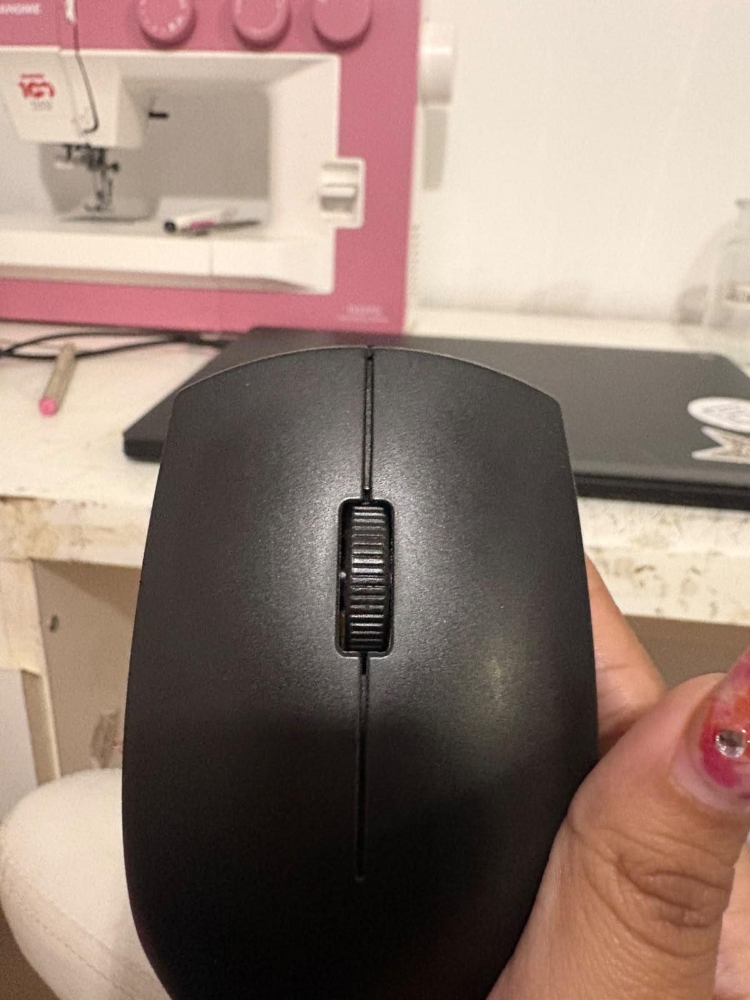
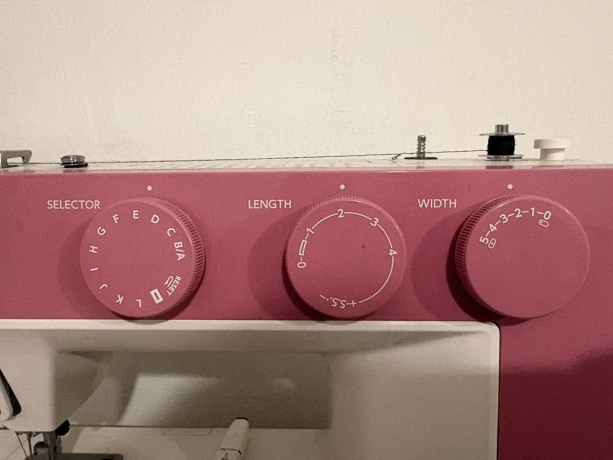
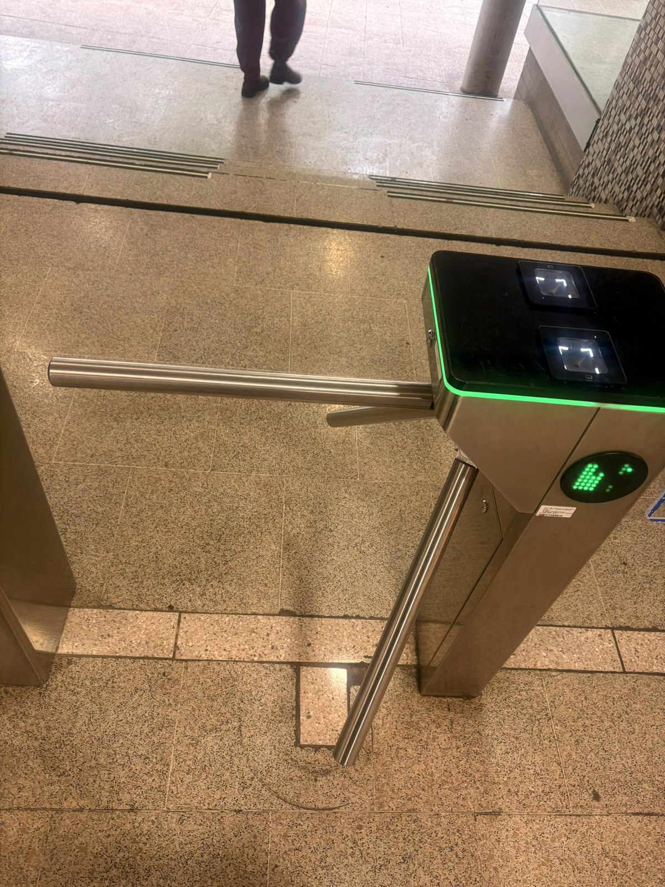
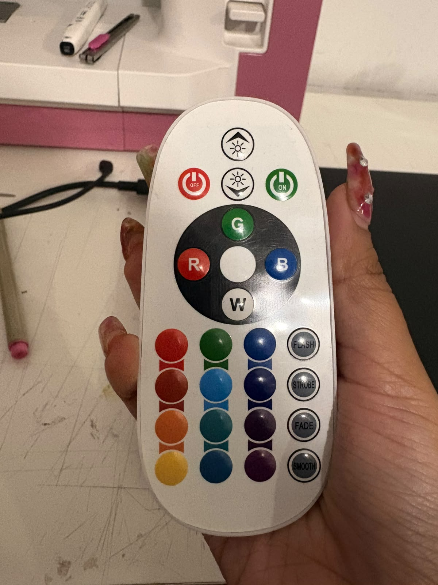
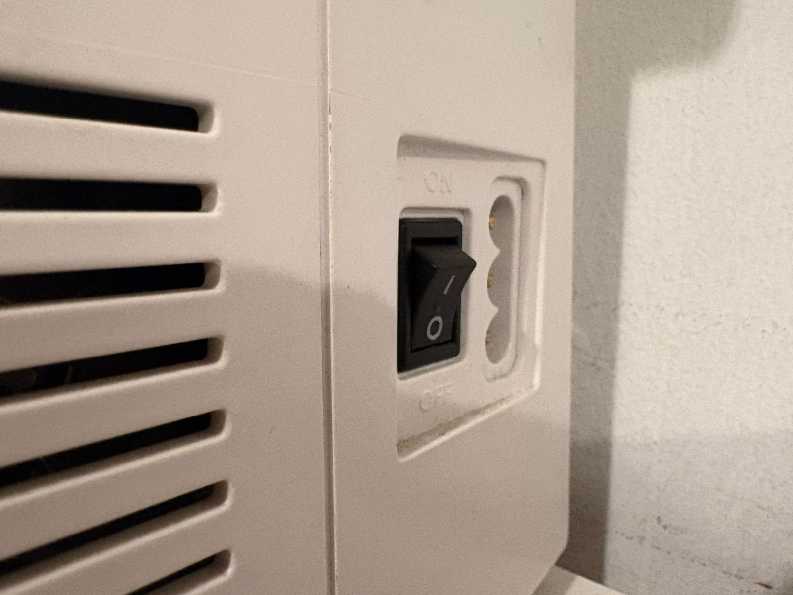
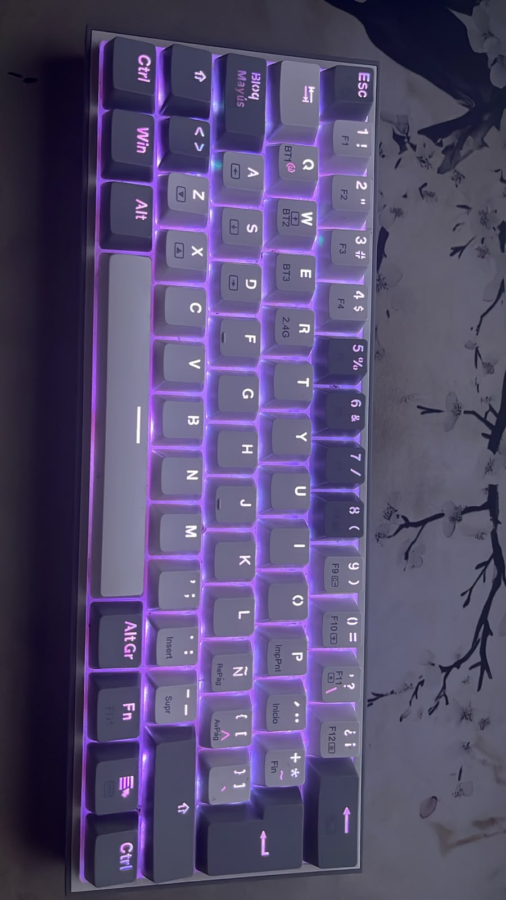

# sesion-08a

## apuntes sesión

### Lógica de las clases y objetos en C++

Por ejemplo, podemos crear una clase llamada `Lucecita` para representar una luz LED. Esta clase define sus propiedades, como el brillo, el color y su estado de encendido.

- **Personas:** podemos representarlas mediante una clase.
- **Botones:** podemos crear una clase que represente su funcionamiento.
- **Luces LED:** podemos definir una clase con sus características y comportamientos.

### Conceptos principales

- **Empaquetar la complejidad:** agrupar las características y funciones de un objeto dentro de una misma estructura.
- **Modelar o reinterpretar:** representar un elemento del mundo real mediante código.
- **Crear:** construir objetos que tengan características y comportamientos definidos por una clase.

En este contexto, buscamos **crear objetos a partir de clases**, organizando el código para facilitar su comprensión y reutilización.

### ¿Para qué sirven las clases?

- Organizar el código.
- Reutilizar estructuras y comportamientos.
- Simplificar la programación de sistemas complejos.
- Facilitar la mantención de proyectos grandes.

## 2. Constructor de una clase

Un **constructor** es un método especial que se ejecuta cuando se crea un objeto. Permite inicializar sus propiedades y establecer sus condiciones iniciales.

Por ejemplo, podemos crear una clase `Boton` que reciba como parámetro el número del pin al que está conectado.

```cpp
class Boton {
  public:
    int patita;

    Boton(int pin) {
      patita = pin;
    }
};
```

En este ejemplo:

- `Boton` es el nombre de la clase.
- `patita` representa el pin asociado al botón.
- `Boton(int pin)` es el constructor.
- `pin` es el parámetro que recibe el constructor.

Para crear un objeto de esta clase:

```cpp
Boton play(A0);
```

Se crea un objeto llamado `play`, asociado al pin `A0`.

**Importante:** `int` es un tipo de dato que permite almacenar números enteros. En cambio, `Boton` es una clase definida por el programador.

## 3. Creación de una clase: Lucecita

Vamos a crear una clase llamada `Lucecita` para representar una luz LED.

### Propiedades de la luz

- **Encendido:** indica si la luz está encendida o apagada.
- **Brillo:** puede variar entre `0` y `255` cuando se utiliza PWM de 8 bits.
- **Umbral:** valor de referencia que permite decidir si la luz debe encenderse o apagarse.
- **Color:** puede representarse mediante los canales rojo, verde y azul (RGB).

Ejemplo conceptual:

```cpp
class Lucecita {
  public:
    bool encendido;
    int brillo;
    int rojo;
    int verde;
    int azul;
};
```

En este ejemplo, las propiedades permiten almacenar el estado de la luz, su intensidad y sus componentes de color.

### Brillo y encendido

- `brillo = 0`: intensidad mínima; el LED puede quedar apagado.
- `brillo = 255`: intensidad máxima en un sistema PWM de 8 bits.
- `encendido = true`: la luz está marcada como encendida.
- `encendido = false`: la luz está marcada como apagada.

El brillo y el estado de encendido son propiedades distintas. Para controlar físicamente el LED, el programa debe traducir esos valores en señales de salida.

### Crear varios objetos

Podemos imaginar un conjunto de luces para una decoración navideña.

```cpp
Lucecita lucesNavidad[100];
```

Esta declaración crea un arreglo de 100 objetos de tipo `Lucecita`.

Para que este ejemplo compile con la clase anterior, conviene definir también un constructor que inicialice las propiedades.

## 4. Ejemplo conceptual: EspantaCuco

Podemos representar un dispositivo llamado `EspantaCuco`, que integra diferentes componentes.

Sus elementos podrían ser:

- `precio`: variable que almacena el precio del dispositivo.
- `espantadora`: objeto de tipo `Lucecita`.
- `sensorLumini`: elemento que representa un sensor de luz.

Ejemplo de estructura conceptual:

```cpp
class EspantaCuco {
  public:
    int precio;
    Lucecita espantadora;
};
```

## 5. Entrada, procesamiento y salida

Un sistema electrónico puede comprenderse mediante tres etapas:

**Input → Black box → Output**

- **Input (entrada):** señales que recibe el sistema, como las de un botón, una perilla o un sensor.
- **Black box (caja negra):** sistema que procesa las señales según una lógica programada.
- **Output (salida):** respuesta del sistema, como encender una luz o mostrar información en una pantalla.

### ¿Qué hace el microcontrolador?

El microcontrolador recibe señales de entrada, las interpreta mediante el programa y genera una respuesta.

Ejemplo:

1. Una persona gira una perilla.
2. El microcontrolador lee el valor recibido.
3. El programa interpreta ese valor.
4. El microcontrolador modifica el brillo de un LED.

La caja negra representa el funcionamiento interno del sistema. Podemos utilizar un dispositivo sin conocer todos los detalles de su construcción interna, siempre que comprendamos sus entradas, sus salidas y cómo responde.

## 6. Analogía con Illustrator

La herramienta Pluma de Adobe Illustrator puede entenderse como una caja negra desde la perspectiva de quien la utiliza.

La persona hace clic o arrastra el cursor y obtiene trazados. Conoce las acciones de entrada y los resultados que produce la herramienta, aunque el procesamiento interno del software sea complejo.

De manera similar, un microcontrolador recibe señales y genera respuestas a partir de su programación.


## encargos


1. tomar muchas fotos, mínimo 3 por cada uno de los 3 elementos que estudiamos hoy: perillas, botones, y luces. subir las fotos a su README como respuesta a este encargo, y describirlas textualmente, para con esa info complejizar nuestras clases programadas este viernes.


### 1. Rueda de un mouse

Control giratorio de pequeño tamaño, integrado en la parte superior de un mouse. Su movimiento rotatorio permite desplazarse verticalmente por documentos y páginas digitales. Dependiendo del modelo, también puede funcionar como un botón al presionarla.

### 2. Perillas de una máquina de coser

Cada perilla presenta una escala gráfica con letras o números que permite seleccionar y regular distintas funciones de la máquina. Las perillas presentan cierta resistencia al girarlas y se perciben pequeños saltos entre una posición y otra, acompañados de un sonido tipo clic. 

### 3. Brazo giratorio de un torniquete de acceso

Mecanismo de control de acceso compuesto por una estructura metálica y brazos horizontales que giran para permitir el paso de una persona. En la parte superior se observan lectores y señalización luminosa que forman parte del sistema de acceso.

se presenta una credencial, el sistema verifica la autorización y, cuando corresponde, permite el giro del mecanismo para habilitar el paso.

### Registro fotográfico de perillas

| Rueda de mouse | Perillas de máquina de coser | Torniquete de acceso |
|:---:|:---:|:---:|
|  |  |  |

# Registro y documentación de botones

### 1. Botones de un control remoto RGB

Los botones permiten enviar instrucciones a una luminaria. Al presionarlos, el control envía una señal al receptor de la luz, que interpreta la instrucción y ejecuta una acción. Permite encender o apagar, seleccionar colores y activar efectos de iluminación, como destellos, cambios de color y transiciones. Cada botón cumple una función específica según la instrucción que transmite.

### 2. Interruptor eléctrico de encendido y apagado

El interruptor permite controlar el paso de corriente eléctrica hacia un dispositivo. Al presionarlo, cambia la posición de su mecanismo interno y alterna entre dos estados: encendido y apagado. Cuando está encendido, permite el paso de corriente; cuando está apagado, interrumpe el circuito. 

### 3. Teclado mecánico 

El teclado mecánico utiliza interruptores individuales (*switches*) debajo de cada tecla para registrar las pulsaciones. Al presionar una tecla, su interruptor se acciona y envía una señal al computador, que interpreta la entrada como una letra, número, símbolo o comando. Al soltar la tecla, el mecanismo vuelve a su posición inicial y queda preparado para una nueva pulsación. Además, incorpora iluminación LED violeta que permite visualizar las teclas en condiciones de poca luz.

## Registro fotográfico de botones

| Control remoto RGB | Interruptor eléctrico | Teclado mecánico |
|:---:|:---:|:---:|
|  |  |  |


2. partir del ejemplo de hoy, que está subido en codigos/ de hoy, y hacer que las luces parpadeen. para eso, definir parpadeo de forma paramétrica.

## lectura
