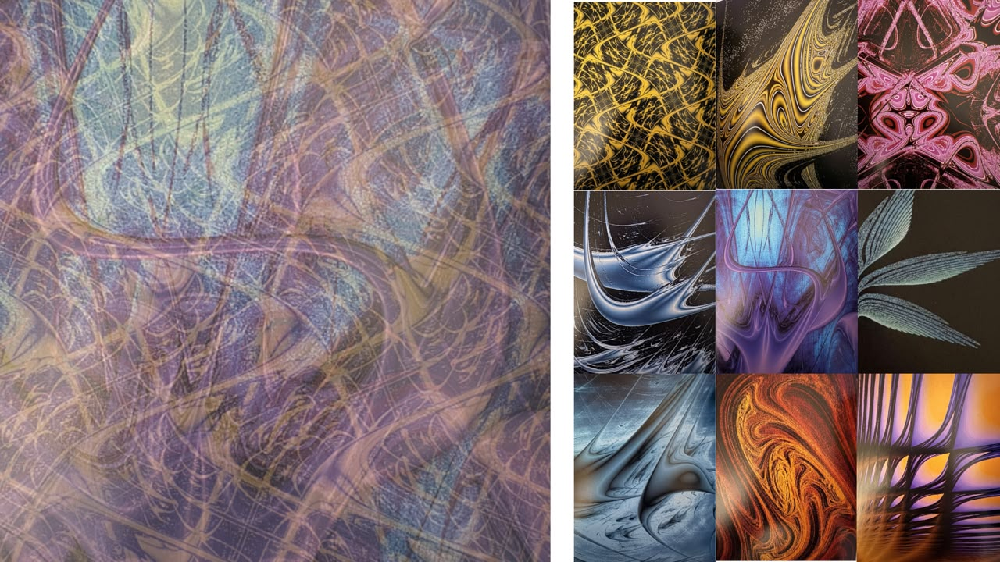

# sesion-10a

## apuntes sesión

clase online

presentamos dudas

Presentamos dudas:
- “Computador” es un término muy amplio.
- Idea inicial: utilizar una pantalla con opciones de menú controladas por botones y perillas.
- Idea de incorporar un botón de error.
- Primeros computadores utilizados para la música.
- El computador como objeto de uso particular.
- Trabajar con sonidos percusivos.
- Un computador es una máquina en la que se pueden programar cosas.
- Trabajar con la expresión mínima del sonido.

https://www.oficinadesonido.org/product/hanan-cumbia-tropical-drum-machine/

## encargos

IBM ThinkPad 701C Butterfly
Apple PowerBook 100 
Apple Macintosh Portable  

antes de definir el proyecto, me interesó este referente por la perilla incorporada en el computador, ya que forma parte de su estructura y funcionamiento, en lugar de ser un dispositivo externo e independiente, como un mouse.

https://www.youtube.com/watch?v=UtGKKUWXOaI

1. ¿Qué podemos observar?
- Sonido como respuesta de la máquina: al encender el computador, este emite un sonido que comunica que ha comenzado su funcionamiento.
- Evolución sonora: los sonidos cambian entre generaciones, desde tonos electrónicos simples hasta acordes más complejos.
- Identidad sonora: un sonido breve puede asociarse a una marca y convertirse en una característica reconocible del computador.

https://www.youtube.com/watch?v=w0xIUuH6Mck

análisis del referente: sonidos de Windows 95

El video recopila los sonidos del sistema operativo Windows 95, lanzado en 1995. Reúne distintos sonidos asociados a las acciones, notificaciones y estados del sistema, mostrando cómo el computador se comunica con el usuario a través del audio.

Características del sonido

- Sonidos funcionales: cada sonido cumple una función dentro de la interacción con el sistema operativo.
- Identidad sonora: los tonos y efectos permiten reconocer el sistema y asociarlo a una época.
- Sonidos electrónicos: utiliza tonos digitales, alertas y secuencias breves.

Seleccionar un computador personal creado entre 1980 y 2010 y desarrollar un tributo a partir de una de sus características más representativas.

"El proyecto consiste en rendir tributo a un computador personal mediante la exploración de sus características sonoras y funcionales. A través de una propuesta interactiva, se busca representar sus funciones y procesos mediante sonidos percusivos, utilizando ritmos, frecuencias y secuencias que permitan identificar sus distintos modos de funcionamiento.

El sonido de un computador está condicionado por la época en la que fue desarrollado, ya que responde a las posibilidades tecnológicas, las necesidades funcionales y el contexto cultural de su tiempo.

Por ejemplo, ¿suena igual un computador de los años 80 que uno de los años 2000? ¿Qué diferencias existen entre sus sonidos y qué nos dicen sobre la evolución de estas máquinas? Se plantea que los sonidos de un computador permiten reconocer aspectos de su época, desde sus limitaciones técnicas hasta las formas en que las personas se relacionaban con la tecnología.

Tecnológicos: las capacidades del hardware, los componentes electrónicos (ships) , los sistemas de audio y las limitaciones técnicas de cada época.
Funcionales: las acciones que realiza el computador, como iniciar el sistema, procesar información, ejecutar programas o comunicar errores.
Culturales: las expectativas y necesidades de las personas, así como la relación cotidiana con la tecnología durante cada período.
Estéticos: las decisiones de diseño que determinan cómo se manifiesta el funcionamiento de una máquina, tanto visual como sonoramente."

una idea de bajada conceptual. 

## lectura

### Capítulo 9 

El capítulo 9 nos muestra las primeras imágenes con color del libro, tal vez me hubiera gustado una exploración más de color.

### Capítulo 10 - Lyap.jar

1. Colores: El color es el valor de lambda. Puedes elegir 3 colores base (para lambda negativo, cero y positivo) y el programa interpola. El infinito lleva un color aparte. Tiene un modo "democrático" que auto-ajusta los colores según el histograma para que se vea mejor.

2. Zoom: No es con la rueda del mouse. Hay un rectángulo rojo en la imagen y lo manipulas con el botón derecho:Una esquina agranda/achica.Otra esquina mueve.Las otras dos rotan y deforman.

3. Archivos: Puedes guardar/cargar tus fórmulas y exportar la imagen a PNG.

4. Truco de velocidad: El programa es lento si escribes la fórmula a mano. Si la programas en Java en una librería propia (la BIB), va 5 veces más rápido. Era necesario para imágenes grandes.

5. Imágenes grandes:En 2003, con 64MB solo podías hacer imágenes de 800x800. Para llegar a 2000x2000 tenías que lanzar el programa pidiéndole más memoria al sistema o hacer la imagen por pedazos y unirla después en otro programa.

En resumen: pasar de espectador a creador, pero con las limitaciones de un PC de 2003 jaja. 

> "Abajo a la derecha en la ventana [de colores] ves el intervalo real calculado, ej: [-8.411, 1.293], que te ayuda a elegir los límites. [...] Tienes que definir aparte qué color usar cuando lambda tiende a +/- infinito, porque se va fuera de rango."

el color no es estético, es una decisión de visualización científica frente a valores que se escapan del rango.

> "Para volver a la imagen completa no hay 'deshacer zoom', tienes que anular todo cargando una figura estándar. La recomendación es ir en orden: primero achicar, luego trasladar, luego rotar/deformar."

 el programa no te da marcha atrás, te obliga a componer la exploración paso a paso, muy distinto a como exploramos hoy.
